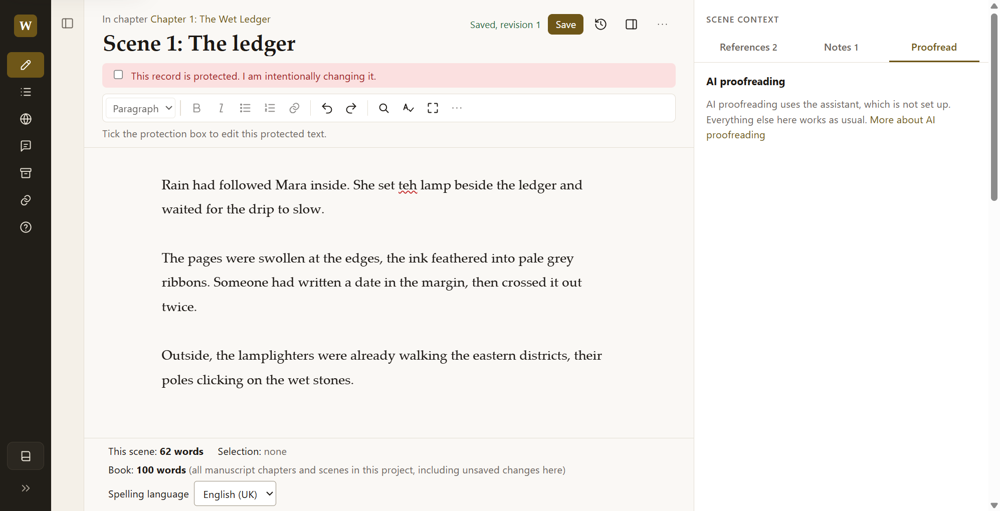
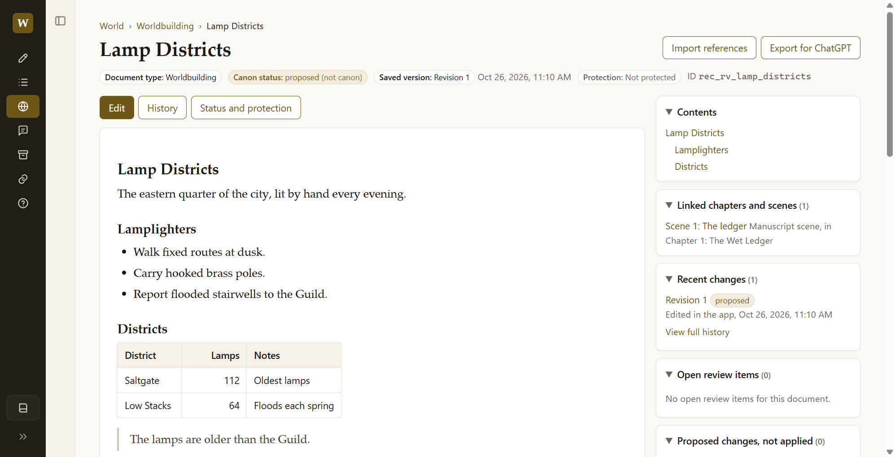
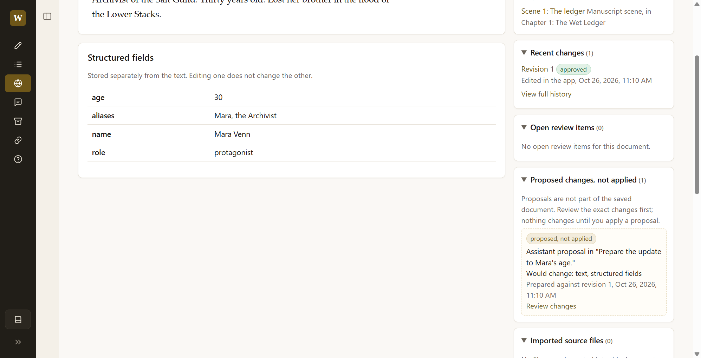
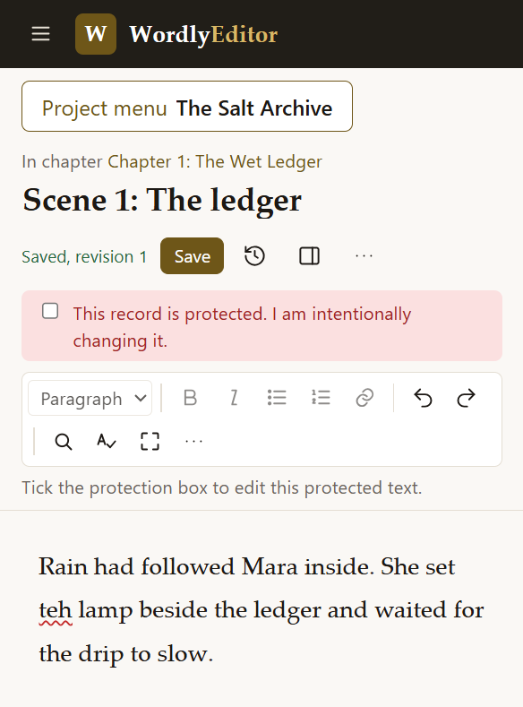
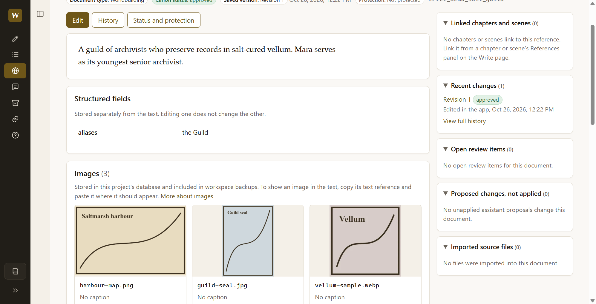
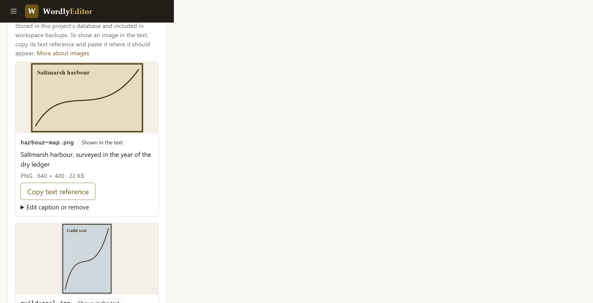
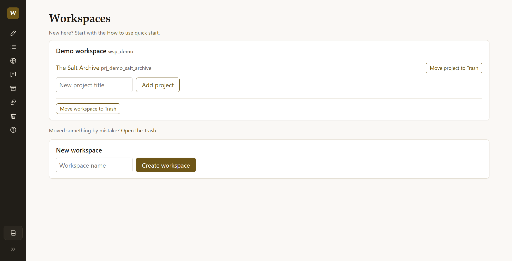
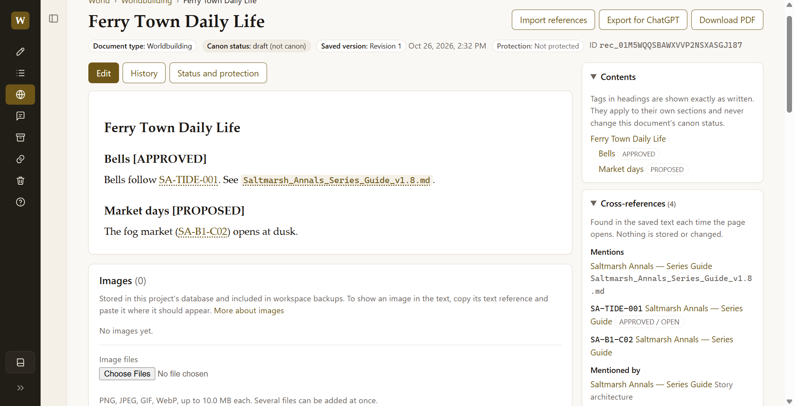
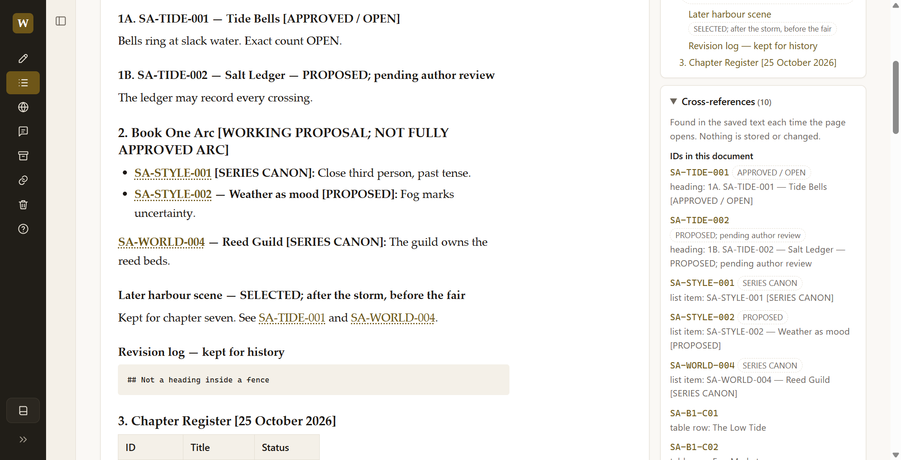

# Progress

## Milestone 1 (baseline commit `daea4e2`)

Revisioned record store, change-package importer (validate, preview, atomic
apply, idempotent, stale detection, protected manuscript), context export,
and the local UI.

## Milestone 2: ready for a controlled trial with copies of real references

### Implemented

- **Baseline preserved.** A local git repository holds the Milestone 1 commit.
  It has no remote. `.gitignore` excludes `.env*` (except `.env.example`),
  SQLite files and journal/WAL/SHM files, `backups/`, `exports/`, `imports/`,
  `uploads/`, `recovery/`, `manuscripts/`, `references/`, `private/`, context
  bundles, backup files, build output, and dependencies.
- **Database location and safe scripts.** One resolver
  (`src/server/dbLocation.ts`) is shared by the app, seed, and scripts. The
  Prisma CLI resolves the same file; this was verified with `migrate status`
  and `db:info`. New scripts: `db:info`, `db:backup`, `db:restore`. `db:deploy`,
  `db:setup`, and `db:migrate:dev` now back up first. `db:reset` refuses to run
  without `--confirm-delete-all-data` and backs up before deleting.
  Previously there was no reset script, but `db:migrate` (`prisma migrate dev`)
  could offer to reset on schema drift with no backup. It is now
  `db:migrate:dev`, which backs up and prints a warning first.
- **Agent rules.** `AGENTS.md` keeps the block that `next dev` manages
  (verified in `generate-agent-files.js`: only the text between the markers is
  replaced). Persistent rules live in `PROJECT_RULES.md`, which `AGENTS.md`
  links to from below the managed block.
- **Schema migration** `20261025152500_package_scope_and_file_imports`:
  change-package idempotency is now keyed by (`projectId`, `packageId`);
  `Source.originalFilename` and the `ImportedFile` table were added. Your
  existing `prisma/dev.db` was backed up to `backups/pre-migration-*/` before
  the migration. It was migrated in place with its data preserved (1 workspace,
  6 records, 8 revisions, 1 package, 4 review items, both before and after).
- **Full backup/restore** (`wordly.workspace-backup` v1, see
  [docs/backup-format.md](docs/backup-format.md)). It covers records,
  revisions, provenance, protection, canon status, links, aliases and fields,
  applied packages with their raw JSON and hashes, audit entries, review items,
  and imported files. The whole file is validated before any write: checksum,
  counts, referential integrity, revision continuity and hashes, package
  hashes, schema version, and ID collisions. Restore is a single transaction,
  either into a separate database with the original IDs or into the current
  database as an isolated new workspace with new IDs. Available as app UI,
  download route, and CLI.
- **Markdown reference import** (app: *Import Markdown references*):
  - Batch preview that writes nothing.
  - Explicit per-file document type (reference types only), canon status, and
    protection, with no defaults and nothing inferred from filenames.
  - Duplicate detection against existing records (same content, same title,
    or previously imported filename) and within the batch. Each duplicate
    needs an explicit create, replace (new revision, stale-checked), or skip.
  - Protected replacements need confirmation, and protection can only be
    raised.
  - One transaction per batch.
  - Original filename and exact content are kept in `ImportedFile`, linked to
    a `markdown_import` provenance source and the revision it produced.
- **ChatGPT round trip** verified end-to-end with invented content
  (`tests/acceptance/chatgpt-roundtrip.test.ts`): import references, export
  context, build a package only from the export, preview, apply, check
  revisions and provenance, reapply with no writes, reject a stale update,
  confirm protected prose is unchanged and flagged for review, then back up
  and restore and reapply as `already_applied` in the restored database.

### Check results (Oct 25, 2026)

| Check | Result |
| --- | --- |
| `pnpm typecheck` | pass (exit 0) |
| `pnpm test` | 11 files, 53 tests passed. 41 were from Milestone 1; 12 are new: 4 backup/restore, 7 Markdown import, 1 ChatGPT round trip |
| `pnpm build` | pass, 0 warnings. Routes include `/backup`, `/backup/[workspaceId]`, `/projects/[projectId]/import-markdown` |
| CLI on your database | `db:info`, `db:backup`, `db:restore --dry-run`, and `db:restore --new-database` (temp file, then deleted) all succeeded; restored counts matched. `db:reset` without the flag refused and changed nothing |
| Browser smoke test | Production build against a scratch database (deleted afterwards). Markdown import preview, duplicate replace, and provenance display worked; backup download, restore as a new workspace, and rejection of a tampered backup worked |

Your `prisma/dev.db` was only read and backed up during this work. Backups
were created in `backups/pre-migration-*` and `backups/*-verify`.

### First trial with copies of real references

1. `pnpm db:backup --label before-first-import`. Copy that folder outside the repository.
2. Copy a few reference files (not the originals, and not manuscript chapters)
   into a folder outside this repository.
3. `pnpm dev`, open your project (or create a new one), and choose
   **Import Markdown references**. Select the copies.
4. In the preview, choose each file's type, canon status, and protection.
   Mark something `approved` only if it really is approved canon. For flagged
   duplicates, choose create, replace, or skip.
5. Import, then open a few records and check the body text and the revision
   provenance ("Markdown import of <filename>").
6. Use **Export context** for the records you want to discuss. Take the bundle
   to ChatGPT, bring back a change package, and preview it on **Import change package**.
7. Afterwards, `pnpm db:backup --label after-first-import`. To undo
   everything, follow "Backup and restore, safely" in the README.

### Remaining manuscript-workflow gaps

- No manuscript chapter import. Chapters are created and edited one at a time
  in the editor, and Markdown import refuses manuscript types by design.
- Replacing a record from Markdown changes its title, body, and status but
  leaves structured fields (for example `age`, `aliases`) untouched. Review
  them after a replace.
- Only a level-1 heading or the filename is used as the suggested title. No
  front-matter parsing, no splitting one file into several records, and no
  folder or tag structure.
- Links between records are only `supersededByRecordId` and free-form fields.
  There is no first-class link or relationship model, and no alias index
  beyond mention detection.
- Mention detection matches exact titles, names, and aliases only; it does not
  catch partial names (for example "Ines" for "Ines Corrow").
- No chapter ordering, or manuscript assembly and export. (Word counts were
  added later; see "Writing tools" below.)
- The editor is a plain textarea: no rich Markdown preview, no search across
  records, and no bulk status changes.

## In-app help ("How to use")

### Implemented

- `/help` page linked from the top bar, with a contents list, quick start,
  task guides, troubleshooting, and limitations. Text lives in `src/help/`
  and describes implemented behavior only. Destructive database commands are
  kept out of the quick start, and deleting the database is never suggested as
  a routine fix.
- Context hints (`HelpHint`) on the pages that link to the matching help
  section. Shared UI labels live in `src/ui/labels.ts`, so the help quotes
  the exact button and field names.
- Copy buttons for commands and instructions. If the browser refuses the
  clipboard, they say so and ask you to copy by hand.
- Forms no longer clear what you typed after a refused submit
  (`submitWithoutReset`; React 19 resets uncontrolled forms after an action).
- `PROJECT_RULES.md` has an "In-app help" section: update the help when
  behavior changes.
- `tests/unit/help.test.ts` checks that anchors are unique, that the scripts
  and routes the help names exist, and that the help never mentions
  `db:reset` or `migrate reset`.

## Writing tools

### Scope adjustment

There is no rich-text manuscript editor and no scene model. The record body is
a plain Markdown `<textarea>`. The tools were built on that existing editor
rather than adding an editor dependency. "Rich-text formatting" here means
Markdown symbols (`**bold**`, `*italic*`, blank-line paragraphs, `***` scene
breaks), which the tools keep intact. Formatting is not rendered, and no
formatting buttons were added. No schema change or migration was needed, so no
backup was taken.

### Implemented

- **Spelling.** Record title and body (record page and New record) have
  `spellcheck` and `lang`. A **Spelling language** select (English US / UK) is
  saved per browser in the `wordly-spelling` cookie and rendered server-side,
  so it holds across pages and reloads. Structured fields, package boxes,
  record IDs, and the Find box have spellcheck off. The browser's context menu
  is untouched. The help says the browser, not the app, controls the
  dictionary.
- **Word counts** (`src/writing/wordCount.ts`, the one counter used
  everywhere). Live document and selection counts appear under the body. For
  manuscript chapters, a book count (the other chapters' saved text plus this
  chapter's live text) is also shown. The project page shows each chapter's
  count and a book total. Markdown and HTML markup, link targets, URLs, list
  numbers, and symbol-only lines such as scene breaks are not counted.
  Hyphenated words (`well-known`) and apostrophes (`Mara's`, straight or
  curly) count as one word. Em/en dashes and spaced hyphens separate words.
  Numbers with separators (`3.14`, `10,000`) are one word.
- **Find and replace** (`src/writing/findReplace.ts`, `FindReplace.tsx`).
  Works on the current record body only. Literal text with Match case,
  Next/Previous (wrapping; Enter / Shift+Enter in Find), "k of N" count,
  Replace (then selects the next match), and Replace all (a single edit).
  Replacements go through the browser's undo history (`execCommand
  insertText`), so Ctrl+Z undoes them and Replace all undoes in one step. If a
  browser refuses that command, an **Undo last replacement** button appears
  instead. On protected records, Replace and Replace all stay disabled until
  the unlock box is ticked, and the server still refuses an unticked save.
  Nothing is saved until **Save as revision N**.
- **Editor fixes found during verification.** The editor and status form were
  remounted on every new revision, which hid the "Saved as revision N"
  message and wiped undo history at once. They are now keyed by record. The
  protection tick box still clears after each new revision.

### Check results (Oct 25, 2026)

| Check | Result |
| --- | --- |
| `pnpm typecheck` | pass |
| `pnpm test` | 15 files, 79 tests passed. New: word counting, find/replace logic, help consistency, and a writing-tools acceptance test (formatting survives replacement and save/reload, protected save refused, undo by inverse edit restores text, chapter and book counts after edits) |
| `pnpm build` | pass; `/help` is static, record and project pages are dynamic |
| Lint | No lint script or ESLint config exists in this project. Editor diagnostics (ReadLints) report no problems in the changed files |
| Browser (production build, scratch database, invented text; deleted afterwards) | Counts correct while typing and for a selection. Replace all of 5 matches kept `**`, `*`, paragraphs, and `***`; one browser undo restored all, and redo re-applied. Match case narrowed matches. Replace selected the next match. Save then reload kept the formatting. "Saved as revision N" now shows, and undo still works after saving. On a protected chapter, Replace was disabled until the tick, and an unticked save was refused with `PROTECTED_RECORD`. UK spelling persisted to the record page and New record form. Help anchors all resolve |
| Native spellcheck | Attributes verified (`spellcheck=true`, `lang=en-US`/`en-GB` on prose; off on fields). Cursor's embedded browser showed no underlines, which is expected because it has no spelling dictionary. Underlines and right-click suggestions still need a quick check in your normal browser |

Your `prisma/dev.db` was not touched by this work.

### Editor limitations

- Plain Markdown textarea: no formatted preview and no bold/italic buttons.
- Undo history belongs to the browser and is lost when you leave or reload
  the page. Use saved revisions after that.
- Find and replace covers one record's body only: not titles, fields, or other
  records. Literal text only (no regular expressions or whole-word option).
- Spelling depends entirely on the browser's spellchecker and installed
  dictionaries. The language choice is per browser.
- No scenes: a scene break is just a `***` line inside a chapter.
- Counts cover the body only. Chapter and book counts exist only for
  manuscript chapters, and the book is every manuscript chapter in the
  project, in no particular order.
- Backups are manual (no schedule). Restoring a single record from an old
  backup is not supported. Restore a whole workspace as a copy and compare.
- No ChatGPT connection. The workflow remains export and paste. See
  [docs/future-chatgpt-connection.md](docs/future-chatgpt-connection.md).

## Assistant (optional)

Details, request settings, retention and the manual connection test are in
[docs/assistant.md](docs/assistant.md).

### Implemented

- **Assistant page** per project (`/projects/[projectId]/assistant`, nav link
  **Assistant**). Off unless `OPENAI_API_KEY` and `OPENAI_MODEL` are set; the
  page then lists what is missing and the rest of the app is unchanged.
- **Integration.** Official `openai` SDK (^7.43.0, newly added), Responses API
  with streaming, behind an `AssistantProvider` interface. Model from
  `OPENAI_MODEL` only. Settings: `store: false`, `truncation: "disabled"`, no
  `previous_response_id`, `max_output_tokens` from config, SDK `maxRetries: 0`
  and `logLevel: "off"`, per-request timeout and cancel signal.
- **Context selection.** Tick reference records (type, canon status, revision
  and size shown), choose a chapter whole or a selected passage, tick earlier
  messages. A "Will be sent" list shows every item. Only those are sent.
- **Size limits.** Nothing is truncated. Over-limit requests are refused before
  anything is sent, with each item's size and how much to cut.
- **Revisions.** Each answer stores the record ID, revision, kind, passage
  offsets, length and SHA-256 of every source, plus the earlier messages
  included. A selection whose record changed is refused (`STALE_SELECTION`).
  Answers whose sources have newer revisions are labelled **Based on an older
  version**. Retry resends the exact stored revisions.
- **Streaming, cancel, retry, errors.** Answers stream to the page. Cancel
  keeps the partial text. Failed and cancelled answers show the reason and a
  Retry button. Provider errors map to the app's own messages (no raw 401
  text; 400/422 text redacted). Interrupted answers are marked failed.
- **Prompt safety.** Sources are wrapped in random-boundary markers with canon
  status; instructions say source text is material, not instructions; ideas go
  under "Proposals (not canon)"; no access to ChatGPT account, memory,
  conversations or Projects is claimed.
- **Usage and limits.** Reported token usage per answer; estimates (chars / 4)
  marked as estimates for cancelled or partial answers. App-wide hourly request
  limit and monthly token cap (UTC month), both configurable. No cost shown.
  The page and help say the cap is not a hard spending cap and that OpenAI
  budget alerts are not hard caps.
- **Security.** Key read only in `server-only` modules; refuses to run if a
  `NEXT_PUBLIC_` OpenAI key variable exists; API routes refuse cross-site
  requests and non-JSON bodies; logs contain IDs and error codes only.
- **Storage.** Migration `20261025170000_assistant_conversations` adds
  `AssistantConversation`, `AssistantMessage`, `AssistantContextItem`
  (additive). Conversations are scoped by workspace and project, and deletion
  needs a confirmation tick.
- **Docs.** Help sections "Assistant (optional)" with setup, choosing what to
  send, reading answers, privacy/usage/limits, troubleshooting entries and
  limitations. `.env.example` placeholders, README, PROJECT_RULES (scope
  exception and secret rules), `docs/assistant.md`.

### Check results (Oct 25, 2026)

| Check | Result |
| --- | --- |
| `pnpm typecheck` | pass |
| `pnpm test` | 19 files, 109 tests passed. New: config and cross-site guard, prompt framing and size checks, OpenAI adapter with a fake client (params, stream mapping, usage, incomplete, failures, HTTP errors without key echo, cancellation), and a service acceptance test with a scripted provider (missing configuration, context selection, records unchanged, workspace isolation, stale selection, older-version flag, cancel then retry, failures before and during streaming, incomplete, one answer at a time, interrupted answers, oversize refusal, hourly limit, monthly cap) |
| `pnpm build` | pass; assistant page and both API routes are dynamic |
| Bundle check | `.next/static` contains no `OPENAI_API_KEY` and no key-like strings; the OpenAI SDK appears only in server chunks |
| Lint | No lint script exists. Editor diagnostics report no problems in the new files |
| Database | `pnpm db:deploy` backed up to `backups/2026-10-25T16-53-12-181Z-pre-migrate`, then applied the migration. Record, revision and package counts unchanged |
| Browser (production build, scratch database, local mock of the Responses stream via `OPENAI_BASE_URL`; no OpenAI requests; deleted afterwards) | Not-configured page lists the missing settings; API refused cross-site (403), non-JSON (415) and unconfigured (503) requests. With the mock: passage selection, streaming, "Used" line, reported tokens, usage counters; the mock saw `store=false`, `truncation=disabled`, `max_output_tokens=2000` and exactly the ticked earlier messages. Cancel kept the partial text with estimated tokens and Retry. A 429 showed the app's message and the key-like text in the provider error never reached the page or log. Editing a record in another tab caused a stale-selection refusal, then older-version labels with "(now rev 2)". Delete removed the conversation and left records untouched. A badge style that struck through "Based on an older version" was fixed |
| Live OpenAI request | Not made (not requested). See the manual test in `docs/assistant.md` |

### Assistant limitations

- Discussion never changes records. Changes go only through a prepared change
  proposal that the author applies (see "Assistant change proposals" below).
- One running answer per conversation. Usage cap and hourly limit are counted
  by this app only.
- Character limits, not exact token counts, decide request size before sending;
  token figures before sending are estimates.
- Conversations are not included in workspace backups and cannot be exported.
- Plain-text answers (Markdown is not rendered).

## Assistant change proposals

Details are in the "Change proposals" section of
[docs/assistant.md](docs/assistant.md).

### Implemented

- **Workflow.** Discussing never changes records. **Prepare change proposal**
  sends the selected records and the request. The server builds a change
  package and shows it with the same diff preview as manual import.
  **Apply this proposal** applies that package, and the result shows changed
  records, revisions and review items. A "yes" typed in the chat is only a
  message. It approves nothing.
- **Structured output.** Responses API strict `json_schema`
  (`wordly_change_proposal`). The model returns a narrow draft (summary,
  operations, related records, field/text disagreements). The schema was
  adapted for strict mode: fields are `{ key, valueJson }` pairs, unchanged
  values are `null`, and unsupported keywords are not used. The full v1 package
  is then validated with `parseChangePackage`.
- **Trusted values.** The server assigns the package ID, workspace and project,
  `scope: "reference"`, empty protected overrides, approval `proposed`, new
  record IDs, the provenance label, and each `expectedRevision` (taken from the
  revision actually sent). The model cannot set any of these. Unknown keys such
  as an invented `approval` make the output malformed.
- **Applying.** A server action takes the proposal ID and its content hash and
  sets the approval statement. Applying goes through `applyChangePackage`, which
  re-checks revisions, scope, protection and idempotency and writes provenance,
  audit and review items. The proposal is marked applied in the same
  transaction. A second Apply returns "already applied". Changes that create,
  promote or alter canon need the canon tick. Otherwise new facts stay
  proposed.
- **Review, not rewrite.** Related records are never changed; they become
  review items. Field/text disagreements (found by the app or reported by the
  model) become review notes.
- **Failures.** Refusals, incomplete responses, malformed or invalid output
  and provider errors are stored as failed or incomplete answers with Retry.
  No proposal is stored for them.
- **Storage.** Migration `20261025200000_assistant_proposals` adds
  `AssistantMessage.mode` and `AssistantProposal` (additive).
- **Manual packages.** The proposal JSON (marked proposed) can be copied.
  Manual import and export are unchanged.
- **Docs.** The "Change proposals" help section, a troubleshooting entry,
  limitations, `docs/assistant.md`, README and PROJECT_RULES.

### Check results (Oct 25, 2026)

| Check | Result |
| --- | --- |
| `pnpm typecheck` | pass |
| `pnpm test` | 21 files, 138 tests passed. New: strict-schema rules, draft conversion and canon rules (unit); structured requests, refusal, incomplete, failures and cancel in the OpenAI adapter (fake client); 15 acceptance tests with mocked model responses covering conversational "yes" changes nothing, prepare and apply, hash mismatch, canon tick, model cannot set approval/overrides/revisions/scope, malformed output and retry, refusal, incomplete, provider error, cancel, no changes, stale revisions at prepare and at apply, duplicate apply, workspace isolation, protected record, manuscript scope, rollback, field/text review notes, exported proposal not importable until approved |
| `pnpm build` | pass |
| Bundle check | `.next/static` contains no `OPENAI_API_KEY`, key-like strings, `api.openai.com` or the proposal schema |
| Database | `pnpm db:deploy` backed up to `backups/2026-10-25T17-24-53-592Z-pre-migrate`, then applied the migration. Record, revision, package, audit and review counts unchanged |
| Browser (production build, scratch database, local mock of the Responses API; no OpenAI requests; deleted afterwards) | The mock saw `stream=false`, strict `json_schema`, `store=false` and only the selected records. The preview showed the field diff, the created record (proposed), review notes including an app-found age/text disagreement, detected mentions and the canon list. Apply stayed disabled until the canon tick. One Apply showed revisions 1 → 2 and new → 1 plus review items. History listed the package. The stored package had the server's approval statement, `reference` scope, no overrides and the proposal provenance label. After a reload the proposal showed as applied with no Apply button |
| Live OpenAI request | Not made (not requested) |

### Change proposal limitations

- Reference records only. Manuscript chapters cannot be changed by a proposal.
- The model can change only records sent with the request, up to 100
  operations per proposal.
- A proposal is applied whole or not at all. A proposal that cannot be applied
  (for example stale revisions) cannot be edited; prepare a new one.
- Field/text checks cover simple values (numbers and short strings) only.

## AI proofreading

Details are in the "Proofreading" section of
[docs/assistant.md](docs/assistant.md). Help: "Writing tools → AI proofreading
(optional)".

### Implemented

- **Modes.** Only **Proofread** (spelling, grammar, punctuation) exists. Style
  and continuity review are not shown anywhere in the app. The API accepts
  only `mode: "proofread"`.
- **Scope.** The selection or the whole saved body of the record being edited.
  Both buttons are disabled while there are unsaved changes, so suggestions
  always refer to a saved revision. Offsets are counted in the Markdown source
  as the text box sees it (line endings normalised to `\n`), never in rendered
  text.
- **Request.** Responses API with strict `json_schema` (`wordly_proofread`),
  `store: false`, no streaming, `truncation: "disabled"`. The instructions ask
  the model to keep voice, meaning, dialogue, dialect and invented terms, to
  change the smallest span, and to treat the text as material rather than
  instructions. The model returns category, original, replacement, short
  explanation and a few characters of context on each side. It never returns
  positions, IDs or revisions.
- **Anchoring (server).** Each suggestion is placed where `before + original +
  after` occurs exactly once in the text that was sent. If the context does not
  match, `original` alone is used, but only if it occurs once. Anything else is
  left out with a reason: ambiguous, not found, unchanged, longer than 200
  characters, adds or removes a line break, changes formatting characters,
  touches code, links, URLs or HTML, splits an emoji or accented letter,
  duplicate. The result carries the run ID, record ID and source revision.
  Overlapping suggestions are flagged.
- **Applying (browser).** A character diff from the proofread text to the
  current text box locates each suggestion. A suggestion is usable only while
  its characters and their immediate neighbours are unchanged. Otherwise it is
  stale and Accept is disabled. Accept replaces exactly the original
  characters through `execCommand("insertText")`, so Ctrl+Z works. Undo puts
  the original back. Dismiss, Previous/Next suggestion and Show in text are
  available. Nothing is applied automatically, and the record is only changed
  when the author saves.
- **Protection.** Proofreading a protected record is allowed (it reads only).
  Accept and Undo stay disabled until the unlock box is ticked, and saving
  goes through the normal save with its revision and protection checks.
- **Limits and privacy.** The same size limit, hourly request limit, monthly
  token cap, cancellation and usage display as the assistant. Proofreading runs
  count toward the assistant's usage. A `ProofreadRun` row stores counts,
  tokens, status and a SHA-256 of the sent text. No text and no suggestions
  are stored. Without an API key the box shows a short "not set up" note.
- **Storage.** Migration `20261025220000_proofread_runs` adds `ProofreadRun`
  (additive).

### Check results (Oct 25, 2026)

| Check | Result |
| --- | --- |
| `pnpm typecheck` | pass |
| `pnpm test` | 23 files, 181 tests passed. New: 26 unit tests (strict schema, malformed output, repeated phrases, ambiguous anchors, fallback, emoji, accents, decomposed letters, lone surrogates, Markdown and protected spans, overlaps, CRLF, accept after length changes, stale after edits, adjacent edits, formatted text, undo by button and by Ctrl+Z including redo after Undo, protected, tampered suggestions, large rewrites, navigation) and 17 acceptance tests with mocked responses (only the chosen text is sent, records unchanged by proofreading, run rows and usage, accept and save on a protected record with and without unlock, earlier revision preserved, selection offsets, left-out reasons, malformed output, refusal, incomplete, provider error, cancel, stale revision, workspace isolation, invalid ranges, not configured, too large, busy, rate limit, monthly cap) |
| `pnpm build` | pass |
| Bundle check | `.next/static` contains no `OPENAI_API_KEY`, `api.openai.com` or the proofreading schema |
| Database | `pnpm db:deploy` backed up to `backups/2026-10-25T17-46-48-900Z-pre-migrate`, then applied the migration. Record (6), revision (8), package, review and imported-file counts unchanged |
| Browser (production build, scratch database, local mock of the Responses API; no OpenAI requests; deleted afterwards) | On the protected demo chapter with invented text: buttons disabled until saved; six suggestions, including two separate ones for a repeated phrase; Accept disabled until unlock was ticked; accepting the second repeated phrase changed only that one; accepting inside `*…*` kept the marks; Dismiss, Undo and Ctrl+Z; editing the suggested word made it stale with Accept disabled; Previous/Next wrapped; selection mode sent only the selection; Cancel stopped the run with estimated usage. The mock saw `stream=false`, strict `json_schema`, `store=false`, `truncation=disabled`. The browser check found that Ctrl+Z after Undo showed the suggestion as stale; fixed and re-checked |
| Live OpenAI request | Not made (not requested) |

### Proofreading limitations

- Proofread only. Style and continuity review are not implemented.
- One record at a time, saved text only, up to the assistant's size limit.
  Large documents are not split into several requests.
- Suggestions are kept in the page only. Reloading or leaving the page loses
  them; a new run is needed.
- A suggestion whose surroundings were edited becomes stale even if the
  word itself is still wrong. Run proofreading again after larger edits.
- Suggestions that need a line break, a formatting change or a change longer
  than 200 characters are left out rather than offered.

## Project dictionary

Design, data format and licences are in [docs/spelling.md](docs/spelling.md).
Help: "Writing tools → Spelling" and "Writing tools → Project dictionary".

### Implemented

- **Checker.** The record text box is checked in the browser by typo-js 1.4
  with the Hunspell en-US / en-GB word lists from `dictionary-en` and
  `dictionary-en-gb`, in a web worker, debounced 300 ms after typing stops.
  Underlines are drawn by a transparent overlay; the textarea's own
  `spellcheck` is turned off while the Wordly checker is active, so there is
  only one set of underlines. A **Spell checker** setting (per browser) can
  switch back to the browser's checker, and the editor falls back to it if
  the Wordly checker fails to start. No AI request is made while typing.
- **In the editor.** Clicking an underlined word, or Previous/Next word,
  shows it in the Spelling panel with suggestions (computed in a second
  worker), **Ignore once** (this occurrence, this page only), **Add to
  project dictionary** and **Add to workspace dictionary**, with an explicit
  Match case box. A word close to a dictionary entry stays flagged and the
  panel names the near match.
- **Scopes.** Project entries apply to one book; workspace entries apply to
  every project in the workspace (the series). No other project or workspace
  sees them.
- **Dictionary page** (`/projects/[projectId]/dictionary`): add, edit (word,
  match case, note, scope) and remove (two steps) entries; each entry shows
  where it came from and any similar entries.
- **Import and export.** Export per scope as a `wordly.dictionary` JSON file.
  Import that format or a plain word list; every word is classified as new,
  duplicate or invalid and nothing is selected until the author ticks words.
- **Reference names.** "Find names" lists unknown words from reference record
  titles and `name` / `aliases` fields, unticked, for optional inclusion.
- **Backup and restore.** Full workspace backups include dictionary entries.
  Older backups restore with an empty dictionary.
- **AI proofreading.** Accepted words that occur in the proofread text are sent
  as accepted spellings, and suggestions that would change them are left out.
- **Storage.** Migration `20261025230000_dictionary_entries` adds
  `DictionaryEntry` (additive).

### Check results (Oct 25, 2026)

| Check | Result |
| --- | --- |
| `pnpm typecheck` | pass |
| `pnpm test` | 25 files, 215 tests passed. New: 24 unit tests (words and skipped Markdown spans, en-US and en-GB lists, matcher and case rules, possessives, near-match detection, validation, duplicates, import parsing and export, moving flags through edits, proofreading terms, checker setting, performance on a 33,000-word chapter and per keystroke) and acceptance tests (persistence, edit, remove and audit; isolation from a sibling project and another workspace; duplicates and case; bulk import skips; reference names; backup round trip, ID remapping, old backups, invalid entries, backing up before the table exists; proofreading terms and the `dictionary_word` rejection) |
| `pnpm build` | pass |
| Bundle check | `.next/static` contains no `OPENAI_API_KEY`, `api.openai.com`, `better-sqlite3` or `DATABASE_URL`; the typo-js chunk is present |
| Database | The first `pnpm db:deploy` stopped during its pre-migration backup because the backup read the not-yet-created dictionary table; nothing was migrated. Fixed (the backup treats a missing table as empty, with a test) and re-run: backed up to `backups/2026-10-25T18-29-56-504Z-pre-migrate`, then applied the migration. Record, revision, package, review and imported-file counts unchanged. The incomplete folder from the first attempt, `backups/2026-10-25T18-23-11-449Z-pre-migrate`, was left in place |
| Browser (production build, scratch database with invented text; deleted afterwards) | Single set of underlines (`spellcheck="false"`); adding a name cleared it and its possessive; a near-miss name stayed flagged with the "close to" note; suggestions disabled while the record was protected and applied after unlocking; Ignore once; differently-capitalised words still flagged under Match case. Dictionary page: add with note, export download, two-step remove. Typing in the middle of a ~30,000-word text (3,000 flags) first showed tasks of 52 and 157 ms; after memoising the overlay and fixing its keys there were no tasks over 50 ms. A zoomed check showed the underlines sat partly on the next line; the underline offset was reduced and re-checked |

### Dictionary limitations

- Only the record text box uses the Wordly checker. Titles, structured fields
  and other inputs use the browser's checker.
- English (US) and English (UK) only. The bundled word lists have accents
  stripped, so an accented word is checked by its unaccented form.
- Ignore once lasts until the page is reloaded.
- On very long records (tens of thousands of words) the overlay adds about
  10–15 ms of browser layout per keystroke.

## ChatGPT connection (MCP): assessment only

Assessed on Oct 26, 2026. Nothing is implemented and no connection exists. The
findings, proposed tools, options for keeping the app local, costs and open
decisions are in
[docs/future-chatgpt-connection.md](docs/future-chatgpt-connection.md). No
tunnel, endpoint, deployment or account change was made, and the author's
ChatGPT plan has not been checked.

## Application shell

Shared layout modelled on the WordlyEditor mockup (Oct 26, 2026). Existing
pages were kept; no mockup placeholder text, facts or mockup-only features were
added.

### Implemented

- **Design tokens.** Semantic colour, font, radius, shadow and width tokens in
  `src/app/globals.css` (warm ivory workspace, charcoal navigation, antique-gold
  accent; serif for headings and record text, sans-serif for labels). Older
  variable names remain as aliases. Text and control colours were checked
  against WCAG AA (contrast notes at the top of the file).
- **Global navigation** (`src/components/shell/`): Write, Plan, World,
  Assistant, Backups, Help, plus a project selector at the bottom showing real
  project names with chapter, word and record counts. Write, Plan, World and
  Assistant need a project; without one they are shown as unavailable, not as
  links. The active item is marked with `aria-current`.
- **Routes.** `/projects/[id]/write` (manuscript chapters), `/plan` (chapter
  outlines and story architecture) and `/world` (dossiers, worldbuilding, canon
  decisions, continuity and reference notes) are filtered views of the existing
  record list, each with the matching default type for new records.
  `/projects/[id]` remains as All records. Record pages highlight the group of
  their type.
- **Project column.** All records, the current group's records by type, and the
  project tools (import change package, import Markdown references, export
  context, history & review with the open-item count, dictionary).
- **Context panel.** The record page's details column is a labelled `aside`
  that sits beside the editor when there is room and below it otherwise.
- **Behaviour.** Collapsible navigation (automatic below 1180 px unless the
  author chooses), tooltips on the collapsed icons, a skip link, visible focus,
  one `main` and one `h1` per page. Below 760 px the navigation and project
  column open as modal drawers that return focus when closed. Panels respond
  to the width of the workspace (container queries), so nothing scrolls
  sideways.
- **Preferences.** Two cookies store the navigation width choice and the last
  opened project ID, so the first render matches; no record text is stored.
- **Help.** New "Finding your way around" section; references to the top bar
  updated.

### Check results (Oct 26, 2026)

| Check | Result |
| --- | --- |
| `pnpm typecheck` | pass |
| `pnpm test` | 27 files, 222 tests passed. New: record-group and active-route mapping (unit); project summary counts, navigation record fields, open review count, and no writes (acceptance); help route check includes route groups |
| `pnpm build` | pass |
| Browser (production build, scratch database with invented text; deleted afterwards) | 16 routes at 1440, 1024 and 390 px: no horizontal overflow, one `main` and one `h1` each, correct active item. 1440: navigation 216 px, project column 240 px, record editor and context panel side by side. 1024: navigation collapses to icons with tooltips; expanding persists across reload. 390: menu and project drawers open as modal dialogs, close on link or close button and return focus; record tables stack. Creating a record updated the selector and project counts |

### Shell limitations

- Plan has no dedicated planning tools; it lists the existing outline and
  story-architecture records.
- The mockup's tabs, badges row and character-facts panel were not built; the
  record page keeps its existing panels.
- Escape closes the drawers through the browser's built-in dialog behaviour.

## Write layout ("01 WRITE")

The mockup's three-column writing screen inside the shared shell (Oct 26, 2026).
The existing editor was kept: the same uncontrolled text box keyed by record
ID, the same save action with revision checks and the protection unlock, the
same writing tools (find and replace, spelling, word counts, proofreading).
Only the layout and the new controls around it are new.

### Schema change

Chapter and scene navigation, scene notes and reference links needed data the
model did not have. Migration `20261026090000_scenes_and_links` is additive
only:

- `Record.parentRecordId` (nullable, indexed): a `manuscript_scene` belongs to
  a `manuscript_chapter`; a `scene_note` belongs to a chapter or scene. Set at
  creation, same project, not revisioned. Both new types reuse `Record`, so
  scenes get revisions, provenance, audit and protection with no new code
  path; scenes are manuscript content and protected by default, scene notes
  are reference content.
- `RecordLink` (`fromRecordId` chapter or scene, `toRecordId` standalone
  reference record, unique pair): reference links. Written only by
  `linkService`; every add or remove writes an audit entry; no revisions.

Applied to the working database with `pnpm db:deploy`, which first wrote
`backups/2026-10-26T13-12-46-809Z-pre-migrate/` (SQLite snapshot plus a
workspace backup). Record, revision, package, review-item and file counts were
the same before and after. Nothing was reset.

Backups (`records[].parentRecordId`, `recordLinks`, both optional so older
backups restore unchanged) and context exports (`parentRecordId`,
`linkedRecordIds`) carry the new data; restore validates parents and links.
Imports, change packages and assistant proposals cannot create scenes or scene
notes (`INVALID_PARENT`). See `docs/backup-format.md`,
`docs/context-bundle-format.md` and `docs/change-package-format.md`.

### Implemented

- **Manuscript column** (`ManuscriptTree`, `src/ui/manuscriptTree.ts`): on Write
  and on any chapter, scene or scene note. Chapters with expandable scene
  lists (disclosure buttons with `aria-expanded`), scene counts, the open item
  marked with `aria-current`, long titles truncated with the full title in a
  tooltip and the accessible name, a title filter with a match count, and New
  chapter / New scene forms (scene form preselects the current chapter).
  Listed in creation order with a note saying so; no reordering controls exist.
- **Writing page** (`WriteEditor`) for chapters and scenes: chapter link for a
  scene, editable title as the page `h1`, save status from the server's answer
  (`Saving...`, `Saved, revision N`, `Unsaved changes`, `Not saved` with the
  refused reason), Save (Ctrl+S), Version history, context-panel toggle, and a
  More actions menu for status, protection, history, compare and structured
  fields. Text column about 70 characters wide in the serif document font with
  1.8 line height; footer with the live word counts and spelling language.
- **Formatting toolbar** (`EditorToolbar`, `src/writing/markdownFormat.ts`):
  paragraph style (paragraph, heading 1-3, quote), bold, italic, bulleted and
  numbered lists, link (Ctrl+K, edits an existing link at the cursor), undo,
  redo, find (Ctrl+F), spell checker, focus mode (Ctrl+Shift+F), and a More
  formatting menu (quote, scene break). Commands write Markdown through
  `execCommand("insertText")`, so each one is a single native undo step, and
  they keep the selection (buttons do not take focus on mouse down). Pressed
  state (`aria-pressed`) reflects the formatting at the cursor; buttons are
  disabled until the protection box is ticked. Names, `aria-keyshortcuts` and
  tooltips with shortcuts; arrow keys move within the toolbar. No underline:
  Markdown has none.
- **Context panel** (`WriteContext`), tabs References, Notes and Proofread:
  - References: linked records with Open and Unlink; a filter over the
    project's reference records (title or type) with Link and Open; Open shows
    the record beside the text without leaving the page.
  - Notes: the scene notes of this chapter or scene; add and edit them through
    the normal record save (revision check, protection unlock if protected).
  - Proofread: the existing proofreader, unchanged. Without the assistant it
    says it is not set up; nothing is shown as checked.
- **Panels**: manuscript and context panels resize by drag or keyboard
  (`role="separator"` with value, arrows, Shift+arrows, Home, End), hide and show
  independently, and persist widths, visibility and the open tab in the
  `wordly-layout` cookie (no text). Below 1200 px the context panel opens over
  the text with a backdrop, takes focus, and closes with Escape, returning
  focus; below 760 px the manuscript column is in the project drawer.
- **Focus mode** hides the navigation, manuscript column and context panel
  with CSS only, so the text box is not re-mounted: text, selection and undo
  history survive. Escape exits and restores the selection.
- **Unsaved-change guard** (`src/components/shell/unsaved.ts`): the writing
  page and note forms register unsaved state; in-app links and New
  chapter/scene ask before leaving, and closing or reloading the tab shows the
  browser's warning.

### Check results (Oct 26, 2026)

| Check | Result |
| --- | --- |
| `pnpm typecheck` | pass |
| `pnpm test` | 33 files, 271 tests passed. New: Markdown formatting commands (18 unit), manuscript tree build and filter (unit), scene and note parents, link rules and audit, project isolation, backup round trip with links and old backups without them, context export fields, no cross-save between records, MCP manuscript gating for scenes (acceptance) |
| ReadLints | no issues in changed folders |
| `pnpm build` | pass |
| Browser (production build, scratch copy seeded with the invented demo project; deleted afterwards) | Created a scene (protected, in the right chapter). Typing shows Unsaved changes; Ctrl+S with the tick gives Saved, revision N; without the tick, Not saved with the reason and the text kept. Switching chapter and scene shows each one's own text and revision; leaving with unsaved changes asks, and Cancel keeps the text. Bold, italic, heading, scene break and link keep the selection and undo in one step; the selected word becomes the link text; Ctrl+K edits an existing link. Toggling panels and focus mode keeps the text, selection and undo history; Escape exits focus mode. Linking and opening a reference and adding and editing a note leave unsaved text alone. Resizer keys and cookie persistence work. At 1024 px the context panel opens over the text, takes focus and closes with Escape back to its button; at 390 px the manuscript tree is in the project drawer, and no element overflows sideways |
| Working database | `pnpm db:deploy` with the pre-migrate backup above; counts unchanged |

### Write layout limitations

- Chapters and scenes appear in creation order and cannot be reordered, moved
  to another chapter, or deleted.
- The text is Markdown in a plain text box; formatting is not rendered, and
  there is no underline.
- The browser's Back button does not trigger the unsaved-change question
  (closing or reloading the tab does).
- Proofread needs the optional assistant; links and notes have no assistant
  integration.
- Shortcut tooltips always say Ctrl; on a Mac, Cmd works too.

## World layout ("02 WORLD")

The mockup's reference screen inside the shared shell (Oct 26, 2026). No schema
change and no new write path: editing, status, protection and links still go
through the existing actions and `mutationService`, with the same revision
check and protection unlock. Everything new reads existing data.

Deliberate differences from the mockup:

- Categories are the record types (Characters, Worldbuilding, Decisions,
  Continuity notes, Reference notes, plus All references). There are no Places
  or Magic types, so there are no such categories; the nav says places and
  magic are Worldbuilding. Nothing is classified from titles or content.
- No Overview / Relationships / Open questions tabs and no fact table: the app
  has no reliable source for them. The document's own text is rendered, with a
  Contents list of its headings. Structured fields, when present, are shown as
  stored, labelled as separate from the text.
- "Proposed (unmerged changes)" is filled only from real assistant proposals
  that are still unapplied, shown apart from the document and dashed, with the
  revision they were prepared against.

### Implemented

- **Safe Markdown display** (`src/writing/markdownParse.ts`,
  `MarkdownView`): a small parser to an AST rendered as React elements, so no
  stored HTML reaches the page. ATX headings, paragraphs, nested lists, block
  quotes, fenced code, rules, GitHub tables with alignment, emphasis, code
  spans, inline/reference/automatic links. Links only for http, https, mailto
  and relative addresses; images become links; raw HTML is shown as text.
  Document headings are shifted one level below the page `h1` and get stable
  `doc-` ids for the Contents list. Tables and code blocks scroll sideways in a
  focusable region.
- **World navigation** (`WorldNav`): search box (title filter as you type,
  Enter runs a text and field search on the World page), All references and one
  category per type with real counts, and the titles of the current category,
  all references, or the matching titles.
- **World page**: category filter (`?type=`), search results (`?q=`, every
  hit, with where it matched and an excerpt marked when shortened), and a
  table with document type, canon status, saved version and protection as
  separate labelled badges. Import references and Export for ChatGPT actions.
- **Reference page** (`ReferenceView`, every non-manuscript record):
  breadcrumbs (World and category, Plan, or Write and the parent of a scene
  note), title, separate badges for type, canon status (with "not canon"
  unless approved), saved version and protection, Import references and Export
  for ChatGPT (opens the export with this record ticked). Edit switches to the
  existing `RecordEditor`; Done editing asks first when there are unsaved
  changes (the editor now registers with the shell's unsaved guard). History
  and Status and protection jump to the existing sections, which moved to
  `RecordSections.tsx` unchanged in behaviour. The field/text disagreement
  check from the previous revision is shown above the document.
- **Context column** (`ContextSection`, collapsible): Contents; Linked
  chapters and scenes (`listLinkingRecords`) or "Note on" for scene notes;
  Recent changes (latest five revisions with source and compare links); Open
  review items for this record (`listOpenReviewItemsForRecord`); Proposed
  changes, not applied (`listPendingProposalsForRecord`, excluding proposals
  whose package was applied); Imported source files
  (`listImportedFilesForRecord`) with the original file shown verbatim.
  Each has an empty state.
- **Export preselect**: `/export?record=`, `?type=` and `?group=world` tick
  those records and say so; unknown IDs are reported, not silently dropped.
- **Responsive**: the context column sits beside the document while the
  content area is wide enough, then moves below it with its sections closed
  and an inline Contents list; at phone width the page is one column with no
  sideways overflow.

### Check results (Oct 26, 2026)

| Check | Result |
| --- | --- |
| `pnpm typecheck` | pass |
| `pnpm test` | 36 files, 295 tests passed. New: Markdown parser (16 unit: headings, lists, tables with alignment and escaped pipes, quotes, code, unsafe links, raw HTML, images), World categories and filters (unit), reference context services (acceptance: linking chapters, open review items, unapplied proposals and their exclusion once applied, imported files) |
| ReadLints | no issues in changed folders |
| `pnpm build` | pass |
| Browser (production build, scratch copy with the invented demo project and an invented Markdown file; deleted afterwards) | Markdown import as Worldbuilding / proposed / not protected; the page renders headings, lists, quote, table (scrolls inside its box) and drops the `javascript:` link; the imported file is listed with its original text. Export for ChatGPT ticks only that record and the bundle has it at the right revision and status. A status change in a second tab made the open editor's save fail with `STALE_REVISION`, text kept; reloading and saving gave revision 3; Done editing with unsaved text asked and stayed. Protect did not create a revision; saving without the unlock tick was refused with `PROTECTED_RECORD`, with the tick gave revision 4 and showed the field/text disagreement. Compare 3 to 4 works. Linking from the chapter's References tab shows the chapter under Linked chapters and scenes. Search finds body text, title filter counts. Widths: 1330 px two columns; 1024 px and 390 px one column with closed context sections, inline Contents, no page overflow |
| Working database | not touched; no migration |

### World layout limitations

- Categories are fixed to record types; a document covering several subjects
  has one type and appears under it and under All references.
- Text search covers World records only; other pages filter by title.
- Markdown display is a subset: no setext headings, indented code blocks or
  HTML. Images from the web are links; images attached to the document are
  shown in place (see "Images and PDF export").
- Linked scenes come only from explicit links made on the Write page; the app
  does not detect mentions here, and related records are never updated
  automatically.
- Proposals are listed only from the in-app assistant; change packages are
  previewed on the import page as before.

## Review layout ("03 REVIEW")

The mockup's review screen around the existing preview and apply workflow
(Oct 26, 2026). `previewChangePackage`, `applyChangePackage` and
`applyProposal` are unchanged: no schema change, no new write path, and the
same atomic, idempotent apply with revision checks and protection rules.

Deliberate differences from the mockup:

- No record checkboxes and no "2 of 2 selected". A package is applied as a
  whole, so the record list only chooses which comparison is shown; it never
  leaves an operation out.
- "Manuscript unchanged" appears only when no operation changes a manuscript
  record. Otherwise the summary names the manuscript records that change.
  Chapters that only mention a changed name are listed under Potentially
  affected, not counted as changed.

### Implemented

- **One review screen** (`src/components/review/`) for imported packages
  (`/import`) and assistant proposals (new page
  `/assistant/proposals/[proposalId]`, opened from Review changes on the
  proposal card and from the reference page's Proposed changes).
- **Header**: package summary, ID, scope, preparation time for proposals, the
  source (From conversation link to an internal conversation, otherwise the
  package's own label and URL) and the validation state.
- **Records** (`nav`): each record with type and what changes (Text, N
  fields, Status a → b, New record, No effective change) and badges for
  manuscript records, records with a problem and records that are out of date. Arrow keys, Home and End move through
  the list; Previous and Next record do the same.
- **Comparison** (`ReviewDiff`): Details (title, canon status, superseded by,
  structured fields) apart from Text; each value in boxes labelled Removed and
  Added. Text side by side while the comparison column is wider than 30rem,
  otherwise one unified text. `ins`/`del` carry screen-reader labels and the
  sample legend shows strike-through and underline, so colour is not the only
  cue. Whitespace is kept; content is rendered as text. Long unchanged
  stretches fold into "N unchanged lines". Explicit new-record, empty-text and
  all-text-removed states, and a per-record out-of-date note.
- **Summary**: records updated and created, manuscript impact from the actual
  operations, protection and override requirements, the revision check from
  the actual validation (expected and current revision per record), and
  Potentially affected, not changed.
- **Apply**: Apply N updates only when ready and every required tick is given
  (protected override confirmation; canon confirmation for proposals). The
  package and the model cannot grant either. Requests go through a single
  in-flight guard, the button shows Applying..., and the result message
  receives focus. Applied, already applied, rejected (with the reasons) and
  failed (result unknown) each have their own message; after rejected or
  failed the screen checks again.
- **Out of date while open**: the screen re-checks when the window regains
  focus, every 30 seconds while visible, and on Check again. A package that
  became stale loses its Apply button, says the current records changed, and
  offers the existing re-export (packages) or prepare-again (proposals) steps.
  Expected revisions are never updated. Confirmation ticks reset when the set
  of protected or canon changes differs.
- **Back**: Back to discussion when the package's source matches a
  conversation in this project; otherwise Back to package text.

### Check results (Oct 26, 2026)

| Check | Result |
| --- | --- |
| `pnpm typecheck` | pass |
| `pnpm test` | 38 files, 331 tests passed. New: review logic (16 unit: record list, summary and manuscript wording, folding, reducer, stale handling, single in-flight apply) and review screen markup (16 unit: selecting a record changes the comparison, details vs text, safe rendering, new and empty states, protected confirmation, canon tick, applying, rejected, failed, applied, already applied, stale and became stale, Back label). Assistant proposal acceptance tests updated for the review page |
| ReadLints | no issues in changed folders |
| `pnpm build` | pass |
| Browser (production build, scratch copy with the invented demo project; deleted afterwards) | Invented packages only. Ready package with a protected override: Apply disabled until the tick; three rapid clicks sent one apply request; applied banner focused, revisions 3 → 4 and 1 → 2. Validating it again showed Already applied. Saving the record from another process while the screen was open: Check again and returning to the window showed Out of date, no Apply, revision line "expects 5, current 6", focus moved to the explanation. Saving just before Apply: Not applied, with `STALE_REVISION`, focus on the message, then Out of date. A dropped request showed the result-unknown message, the re-check showed ready, and a second Apply succeeded. Reference-only package showed Manuscript unchanged; packages touching the chapter named it. Invalid package listed the schema problem with no Apply. Proposal pages: applied proposal showed Already applied with From conversation and Back to discussion to the proposal; a stale proposal showed the prepare-again steps. 80-line text folds unchanged lines; markup shown as text; indentation kept. Arrow keys move selection. Contrast of measured text at least 4.96:1. Widths: 1330 px three columns, side by side; 1024 px two columns, side by side; 390 px one column, unified, no page overflow |
| Working database | not touched; no migration |

### Review layout limitations

- Only whole-package apply; there is no way to apply part of a package.
- The re-check compares revisions and validation; it does not reload the
  package text, so an edited package must be validated again.
- Potentially affected lists title, name and alias mentions; it does not
  judge meaning.

## Redesign review (Oct 26, 2026)

A review of the finished Write, World and Review layouts against the visual
reference and the real workflows. No product scope was added. All checks ran
on a production build against a temporary database with the invented demo
project plus invented scenes, a note, a worldbuilding document and one
scripted assistant proposal (prepared through the real proposal code with a
local stand-in provider, no network). The temporary database and seeding
script were deleted afterwards; the working database was not touched.

### What changed

- **Review text comparison kept spaces wrongly.** The word diff moved
  whitespace between parts, so the Current column could read "Thirtyyears".
  `textDiff` (`src/changePackage/diff.ts`) now uses `diffWordsWithSpace`, so
  unchanged plus removed parts rebuild the old text exactly and unchanged
  plus added parts rebuild the new text. Also affects revision compare on
  record pages. New `tests/unit/textDiff.test.ts`.
- **Grammar**: "2 chapter or scenes mention…" is now "2 chapters or scenes
  mention…" (`REVIEW.manuscriptMentions`).
- **Reference document width**: the rendered document card was narrower than
  the Structured fields and details cards beside it. The card now spans the
  column and the reading measure (68ch) applies to its contents.
- **Checkbox labels at narrow widths**: in the protection bar and review
  confirmations the checkbox could sit on its own line above its text. Inline
  checkbox and radio labels no longer wrap the box away from the text.
- **Skip link**: its shadow showed faintly at the top-left while hidden; the
  shadow now appears only when the link has focus.
- Earlier in this pass (already in "Review layout"): the outcome and
  out-of-date banners receive focus; review badges and the untitled-package
  title come from `src/ui/labels.ts`; the comparison switches to one column
  in a narrow container.

### Screenshots

Invented data only.

1. Write with contextual references open (spelling underline, protected
   record bar, References tab):
   
   Proofread tab without an assistant connection (honest unavailable state;
   no paid request was made):
   
2. Write in focus mode:
   
3. World reference detail (rendered Markdown with headings, list, table,
   quote, contents and structured fields):
   
   Proposed changes kept apart from the saved document:
   
4. Review changes for an assistant proposal (Removed/Added field boxes,
   current vs after-applying text, canon confirmation):
   
5. Narrow screen (390 px): mobile top bar, toolbar wrapped to two rows with
   nothing clipped, protection checkbox beside its text:
   

### Verification results

| Check | Result |
| --- | --- |
| `pnpm typecheck` | pass |
| `pnpm test` | 39 files, 338 tests passed (new: 7 `textDiff` tests) |
| Lint | the project has no lint script or ESLint config; editor diagnostics (ReadLints) report no issues in changed files |
| `pnpm build` | pass |
| Shell and styles | Same rail, header, button, and badge styles on Write, World, Review, Import, Export, History, Backups, Help and Connections. Badges carry text labels (Document type, Canon status, Saved version, Protection), not colour alone |
| Write | Editor is the widest column; context panel tabs References (linked and findable references, "Showing N of N"), Notes and Proofread. Arrow keys move between tabs. Protected scene: formatting disabled until the tick, with a hint. "Saved, revision 1" status |
| Focus mode | Rail and panels hidden, "Focus mode. Press Escape to exit.", focus stays in the text; Escape exits and keeps focus in the text |
| World | Breadcrumbs, labelled badges, Edit / History / Status and protection, rendered document with contents, structured fields table, Linked chapters and scenes, Recent changes, Open review items and Imported source files with their empty states |
| Proposed vs saved | Proposed changes are a separate dashed panel, "proposed, not applied", with "Proposals are not part of the saved document". After the document changed, the panel says Apply will be refused. The review screen labels "Current (revision N)" and "After applying" |
| Nonfunctional controls | None found. Proofread without a key shows the unavailable message instead of run buttons |
| Overflow | 26 routes at 1330 px and 390 px (home, backups, connections, help, project, Write, Plan, World with filter and search, Assistant, proposal review, both imports, export, history, dictionary, record pages, 404): no page-wide overflow, no clipped toolbar buttons |
| Keyboard and focus | Visible 3 px focus outline (about 6.6:1 against the page). The narrow-screen menu is a modal dialog: focus moves to Close menu and returns to Open menu on close. Escape on the native dialog could not be exercised because the test browser sends synthetic key events |
| States | Empty (no review items, no proposals, no imported files, no links), saved, protected, out of date, applied, and assistant-unavailable states all show a message |
| Package workflow | Imported `examples/sample-change-package.json`: checked ready, records list and comparison, revision check, Potentially affected. Apply 3 updates: banner focused, revisions 1 → 2, new record created, 5 open review items, package listed in History & review |
| Backups | Backups page lists the workspace; `/backup/wsp_demo` returned a `wordly.workspace-backup` JSON attachment (not saved) |
| Export | `?record=` preselects the document; Generate bundle offers Download JSON and Copy |
| Working database | not touched |

### Remaining differences from the visual reference

- World categories are document types (Characters, Worldbuilding,
  Decisions, Continuity notes, Reference notes). There are no separate Places
  or Magic categories; help explains that both are Worldbuilding.
- No Overview / Relationships / Open questions tabs and no generic fact
  table. The document text, its structured fields and the context sections
  are shown instead.
- Review has no per-record checkboxes or "2 of 2 selected": packages apply
  as a whole.
- The Proofread issue card with Accept and Dismiss appears only when the
  optional assistant is configured; without it the tab shows the unavailable
  state.
- The save status reads "Saved, revision N" rather than "Saved locally"; the
  Write header uses a protection bar instead of a lock badge.
- At laptop widths the manuscript panel starts collapsed to keep the editor
  wide.

### Left for another milestone

- Style and continuity proofreading beyond the existing AI proofreading.
- Applying part of a package.
- Relationship views between references.
- Images in reference documents and PDF export: done, see the next section.

## Images and PDF export (Oct 26, 2026)

Requested: world-building reference images, shown both in a gallery and in
the text, allowed on every reference document type, stored in the database
and included in backups; and real PDF downloads of the manuscript, a
selection or category of references, and a single reference.

### Schema change

Migration `20261026160000_record_images` adds one table, `RecordImage`
(file bytes, format, size, dimensions, sha256, caption, description,
position), with a unique image name per record. Nothing existing is changed.
Apply it with `pnpm db:deploy`, which backs up first. Until then the image
panel says a database update is needed and the rest of the app works.

### Implemented

- **Images** (`src/images/imageFormat.ts`, `imageService`): PNG, JPEG, GIF
  and WebP, recognised from the file's bytes, not its name or the browser's
  claim. Up to 10 MB each and 100 per document; several files at once.
  Chapters and scenes cannot have images. Names are made safe and unique
  within the document.
- Images are not record content: adding, captioning or removing one creates
  no revision and does not go through `mutationService`. Every change is in
  the audit log (`record.image.add`, `record.image.update`,
  `record.image.remove`). Protected documents need the same explicit tick as
  editing their text.
- **Gallery** on the document page: thumbnail, "Shown in the text" badge,
  format, size and dimensions, Copy text reference, caption and description
  for screen readers. Remove asks for confirmation and is not offered while
  the text shows the image. A "Not attached" list names references in the
  text that match no image.
- **In the text**: `` shows the image with its
  caption. The editor has Insert image, which places the reference at the
  cursor and can be undone with Ctrl+Z. Older revisions that showed a
  removed image say "Image not found".
- **Image address** (`/projects/<id>/images/<imageId>`): checks the project,
  sends the stored format with `nosniff`, a sandboxing content security
  policy, an ETag (304 on repeat) and long private caching.
- **Backups** carry images as base64 with size and hash; restore checks the
  data against both and against the claimed format, in either restore mode.
  See [docs/backup-format.md](docs/backup-format.md).
- **PDF export** (`pdfExportService`, `src/server/pdf/pdfRender.ts`, PDFKit
  with bundled DejaVu fonts): made on the server from saved versions and
  sent as a download; nothing is stored. The **Export PDF** page has a
  manuscript form (chapters in Write order, scene titles or a centred `***`
  between scenes) and a reference picker grouped by type with Select all.
  The World page's **Export PDF** and a document's **Download PDF** open
  it preselected or download directly. Each reference starts on a new page
  with its type, canon status ("not canon" unless approved), revision and
  protection, then its text, structured fields and any images not shown in
  the text. PDFs have a title page, a contents list when several documents
  are included, bookmarks, and page numbers. PNG and JPEG are embedded;
  GIF and WebP are listed by name.
- **Assistant key**: the app uses only `WORDLY_OPENAI_API_KEY` from its own
  `.env`. A shared `OPENAI_API_KEY`, organisation, project or base address
  set for other apps is ignored, and the Connections page explains that the
  app needs its own key.
- Help: new "Images" and "PDF export" topics; backup, limitation and
  assistant setup text updated.

### Screenshots

Invented data only.

1. Images shown in the text with a caption:
   
2. The gallery on a worldbuilding document:
   
3. Gallery at 390 px:
   
4. Export PDF, opened from the World page with its documents ticked:
   

### Verification results

Browser checks ran on a production build against a temporary database with
the invented demo project. The temporary database was deleted afterwards;
the working database was not touched.

| Check | Result |
| --- | --- |
| `pnpm typecheck` | pass |
| `pnpm test` | 41 files, 360 tests passed. New: image format detection and names, Markdown image rendering, image service (limits, protection, audit, chapter refusal, removal blocked while shown, other-project 404), backup round trip with images in both restore modes and rejection of altered image data, reference and manuscript PDFs, assistant key isolation |
| Lint | no lint script; editor diagnostics report no issues in changed files |
| `pnpm build` | pass, no warnings |
| Upload | PNG, JPEG and WebP added in one go; formats, sizes and dimensions detected correctly |
| Text | Insert image at the cursor, undo and redo; saved as a new revision; caption and description show in place |
| Protection | Adding to a protected document without the tick was refused with an explanation; with the tick it worked |
| Removal | Refused while shown in the text; otherwise confirm, Cancel keeps the image, confirming removes it; no new revision; all five image changes in History & review |
| Image address | correct format, `nosniff`, sandbox policy, ETag and 304; another project or a missing image gives 404 |
| PDF downloads | manuscript, three references, one reference and a whole category: `application/pdf` attachments with dated filenames. The three-reference PDF has a title page, one page per document, three bookmarks and the PNG and JPEG embedded. An empty selection or unknown kind gives 400; manuscript records or another project give 404 |
| Narrow screen | gallery and Export PDF at 390 px: no overflow |
| Working database | not touched |

### Limitations

- PDFs could not be viewed as pages in the test browser; their structure
  (pages, bookmarks, embedded images, fonts) was checked instead.
- GIF and WebP are not drawn in PDFs; convert to PNG or JPEG to include them.
- Large images make the database and backups larger; there is no resizing.
- After a refused image upload the file has to be chosen again.
- Images in the text use the `image:` reference; dragging an image into the
  editor is not supported.

## Trash (Oct 26, 2026)

Requested: a way to delete reference documents, chapters and scenes, whole
projects and whole workspaces, as a Trash: hidden from all lists, history
kept, restorable, and emptied permanently later.

### Schema change

Migration `20261026190000_trash` adds nullable `trashedAt` to `Workspace`,
`Project` and `Record`, and `trashBatchId` (indexed) to `Record`. Nothing
existing changes; every current row starts outside the Trash. Apply it with
`pnpm db:deploy`, which backs up first.

### Implemented

- **Move to Trash**: a section at the end of every document's page, and a
  button beside each project and each workspace on the Workspaces page. All
  ask first, saying what moves along. A chapter or scene moves with every
  scene and note inside it as one batch; if any of them is protected, the
  protection tick box is required. Records move through `mutationService`
  (`trashRecord`); projects and workspaces through `trashService`. Every
  move, restore and deletion is in the audit log (`trash.move`,
  `trash.restore`, `trash.delete`).
- **Hidden everywhere**: lists, counts, navigation, search, word counts,
  links, review items, context export, Markdown import matching, PDF
  export, images, the assistant, proofreading, the dictionary, change
  packages (a package naming a trashed record is refused with "in the
  Trash") and the MCP adapter. Opening a trashed item's address gives "Not
  found". The filters are in `src/server/services/trashFilters.ts`.
- **Trash page** (`/trash`, left navigation): workspaces, projects and
  documents in the Trash, with what moved along. **Restore** puts a batch
  back exactly as it was; a scene whose chapter was moved separately says
  to restore the chapter first. A workspace in the Trash has **Download
  backup**.
- **Delete permanently** and **Empty Trash** ask first, write a full backup
  to `backups/<timestamp>-before-permanent-delete/` (SQLite snapshot plus a
  JSON file per workspace, as `pnpm db:backup`), and only then delete, in
  one transaction, removing each table's rows explicitly. Nothing is deleted
  if the backup fails. A document that another document's "superseded by"
  points to cannot be deleted until that link changes; nothing is written
  in that case.
- **Backups** keep Trash state (only written when set, so other backups are
  unchanged); restoring as a new workspace never leaves the workspace itself
  in the Trash. See [docs/backup-format.md](docs/backup-format.md).
- [PROJECT_RULES.md](PROJECT_RULES.md): permanent deletion from the Trash is
  now the second documented way data is deleted, alongside `db:reset`.
- Help: new "Deleting and the Trash" topic; workspace and limitation text
  updated.

### Screenshots

Invented data only.

1. Moving a protected chapter: what moves with it, and the tick box:
   
2. The Trash page:
   
3. Project and workspace buttons on the Workspaces page:
   

### Verification results

Browser checks ran on a production build against a temporary database with
the invented demo project. The temporary database and the backup made by
the permanent-delete check were deleted afterwards.

| Check | Result |
| --- | --- |
| `pnpm typecheck` | pass |
| `pnpm test` | 42 files, 372 tests passed. New: batch move with protection, hidden from every read path, refusals for trashed records and projects, restore order, project and workspace Trash, permanent deletion with backup, superseded-by block (no backup written), Empty Trash, backup round trip, backup of a database not yet migrated |
| `pnpm build` | pass, no warnings |
| Chapter | confirm listed its note; confirm was blocked until the protection box was ticked; moved, returned to Write, counts dropped; Trash listed it with its note; Restore brought both back |
| Reference document | no tick box (not protected); moved and returned to World; Delete permanently wrote the backup folder first and reported "1 record" |
| Workspace | moved with its project; the home page and project address hid it (404); Download backup returned the workspace with its Trash time; Restore brought it back |
| Project | moved from the Workspaces page |
| Empty Trash in the browser | not run (the automated browser step was stopped by an approval check); covered by the acceptance test |

### Limitations

- Deleting permanently also deletes proofreading runs on those documents,
  so the assistant's usage counts go down.
- Deleting a project or workspace permanently deletes its audit history
  too; the backup written first keeps it.
- There is no "undo" notice after moving something; restore it from the
  Trash page.
- Workspaces still cannot be renamed.

## Series bibles, status tags and cross-references (Oct 26, 2026)

Requested: compatibility with the author's series-bible style of Markdown:
section headings tagged `[APPROVED]`, `— PROPOSED`, `[WORKING PROPOSAL; NOT
FULLY APPROVED]` and similar; `MV-…`-style IDs; backticked filenames
pointing at other documents; versioned filenames
(`..._APPROVED_WORKING_v1.9.md`, `18-..._EDITED.md`); long documents; and
chapter text kept as `.md` files. No schema change and no migration.

### Implemented

- **Section status tags** (`src/writing/sections.ts`): a heading's trailing
  `[...]` with an all-caps word, or the text after its last ` —` when that
  starts with an all-caps word, is shown word for word as a badge in the
  Contents outline. Dates and lowercase tails are not tags. Tags never
  change a record's canon status. The assistant, the context export
  (`sectionStatus`, `readingInstructions`) and the MCP adapter
  (`statusMarkedInText`) are told that in-text markings govern their own
  sections.
- **Cross-references** (`src/writing/crossRefs.ts`,
  `src/server/services/crossRefService.ts`), computed from saved text each
  time a page opens; nothing is stored:
  - backticked filenames link to the imported document with the same
    document key, whatever its version;
  - IDs such as `SA-TIDE-001` (capitals, hyphens, at least one digit) link
    to where they are defined: a record's own `fields.refIds`, then a
    heading, then a bold list item or paragraph, then a table row;
  - each reference page lists "IDs in this document", "Mentions" and
    "Mentioned by"; chapters and other records show the same panel in
    Record details.
- **New versions** (Markdown import): a file whose name matches an imported
  document once version numbers, dates, status words and a leading number
  are ignored is marked "same document, another version". Replace as a new
  revision stays the author's choice.
- **Long documents by section**: the assistant's context picker can include
  single sections of a reference instead of the whole document; a change
  proposal cannot replace the whole text of a record sent only as sections.
  MCP gains `list_sections` and `get_section`; nothing is cut short.
- **Load text from file** (Write page, More actions): fills the chapter or
  scene editor from a `.md`, `.markdown` or `.txt` file (UTF-8, up to
  5 MB). It asks before replacing text, needs the protection tick box,
  and saves nothing until Save; Undo reverses it.
- Help: new "Series bibles and linked documents" topic. README,
  PROJECT_RULES, the context-bundle format, the assistant notes and the
  future ChatGPT connection notes are updated.

### Screenshots

Invented data only.

1. Section tags in Contents, links in the text, and Mentions / Mentioned by:
   
2. Following an ID link opens the guide at the heading that defines it:
   
3. A chapter after Load text from file, unsaved:
   

### Verification results

Browser checks ran on a production build against a temporary database with
the invented demo project and the invented
`tests/fixtures/markdown/Saltmarsh_Annals_Series_Guide_CURRENT.md`. The
temporary database was deleted afterwards.

| Check | Result |
| --- | --- |
| `pnpm typecheck` | pass |
| `pnpm test` | 43 files, 394 tests passed. New: status tags, sections, fences, document keys, ID definitions and priority, refIds, file and ID resolution, mentioned-by, "same document" import matching, assistant section context and retry, partial-record proposals refused, MCP sections, context-export `sectionStatus` |
| `pnpm build` | pass |
| Reference page | Contents showed APPROVED and PROPOSED badges; IDs and a versioned filename were links; Mentions and Mentioned by were correct; a filename not in the project said "not imported into this project" |
| ID link | opened the guide scrolled to `1A. SA-TIDE-001 — Tide Bells [APPROVED / OPEN]` |
| Record ID | a chapter with `refIds: ["SA-B1-C01"]` received the guide's link to that ID and listed the guide under Mentioned by |
| Load text from file | asked before replacing; byte-order mark and Windows line endings removed; "Unsaved changes" shown; Undo restored the old text; nothing saved |
| Assistant section picker | not run in the browser (an approval check stopped opening a conversation); covered by the automated tests |

### Limitations

- Cross-references are worked out from every live record's text each time
  a page opens; very large projects may open more slowly.
- IDs must be capitals and digits joined by hyphens with at least one
  digit. Unknown IDs are shown only when another ID with the same prefix
  is defined somewhere.
- Status words are read from headings only, not from inline words such as
  "OPEN" in a paragraph.
- A change proposal cannot replace the whole text of a record the
  assistant saw only as sections; include the whole document for that.
- MCP `list_sections` and `get_section` read the current version only.

## Chapter import, reading view, ChatGPT settings and assistant layout (Oct 26, 2026)

Requested: turn the ChatGPT connection on and off in the app; upload
`.md` chapter files to edit them; a better manuscript view; and an
assistant layout with the question box closer to the conversation. No
schema change and no migration.

### Implemented

- **Connections settings** (`grantSettingsService`, `/connections`): an
  on/off switch, tick boxes for the projects ChatGPT may read (grouped by
  workspace) and "Also allow chapter and scene text". Saving writes the
  grant file the adapter reloads on every call, always read-only, atomically.
  It refuses an existing file it cannot parse, and projects that are
  missing or in the Trash. `WORDLY_MCP_DISABLED` still overrides.
- **Import chapters** (`chapterImportService`, `/import-chapters`): each
  `.md`, `.markdown` or `.txt` file (up to 5 MB, 200 files) becomes a
  protected draft `manuscript_chapter`. Files are created in the order of
  the number their names start with, then the rest in the order picked. The
  title comes from the first heading, else the cleaned filename. A file
  matching an existing chapter (same filename, another version, same title,
  same text) needs a choice: new chapter, replace that chapter's text as a
  new revision (title kept; protection confirmation needed), or skip. Two
  versions of one chapter in the same import are refused unless all but one
  are skipped. One transaction; each file kept verbatim as an
  `ImportedFile`; audited. The reference importer still cannot create
  chapters.
- **Read the book** (`/read`): every chapter and its scenes on one page in
  manuscript order, in the book typeface, with a contents list, the total
  word count and an Edit link on each heading. A leading heading that
  repeats the title is shown once. Printing leaves out the list and links.
  Links to both pages are on the Write page, the manuscript panel and
  Project tools.
- **Assistant layout**: the conversation and the question box are in the
  main column, with Send and Prepare change proposal right under the
  transcript, which scrolls and follows new messages unless you scrolled
  up. "Include in the next question" is a side panel you can hide (the
  choice is remembered); a line above the question box says how much is
  included. The model line moved under Conversations. On narrow windows
  the panels stack. What is sent is unchanged.
- Labels, help ("Importing chapters from files", "Reading the whole
  book", the assistant and ChatGPT topics), README, PROJECT_RULES and the
  ChatGPT connection notes are updated.

### Verification results

Browser checks ran on a production build against a temporary database with
the invented demo project, invented chapter files, an invented
conversation, a temporary grant file and a placeholder API key (no request
was sent). All temporary files were deleted afterwards. Screenshots could
not be taken this time because the browser tab was hidden; layout was
checked by measuring element positions.

| Check | Result |
| --- | --- |
| `pnpm typecheck` | pass |
| `pnpm test` | 45 files, 405 tests passed. New: chapter import order, protected drafts, kept files, version match needing a choice, replace with confirmation, batch clashes, rejected files, no-change replacement, reference importer refusing chapters; grant settings save, on/off, kept id and label, refused projects, unreadable file left alone; `documentName`, `filenameNumber`; navigation for the new pages |
| `pnpm build` | pass |
| Connections | ticking on and a project and saving wrote `status: active`, the project and `manuscriptRead: false`; the adapter checks above the form changed to the grant being active at once |
| Import chapters | three files listed and created as 2, 3, then the unnumbered one, with titles from their headings; a newer version of chapter 2 was matched (same document, same title), refused without the protection tick and then saved as revision 2 |
| Read the book | four chapters in manuscript order, each title once, Edit links to each chapter |
| Assistant layout | at a 1330 x 680 window the question box starts at 548 px and the buttons end at the bottom edge (before: question box at 717 px, below the fold); the context panel sits beside the conversation and hides |

### Limitations

- Imported chapters are added after existing ones; reordering chapters is
  not supported, and scenes cannot be imported from files.
- The assistant's chapter picker lists chapters alphabetically, not in
  manuscript order.
- Connections settings cover only the fields shown; the grant's id and
  label are kept from the existing file.

## Tidy text and text appearance (Oct 26, 2026)

Requested: choose other fonts, and an auto format. The author chose: font,
size, line spacing and line width for writing and reading text (menus
unchanged); a Tidy action that also converts quotes and dashes; and the
same tidy-up when importing chapter files. No schema change and no
migration.

### Implemented

- **Tidy text** (`src/writing/tidy.ts`, writing page More actions): one
  blank line between paragraphs and none at the ends; no trailing spaces;
  `#Title` becomes `# Title` with blank lines around; `***`, `---`, `#`
  and `⁂` scene breaks become `* * *`; curly quotes and apostrophes, `--`
  to an em dash, `...` to an ellipsis. Single line breaks are kept (the app
  shows them as line breaks). Fenced code, front matter, code spans, link
  addresses, URLs, HTML comments and table rules are untouched. Applied as
  one undoable edit with a summary of what changed; nothing is saved until
  Save; protected text needs the tick box. Idempotent.
- **Import chapters**: "Tidy the text as it is imported", ticked by
  default. The preview shows the tidied text, matching uses it, and the
  original file is stored unchanged. Changing the tick recomputes the list.
- **Text appearance** (`src/ui/textAppearance.ts`,
  `TextAppearanceMenu`): an Aa button on the writing page, Read the book
  and reference pages. Twelve fonts that ship with Windows (Garamond if
  installed), four sizes, four line spacings and four widths, as factors on
  the existing defaults. Kept in a `wordly-text` cookie so the first paint
  already uses it; changes apply at once. PDFs are not affected.
- Fixed: the import previews on Import chapters and Import Markdown
  references showed "..." after short excerpts that contain non-ASCII
  characters (or tidied text), because they compared bytes with
  characters. They now use an `excerptTruncated` flag.
- Help: "Tidying a chapter" and "Fonts and text size", plus the import
  option and the writing page list. README updated.

### Verification results

Browser checks ran on a production build against a temporary database with
the invented demo project and invented text; nothing was saved, and the
database was deleted afterwards. The browser's text appearance cookie was
cleared afterwards.

| Check | Result |
| --- | --- |
| `pnpm typecheck` | pass |
| `pnpm test` | 47 files, 415 tests passed. New: tidy (spacing, headings, scene breaks, typography, protected regions, idempotence, line endings), text appearance parsing and variables, chapter import with tidy |
| `pnpm build` | pass |
| Text appearance | Courier New and Large changed the editor to Courier at 20.7 px with line height 37.26 px; buttons kept the interface font; another page's server HTML already carried the variables |
| Tidy text | messy text was tidied with the summary "4 extra blank lines removed, trailing spaces on 1 line, 1 heading, 1 scene break, 2 blank lines added..., 3 quote marks, 1 dash, 1 ellipsis"; Undo restored it; a second Tidy said already tidy |
| Import tidy | the preview showed the tidied text; unticking showed the file as it is |

### Limitations

- Tidy does not join or split paragraphs written with single line breaks.
- Quote direction is worked out from neighbouring characters; unusual
  cases (a quote straight after a dash with no space before the next word)
  may need a manual fix. Undo reverses the whole tidy.
- Text appearance is per browser, not per project, and does not change
  headings, menus or PDF exports.

## Dark mode (Oct 26, 2026)

Requested: a dark mode. No schema change and no migration.

### Implemented

- **Theme button** at the bottom of the left column (and in the narrow-window
  menu): Light, Dark, then Match system, which follows the computer's
  setting. Light stays the default. Kept in a `wordly-theme` cookie and set
  as `data-theme` on `<html>` by the server, so the first paint is already
  in the chosen colours (`src/ui/theme.ts`).
- **Colours** in `globals.css` are now `light-dark()` pairs, chosen by
  `color-scheme` from `data-theme`, so form controls and scrollbars follow
  too. The 45 or so colours that were written into individual rules (warning
  backgrounds, white inputs and cards, badges, diff text, tooltips) became
  tokens. The dark palette keeps the warm browns and the gold accent; buttons
  on the gold accent use dark text. Contrast is noted at the top of the file.
- Printing always uses light colours; PDF exports are unaffected.
- Help: "Light and dark theme" under Finding your way around. README updated.

### Verification results

Browser checks used the dev server and the invented demo project; only the
theme cookie was set, and it was put back to Light afterwards.

| Check | Result |
| --- | --- |
| `pnpm typecheck` | pass |
| `pnpm test` | 48 files, 418 tests passed. New: theme parsing and order, and a check that no colours remain written into rules outside the tokens |
| Dark | the page background, text, links, inputs, buttons and badges changed at once; a fresh load came from the server with `data-theme="dark"` |
| Match system | dark when the computer prefers dark, light when it prefers light |

### Limitations

- The theme is per browser. Images and PDFs are shown as they are.
- `light-dark()` needs a browser from 2024 or later (Chrome or Edge 123,
  Firefox 120, Safari 17.5).

## Protection tick in the writing tools; cross-reference check (Oct 26, 2026)

Reported: spell check asked to tick the protection box "below", but on the
chapter page the box is above the toolbar, so there seemed to be nowhere to
unlock. Requested: the three cross-reference improvements offered (a
project-wide report, warnings on links to superseded or draft documents, and
characters and places found in chapter text). No schema change and no
migration.

### Implemented

- **Protection tick where it is asked for** (`ProtectionTick`): the spelling
  box, Find and replace, and proofreading suggestions now show the tick box
  themselves on protected text. It sets the same unlock as the editor's own
  box (now kept in step with it), which is still the one sent with Save. The
  notes no longer say "below".
- **Status on links** (`crossRefs.ts`): every cross-reference target carries
  its record's canon status. Links to superseded or draft documents are
  flagged in the Cross-references panel (with the replacing document when
  Superseded by is set) and in the text (wavy underline and a dagger for
  superseded, dashed underline for draft; the reason is in the tooltip). An
  ID defined in both a superseded and a current document now resolves to the
  current one.
- **Characters and places in chapters**: dossiers and worldbuilding records
  are matched by name in chapter and scene text: title up to a dash, colon
  or bracket; without a leading "The"; `aliases` from structured fields; and
  a character's first and last word when no other character uses it and it
  is not a title such as Captain. Whole words, capitals as written, longest
  form first. Chapters list who and what they name with counts; dossiers
  list the forms looked for and the chapters that name them.
- **Cross-reference check** page (`/projects/[id]/cross-references`, Project
  tools): IDs no document defines, filenames never imported, IDs defined in
  more than one current document (a register row beside the defining
  document is not counted), mentions of superseded or draft documents, and
  the manuscript name counts. Mentions made by superseded documents are left
  out.
- Help: the tick box in each tool, link warnings, "Characters and places in
  chapters" and "Checking every cross-reference"; the Project tools list now
  names every tool. README updated.

### Verification results

Browser checks used the dev server and the invented demo project; nothing
was saved (the protection tick was ticked and unticked without saving).

| Check | Result |
| --- | --- |
| `pnpm typecheck` | pass |
| `pnpm test` | 49 files, 425 tests passed. New: name forms, aliases, ambiguous first names, longest match, superseded resolution and replacement, report sections, register rows not counted as conflicts |
| Protection tick | on the chapter page the Find panel showed the tick box; ticking it ticked the editor's box and enabled the toolbar; unticking restored both; still "Saved, revision 1" |
| Names | the demo chapter lists Mara Venn (1 mention); the dossier lists its forms and the chapter |
| Cross-reference check | opens from Project tools; the demo project shows no broken links and the names table, with the characters not yet named |

### Limitations

- Name matching is literal: other spellings, possessives with a different
  form, and lowercase mentions need aliases. A common word used as a name
  (for example a character called Hope) is matched everywhere it is
  capitalised, such as at the start of a sentence.
- Draft is the default status for many imports, so draft warnings can be
  frequent; they are shown quietly, superseded warnings stand out.
- Names are not linked inside the chapter text itself; the lists are in the
  Cross-references section below it.

## Book order and manuscript search (Oct 26, 2026)

Requested from the gaps list: reorder chapters and scenes (including moving a
scene to another chapter) and full-text search across the manuscript. This
supersedes the "creation order, cannot be reordered" limitations in earlier
sections. One schema change: nullable `Record.position` (migration
`20261026210000_book_order`, applied with `pnpm db:deploy`, which backed up
first).

### Implemented

- **Book order** (`src/domain/bookOrder.ts`, `moveInBook` in
  `mutationService`): positioned records first, then unpositioned ones in
  creation order, so new and imported chapters join the end. A move writes no
  revision, needs no protection unlock, and is audited as `record.move`. Only
  scenes change parent, only into a live chapter of the same project; notes
  stay on their scene. Moves that change nothing are not recorded.
- **Book order panel** on the Write page (replaces the alphabetical chapter
  and scene tables): Move up / Move down for chapters and scenes, a chapter
  list plus Move to chapter for scenes, status, protection and word counts.
  The manuscript panel, Read the book and PDF export follow the order.
- **Manuscript search** (`searchManuscript`, `src/writing/textSearch.ts`):
  search box on the Write page, and Enter in the manuscript panel's title
  filter. Literal matching identical to the editor's Find, optional Match
  case, every chapter, scene and scene note in book order, match counts, up
  to three highlighted excerpts each with "and N more". **Open with Find**
  opens a chapter or scene with Find filled in (`?find=`) and the first match
  selected. Read-only.
- Backups carry `position` (written only when set); restore keeps it.
- `getDb` now replaces its cached client when the generated Prisma client
  changes, so a running `pnpm dev` picks up a schema change without a restart.
- Fixed `--color-accent-tint`, which referred to itself in light mode (hover
  tint on navigation links was missing).
- Help: "Changing the book order", "Searching the manuscript", updated
  manuscript panel, chapter import, PDF and limitations text; corrected
  "records cannot be renamed" (titles can be edited). PROJECT_RULES, README,
  backup and context-bundle docs updated.

### Verification results

Browser checks used a production build on port 3100 against a temporary
database seeded with the demo project plus invented chapters (deleted
afterwards). The real database only received the migration.

| Check | Result |
| --- | --- |
| `pnpm exec tsc --noEmit -p .` | pass |
| `pnpm exec vitest run` | 51 files, 438 tests passed. New: book order tree, moves (protected, no revision, audit, no-op, refusals, scene with notes), backup round trip, manuscript search (order, notes, case, Trash), excerpts |
| `pnpm build` | pass |
| Move chapter up | Chapter 3 became 2 of 3; panel, manuscript tree, Read the book updated |
| Move scene to chapter | scene moved into Chapter 1; both moves in the audit log |
| Search "bell" | 4 matches in book order with highlighted excerpts |
| Open with Find | editor opened with Find "bell", "1 of 1", match selected, still "Saved, revision 1" |

### Limitations

- No replace across the manuscript; replace one chapter or scene at a time.
- Scene notes in search results open normally (no Find pre-filled).
- A scene cannot become a chapter or the reverse; scenes move only within or
  between chapters, one place or one chapter at a time (no drag and drop).
- Context exports still list records by type and title, not book order.
