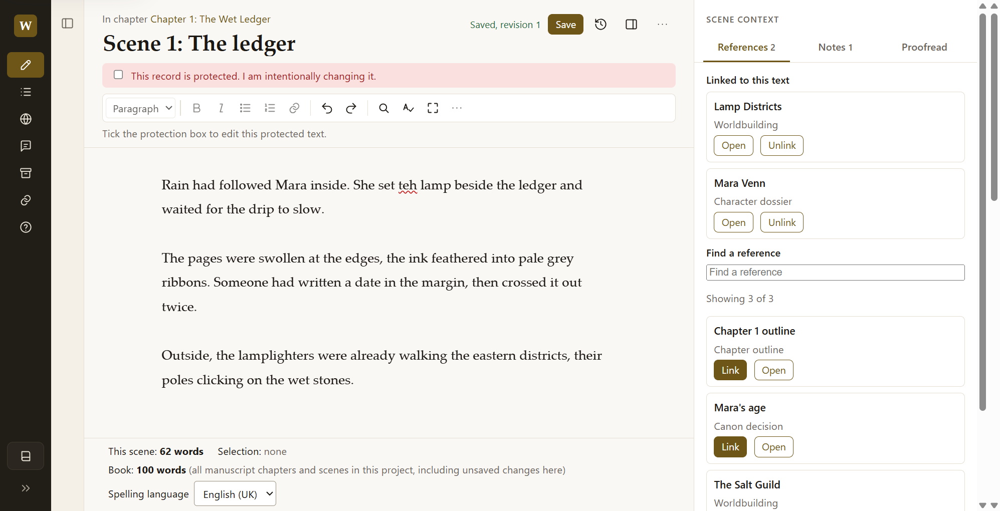
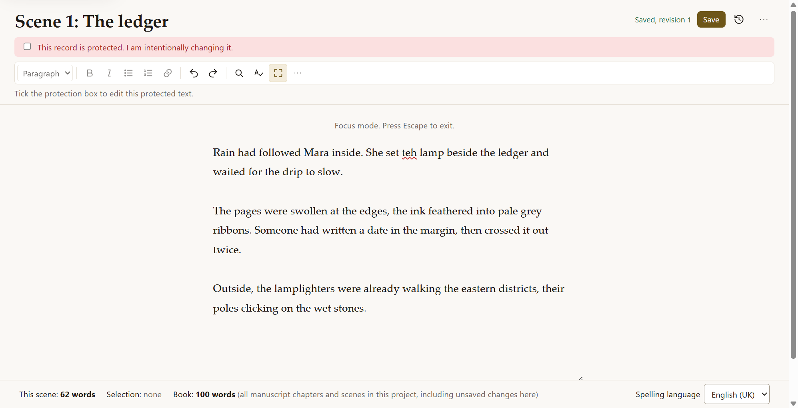
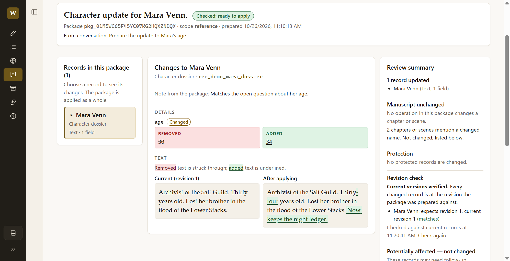
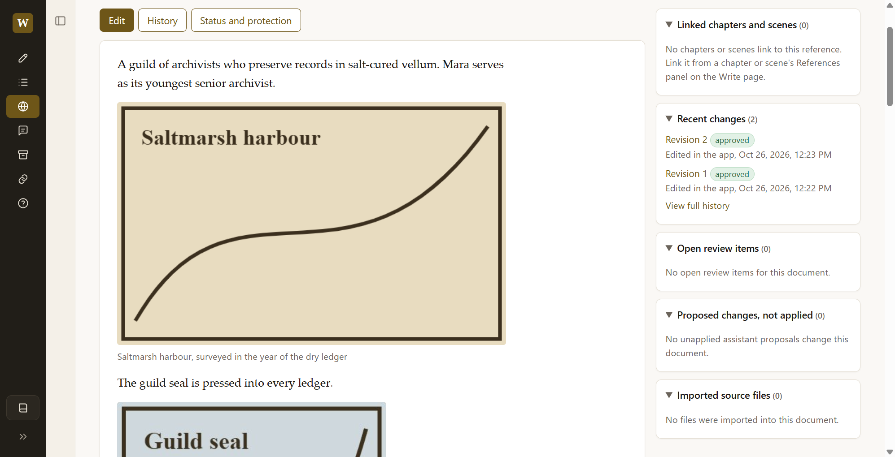
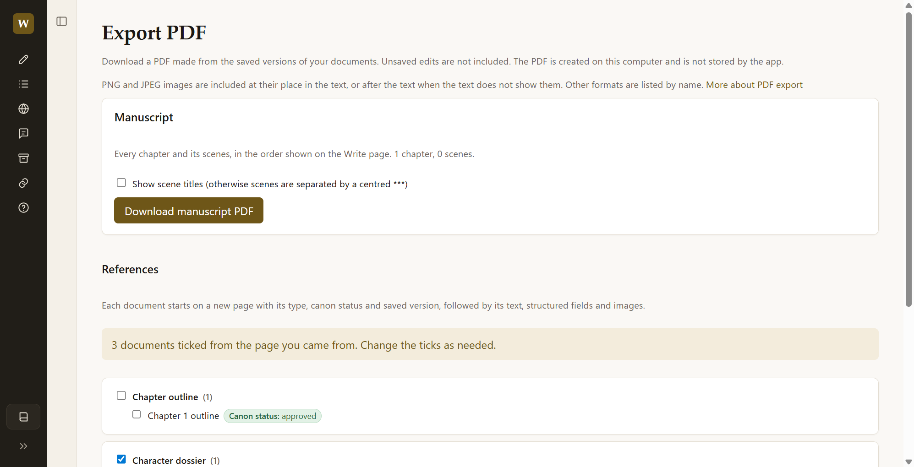
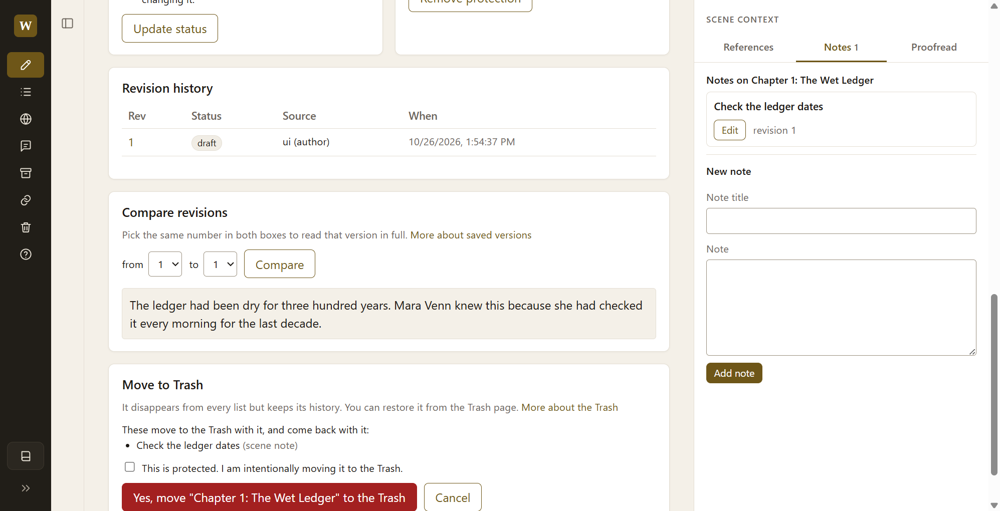
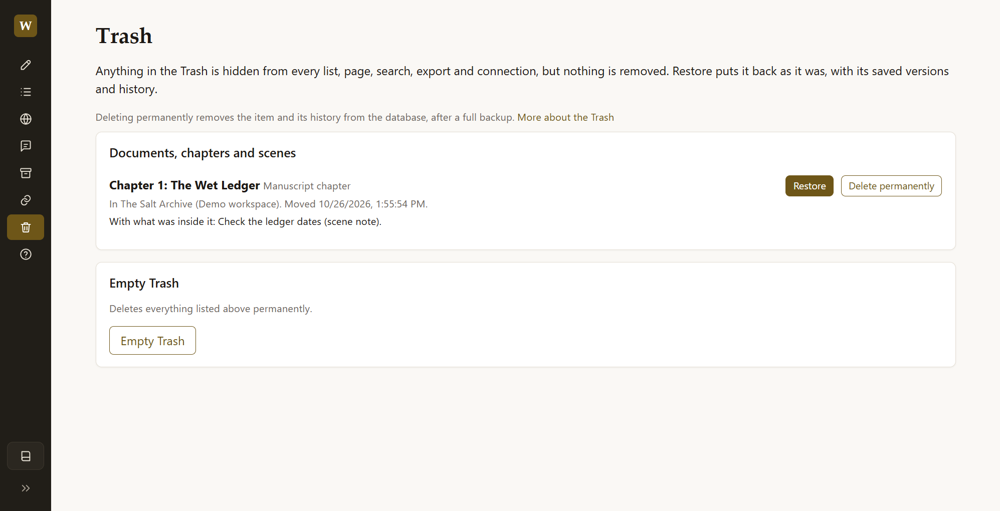
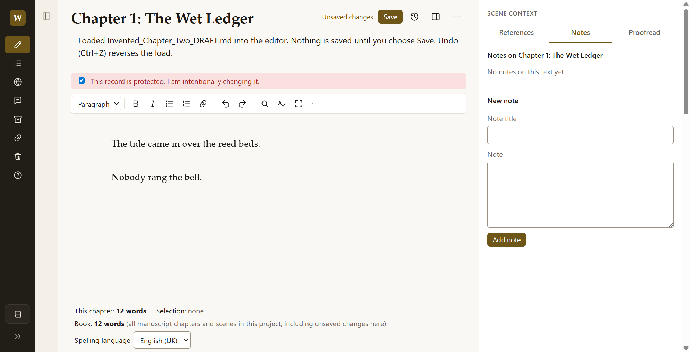

# Progress

## W8 Close-Out — MCP stdio cold start + final gates (Nov 23, 2026)

Closes the remaining W8 release gate on the final tree:

- **Cause:** `scripts/mcp-stdio.ts` loaded `stdioMain`, which statically imported the MCP SDK, database, and handlers before `isMcpDisabled` ran. Under suite concurrency the disabled child could exceed the 12s `exitOf` budget with empty stdout/stderr (prior cold `speak` ~22s).
- **Fix:** `mcp-stdio.ts` exits on `WORDLY_MCP_DISABLED` before importing `stdioMain`. `stdioMain` still checks disabled + grant/revocation, then dynamically imports SDK / db / handlers only after an active grant. Stderr diagnostics, JSON-RPC-only stdout, and bounded `stopChild` cleanup unchanged.
- **Verify (stdio protocol):** enabled `speak` lists projects; disabled and revoked exit non-zero with empty stdout and the expected stderr lines. Diagnostic under full-suite concurrency: `speak` ready ~12.4s; disabled exit ~1.5s; revoked exit ~6.4s (machine-dependent; not CI bounds). Dual-`createTestDb` hook timeouts did not recur; suite timeouts left unchanged.
- **W8A / W8B execution:** included in the full suite below. Prior targeted runs also passed: `world-bible-export-w8a` (Saltmarsh five-format artifacts), `backup-w8b` + `backupIdRemap` (partial schema, reader abort, preserve/remap, pre-W4 → head via isolated `pnpm db:deploy` + restore). Working `prisma/dev.db` size unchanged (43 692 032 bytes); no reset/reseed.
- **Final gates (same tree, sequential):** `pnpm test` — **184 files / 988 tests passed**; `pnpm build` — pass (existing Turbopack fs-trace warnings only); `pnpm typecheck` — pass.
- **Manual still outstanding:** author spot-check of Help world-bible / backup restore notes in the running app; apply any pending working-DB migrations with `pnpm db:deploy` only when ready (backup first). Unrelated in-tree maps landing work is separate from this W8 close-out.

### Rollback

Revert `scripts/mcp-stdio.ts` / `src/mcp/stdioMain.ts` / this entry. W8A–W8C product changes stay.

## World Maps Landing Redesign (Nov 23, 2026)

Atlas-style Maps landing under the existing World header (nav, crumbs, cover, Getting started unchanged):

- **Library UI:** Intro row, search / type filter / sort / grid–list toolbar, “Your atlas” count, visual cards (thumbnail, optional type badge, linked reference, marker count, open + overflow), list view, dashed Add a map tile, empty / no-match states.
- **Create:** Inline create panel removed; same upload / existing-image / new-reference flow opens in a dialog with live preview; post-create still navigates to the map.
- **Classification:** Nullable `WorldMap.classification` (`world`…`other`); optional on create and Edit details; never inferred. Delete from the card menu confirms and keeps the host reference and image. Grid/list preference via `wordly-maps-view` cookie.
- **Verify:** `tests/unit/map-library.test.ts`, `tests/acceptance/maps-landing-library.test.ts`; Help `#world-maps` / `#optional-maps` updated.

### Rollback

Revert maps landing components / CSS / labels / Help / PROGRESS; drop `classification` only after confirming backups do not need it (`ALTER TABLE … DROP COLUMN` on a disposable copy). Working DB: additive column only.

## W8C — World Bible Format Links, Labels & Character Slices (Nov 23, 2026)

Shared world-bible model unchanged for eligibility; writers consume resolved labels and page ids:

- **Wiki:** Relative hrefs from the emitting file (`pages/…` on the index; peer `….html` inside articles). Infobox, relations, See also, and `[[wiki]]` body links resolve; excluded targets stay plain labels.
- **PDF / EPUB:** Each character slice renders once. EPUB adds scope note, home/authority meta, and internal `.xhtml` links for profile fields, relations, and body wiki links.
- **DOCX:** Category / subcategory / home / authority on each entry; See also, relations, and record-ref fields use Word-safe bookmarks (`wb_*`) and internal hyperlinks; same-title records stay distinguishable via page id text.
- **Markdown:** Secondary “Also listed under” uses resolved labels; each standalone `.md` file includes the scope note.
- **Verify:** `tests/acceptance/world-bible-export-w8c.test.ts` (Saltmarsh fixture, all five formats, distinctive character phrase once).

### Rollback

Revert `wikiExportHtml` / `worldBibleExport` / `worldBibleProfileRender` / `worldBibleModel` (secondaryListings + bookmark helper) / EPUB link handling in `manuscriptExportMarkdown` / Help / this note / W8C test. W8A model eligibility stays.

## W8B — Backup / db:deploy Hardening (Nov 23, 2026)

Disposable-DB fixes so pre-migrate backups stay complete and remap restores keep typed links:

- **CompileProfile:** when `bookTheme` is missing (`P2022`) but layout columns exist, the backup keeps `trimSize`, `marginInches`, `backMatterBody`, `excludedRecordIds`, and the other layout fields instead of resetting them to defaults.
- **Continuity / contradiction:** missing tables (`P2021`) read as empty; unexpected read errors abort the backup so `db:deploy` does not migrate after an incomplete snapshot.
- **Remap:** `idStrategy: "remap"` rewires typed IDs in `worldProfile` history/values, `characterDevelopment`, SmartCollection `filterJson` (`draftId` / `linkedRecordId`), and compile `excludedRecordIds`. Prose, archive holds, unknown extension keys, and literal strings that happen to equal an old ID are left alone.
- **Verify:** `tests/unit/backupIdRemap.test.ts`, `tests/acceptance/backup-w8b.test.ts` (partial compile schema, reader failure, Saltmarsh preserve/remap behavior, pre-W4 → head via `pnpm db:deploy`). Working `prisma/dev.db` untouched.

### Rollback

Revert `backupService` / `backupIdRemap` / Help restore notes / this entry / W8B tests. Pre-migrate backups already written under the fixed readers remain valid. Working DB: no schema change in this milestone.

## W8A — World Bible Export Selection, Facts, Anchors & Images (Nov 23, 2026)

Tightens which records and established facts enter world-bible exports (Wiki / Markdown / DOCX / EPUB / PDF):

- **Facts:** series-shared subjects load `EstablishedFact` rows from the home book; point mode keeps only accepted facts with evidence at or before the story point (later / undated / incomparable stay out). Full-author exports keep visible accepted facts.
- **Anchors:** story-point chapters/scenes resolve across authorized series books; viewing-book scope stays separate from the anchor’s home book. Invalid / out-of-series anchors throw instead of degrading to a full export. Export PDF lists each story point with its book title.
- **Collections:** live SmartCollection when untouched; `selectionOverride` intersects explicit ticks with collection members and distinguishes an explicit empty selection.
- **Labels:** custom category / subcategory labels (including secondary memberships) come from the record’s home book even when the viewing book redefines the same slug.
- **Images:** point-scoped Wiki/PDF keep only images named in the redacted body; gallery-only assets (caption, filename, bytes) are omitted. Full-author keeps eligible gallery images.
- **Verify:** `tests/acceptance/world-bible-export-w8a.test.ts` (Saltmarsh two-book fixture, PDFKit text extraction) plus `tests/unit/worldBibleExportQuery.test.ts`.

### Rollback

Revert `worldBibleModel` / `worldBibleExportQuery` / `worldBibleExport` / `pdfExportService` / `characterWritingContextService` (focus bookIds) / Export PDF picker+page / labels / Help / this note / W8A tests. W7C writers remain.

## W7C — Taxonomy-Organized, Point-Scoped World Bible & Wiki Exports (Nov 23, 2026)

Shared world-bible model for HTML wiki, Markdown, DOCX, EPUB, and PDF:

- **Model:** `worldBibleModel` — live SmartCollection / taxonomy / type / record selection via `resolveAvailableReference`; primary taxonomy grouping with secondary “See …” cross-refs; stable `slug-id` page targets; home-book category/template labels.
- **Spoiler policy:** `mode: full | point` with story point + optional viewing book + approved-only; whole-artifact redaction via `redactWorldFieldsForExport` / `redactCharacterFieldsForExport` / `stripUnsettledAndOverlappingBody` before any writer runs; ambiguous title/alias wiki links omitted; excluded-record `[[…]]` targets stripped to plain text.
- **Profiles:** `worldBibleProfileRender` — human-readable Living World Profile fields (units/qualifiers, documented zero), relationships, character dossier slice path preserved.
- **UI / routes:** World Hub hands collection or active taxonomy filters to Export PDF; shared Export scope & spoiler controls on all five download buttons; query parser for `mode` / `book` / `spoilerBefore` / `ceiling` / `collection` / taxonomy params.
- **Verify:** `tests/acceptance/world-bible-export-w7c.test.ts` (Saltmarsh Annals two-book fixture, `FUTURE_PHRASE_W7C` absence, live + empty collections) plus existing `world-bible-export.test.ts`.

### Rollback

Revert `worldBibleModel` / `worldBibleProfileRender` / `worldBibleExportQuery`, writer/route/UI/Help/PROGRESS changes for this milestone. Full-author exports without point params remain the previous default path.

## W7B — Manuscript vs Approved World-Fact Contradiction Review (Nov 23, 2026)

Author-triggered, story-point-scoped comparison of manuscript passages against approved Living World Profile facts:

- **Domain:** `src/domain/worldContradiction.ts` — claim stance (`narration` / `dialogue` / `belief` / `uncertainty`), entity and sub-scope guards, quantity/unit comparison (documented zero, `about` ±10%/35% bands, length/area conversion), AI candidate quote validation via `resolveQuotation`.
- **Persistence:** `WorldContradictionCheck` (issueKey + revision-pinned dedupeKey, `needsRecheck`); mutation hooks; trash delete; optional backup `worldContradictionChecks`; ContinuitySuppression `resolved` in backup format.
- **Service:** `reviewManuscriptContradictions` reuses W5C/W7A eligible facts only (no undated / planned / sibling-local); persist upserts by dedupeKey and retires obsolete rows without editing prose or canon.
- **UI:** Continuity Ledger kind `world_contradiction`; Write → References ContinuityStrip **Check world facts** + suppress actions.
- **Tests:** `tests/unit/worldContradiction.test.ts`, `tests/acceptance/world-contradiction.test.ts` (Saltmarsh, Population, Waterway, Scope). Wiki / world-bible formatting is W7C.

### Rollback

Revert domain/service/Prisma migration/backup/continuity/Write/Help/PROGRESS for this milestone. Drop `WorldContradictionCheck` only after confirming no needed review rows in backups.

## W5D — Optional Subcategory Sections (Guilds, Rituals, Dialects) (Nov 23, 2026)

Extends the Geography optional-section pattern. Matching taxonomy suggests a section; the author enables it. Hiding keeps values. `definitionId` stays sticky.

- **Reused:** Organizations `membership` (who belongs). `record_ref` for dialect parent language (`{ recordId }`). `ordered_list` for apprenticeship stages, credentials, participant roles, ritual steps, and distinctive expressions. No language relation kind exists (Record relations are characters, organizations, and places; Place relations are `part_of`, `flows_into`, `governed_by`).
- **Added:** Guilds `admissionRequirements`, `apprenticeshipStages`, `credentialsIssued`. Rituals `ritualOccasion`, `participantRoles`, `ritualSteps`, `ritualVariations` (the Religion profile `rituals` notes field is unchanged). Dialects `parentLanguage`, `regionalSoundChanges`, `distinctiveExpressions`, `exampleLines` (`glossed_lines`: `{ line, gloss }[]`).
- **Continuity:** Those new prose, stage, step, and sample fields are descriptive. Structuring them does not create a contradiction rule. Undated current values stay unknown at an earlier point. Parent language follows the existing record-reference export rule (title when the target is in the export set).
- **Limitation:** Sections are not gated by profile definition, including custom home-book kind templates. A custom subcategory slug does not suggest these sections. Membership appears in the editor only on a definition that includes it (`category:organizations`). The history value box for example lines uses `line | gloss` per line.
- **Tests:** `tests/unit/worldSubcategorySections.test.ts`, `tests/acceptance/world-subcategory-sections-w5e.test.ts`.

Revert the guild/ritual/dialect registry, glossed-line reader, panel editor, heading map, contradiction guard, Help, and this note. Profiles without `enabledSections` still read as `[]`.

## W5D — Optional Subcategory Sections (Geography) (Nov 23, 2026)

Optional Living World Profile subcategory sections for Geography, without changing `definitionId`:

- **Domain:** `enabledSections` on `worldProfile` (version 1, additive); `WorldProfileQuantity` + `quantity` field type with qualifiers (`exact` / `about` / `at_least` / `at_most`) and optional units; documented `amount: 0` vs blank unknown.
- **Registry:** `WORLD_SUBCATEGORY_SECTIONS` for `geography:cities_and_settlements`, `geography:regions`, `geography:waterways`; shared `POPULATION_ESTIMATE_FIELD`; waterway `waterwaySource` (avoids magic-system `source` collision); outlet reuses PlaceRelation `flows_into` with profile fallback.
- **UI:** WorldProfilePanel optional sections (taxonomy suggestions + picker); quantity editors; sticky enabled sections / saved-value discoverability; History picker includes quantity and section fields.
- **W5C/W7A:** Undated estimates stay unknown / omitted when drafting earlier scenes; heading overlap map covers new fields; dated `fieldHistory` resolves with qualifier + unit.
- **Tests:** `tests/unit/worldSubcategorySections.test.ts`, `tests/acceptance/world-subcategory-sections.test.ts`.

Revert domain/registry/panel/history/heading-map/Help/PROGRESS changes for this milestone. Existing profiles without `enabledSections` read as `[]`.

## W7A — Story-Point & Book-Scoped World Facts for AI (Nov 23, 2026)

Point-scoped Living World Profile facts for drafting, retrieval, and spoiler-redacted context export:

- **Domain:** `src/domain/worldWritingContext.ts` — `renderWorldContextSlice` / `redactWorldFieldsForExport` reuse W5C `resolveWorldFieldsAtPoint` + history visibility; drafting never promotes undated current values, planned changes, archives, or conflicted chronology; objective-setting framing distinct from character knowledge.
- **Services:** series-aware pins / selectable refs / `loadDocuments` via `resolveAvailableReference`; world refs render through `renderWorldReferenceForAssistant` (not raw `JSON.stringify(fields)`); retrieval tools filter book-local siblings, planned facts/planning search at chapter scope, and series-shared `events_at_place`; context export deep-redacts world fields when drafting/spoiler tick is on.
- **Verify:** `tests/unit/worldWritingContext.test.ts`, `tests/acceptance/world-writing-context.test.ts` (Saltmarsh Station matrix + mock provider). World-fact contradiction review is W7B; wiki formatting remains W7C.

### Rollback

Revert `worldWritingContext` + `worldWritingContextService`, assistant/retrieval/pin/find/export wiring, Help/PROGRESS notes. W5C history and series visibility stay.

## World Hub — Saved World Collections (Nov 23, 2026)

World-scoped `SmartCollection` rows store Hub filter definitions for the book where they were created:

- **Bridge:** `src/world/worldHubCollections.ts` maps `WorldHubQuery` ↔ `SmartCollectionFilter` (stable category / subcategory / tag / type / kind / scope / status / protection / query / sort / view). Evaluation reuses `filterWorldHubRecords` / `discoverWorldHubRecords` against the viewing book’s Hub index (dedupe by `Record.id`, secondary membership included).
- **UX:** `WorldHubCollections` on `/world` — save (with summary), open (restores controls via `?collection=` + filter params), rename, update from current filters, delete. Experimenting does not write until Update. Empty matches keep the collection available.
- **Compat:** Manuscript collections and older `filterJson` still parse; backups already round-trip `smartCollections`.

### Rollback

Revert worldHubCollections + WorldHubCollections wiring, worldHref `collection` param, Help/outline/labels/PROGRESS notes. Existing `SmartCollection` rows remain; delete world-scope rows if unwanted.

## New reference field explanations (Nov 23, 2026)

Info icons on New reference (and the same labels when editing) explain document type, kind, where this applies, Hub classification, also belongs to, profile definition, starting headings, canon status, and the short character details. No schema change.

### Rollback

Revert the new label strings, the `HelpPopover` placements, the `.field-caption` rule, the Help sentence, and this note.

## World Hub — Category Discovery on Maps, Boards, Relationships (W6A) (Nov 23, 2026)

Bring World Hub category/subcategory discovery into Maps, Boards, and the Relationship Explorer without copying records or rewriting placements:

- **Shared helpers:** `src/world/taxonomyDiscovery.ts` (`filterPlaceableRecords`, canvas filter helpers) plus `TaxonomyFilterSelects`, `ReferenceTaxonomyPicker`, and `TaxonomyBadges`.
- **Pickers:** Map and Board record pickers search local + series-shared references by title and taxonomy; one result per `Record.id`; selecting a shared result links the original id.
- **Canvas filters:** Maps combine taxonomy with era/draft/book/layer; Boards combine taxonomy with card-kind. Unlinked notes/images and map-to-map pins do not match an active category filter; clearing restores the full canvas.
- **Relationships:** graph nodes carry taxonomy; filter with matching-only or matching+neighbors; series-shared nodes included in all-connections; endpoint/series eligibility reported separately.
- **Inspector:** discovery metadata in pickers; detailed profile (including taxonomy badges and series home) loads on inspect.

## World Hub — Living World Profile History (W5C) (Nov 23, 2026)

Optional dated `worldProfile.fieldHistory` on the existing overlay (no SQLite migration):

- **Layers:** undated current (Details / panel) ≠ dated change ≠ resolved as-of. Alone, undated current does not fill earlier story time (as-of → unknown).
- **Resolve / compare / supersede:** `src/domain/worldProfileHistory.ts` reuses NarrativePoint + OrderEdge placement; approved view is approved && !planned && not superseded. Book-scoped changes filter by viewing project.
- **UX:** WorldProfilePanel History section — as-of picker, compare, record change, correct; scalar short/long text for flat climate + profile access first. Evidence catalog from `loadDevelopmentEvidenceCatalog`.
- **Export:** context bundles redact planned / unapproved / later history and add a reading instruction; no W7 `worldContexts` product.
- **Tests:** `tests/unit/world-profile-history.test.ts`, `tests/integration/world-profile-history.test.ts` (station fixture).

### Rollback

Revert `fieldHistory` known key + history module, panel/section wiring, contextExport redaction, Help/docs/this note. Legacy records without `fieldHistory` stay unchanged.

## World Hub — Category Living World Profiles (W5B) (Nov 23, 2026)

Built-in optional Living World Profile definitions for the 13 non-character Hub categories on the W5A overlay:

- **Ownership:** flat `WORLD_KIND_FIELD_SPECS` (e.g. place `climate`, magic `source`/`limits`) stay in Details; category definitions reference them as `storage: "flat"` and add profile-only fields (terrain, workings, costs, layout, …).
- **Selection:** sticky `definitionId`; home-project templates first; author choice when multiple built-ins are plausible; taxonomy/tag edits never clear the selection or saved values.
- **Upgrade:** expanded deterministic heading map scoped to the active definition; Costs/Limits/Workings and geography/location headings classify correctly.
- **UX:** panel groups suggested definitions, edits ordered-list / calendar free-text / record-id fields without a deeper picker.
- **Deferred:** rich calendar picker, record pickers, collection editors, wiki/bible deep formatting, AI fill (W7+).

### Rollback

Revert registry category field packs, selection helpers, panel/heading changes, Help/docs, and this note. Overlay schema unchanged (W5A).

## Info icon for explanations (Nov 23, 2026)

Explain buttons are the shared info icon (`HelpPopover`). The icon stays on the same line as the label or sentence, and hover, focus, or a tap opens the explanation. No schema change.

### Rollback

Revert `HelpPopover`, the `.help-popover` rules, the Weave note markup, Help, and this note.

## World Hub — Living World Profile Foundations (W5A) (Nov 23, 2026)

- **Overlays:** optional `fields.worldProfile` (v1) on non-character World types (worldbuilding, rules_glossary, research_note, canon_decision, continuity_note, reference_note) and immutable `fields.worldMarkdownArchive` snapshots. Per-field `fieldMeta` approval and provenance; extracted material stays draft and is never auto-approved.
- **Schema:** `WorldCategoryDefinition` for custom Hub categories, plus `WorldKindTemplate` profile extensions (`definitionId`, `label`, `description`, `categorySlug`, `subcategorySlug`, `profileSpec`).
- **Registry:** built-in profile definitions merged with template `profileSpec`, resolved with series-home precedence.
- **UI:** Living World Profile panel, Markdown upgrade review (`/records/<id>/world-upgrade`) with accept / keep / merge / modify / reject / defer, infobox and inspector summaries, create-form definition picker, custom categories on the World hub.
- **Integration:** backup/restore (optional `worldCategoryDefinitions`), Trash, mutation validation (unsupported versions refuse writes), and export / context bundle.
- **Tests:** unit (`world-profile`, `world-profile-upgrade`) and integration (`world-profile-foundation`) coverage for the domain, registry, upgrade, categories, packages, and revision rollback.
- **W5B boundary (out of scope):** deeper collection editors, calendar picker UX polish, wiki/bible deep formatting, and AI-assisted world profile fill.

### Rollback

Revert the profile panel, upgrade route, registry, and docs. Older backups omit the new keys and restore unchanged; `worldProfile` / `worldMarkdownArchive` stay inert in fields.

## World Hub — Series-Wide Worldbuilding Integration (W4) (Nov 22, 2026)

Extend single-record `worldScope` so series-shared references participate across sibling books without duplication:

- **Schema:** forward-only migration adds `PlaceRelation.scope` / `RecordRelation.scope` (default `book`) and optional `WorldKindTemplate.worldScope`.
- **Resolution:** `resolveAvailableReference` / `listAvailableReferences` / `resolveAvailableImage` with strict workspace + series isolation; `getRecord` stays local-only.
- **Maps / boards / inspectors:** pin and card pickers use available refs/images; views carry `home` / `worldScope` / `unavailable`; inspectors and canvas summaries badge shared-from home.
- **Relationships:** endpoints may be local or series-shared; series scope requires named series + both ends `worldScope = series`; graphs/forests load sibling series edges.
- **Templates / lifecycle:** home `(projectId, kind)` wins; optional series template sharing; `deleteProjectRowsInTx` cleans templates and related project children; unshare preview warns when siblings still pin/card.
- **Backups / packages / export:** optional `scope` / `worldScope` in v1 format; integrity allows series-compatible cross-project links; change packages emit `SERIES_SHARED_READ_ONLY` for sibling mutations; export/world bible include eligible shared refs.

| Check | Result |
| --- | --- |
| Isolated `prisma migrate deploy` | pass (`/tmp/w4-migrate-test`) |
| `pnpm typecheck` | pass |
| `pnpm test` | 159 files / 871 tests passed (incl. `tests/acceptance/series-wide-worldbuilding.test.ts`) |
| `pnpm build` | pass (after clearing `.next`; client-safe extracts for place/record relations, established facts, and map layers) |

### Rollback

Revert migration `20261123010000_series_relation_template_scope` only after restoring a pre-migrate DB backup if needed; revert service/UI/docs/test changes and this note. Do not reset the working author database.

## Verification baseline restoration (Nov 22, 2026)

Cleared outstanding post-W3 verification failures without starting W4:

- **`/settings` build:** Removed non-async `ASSISTANT_PROVIDER_OPTIONS` from `"use server"` `settings/actions.ts`. Settings UI now imports `ASSISTANT_PROVIDERS` from `@/assistant/config`. Server actions and settings behavior unchanged.
- **`mcp-readonly` Unicode search:** SQLite `contains` candidate filter only saw the NFC query form, so NFD-stored text (e.g. `cafe\u0301`) never reached JS matching. `searchProjectRecords` (and manuscript candidate filter) now OR both NFC and NFD query forms; excerpts still normalize to NFC.
- **`reference-templates`:** Test expected eight outlines; product already ships Character plus the eight worldbuilding outlines. Assertion updated to the real nine-template list (no product change).

| Check | Result |
| --- | --- |
| `pnpm lint` | no `lint` script / ESLint config in this repo |
| `pnpm typecheck` | pass |
| `pnpm test` | 158 files / 869 tests passed |
| `pnpm build` | pass (including `/settings`) |

### Rollback

Revert settings import move, `searchService` NFC/NFD candidate OR, reference-templates assertion, unicode unit test, and this note. Working DB unchanged.

## World Hub — Navigation and Creation UX (Nov 22, 2026)

Category-driven World Hub on existing `fields.taxonomy` (no new tables, no kind rewrite):
- **Discovery:** `src/world/hubDiscovery.ts` parses/filters/sorts hub URLs; `/world` shows 14-category rail, tools separation, recent accessed/updated, list/card views, and combined filters. Legacy `type`/`kind`/`q`/`list` preserved.
- **Create/edit:** `TaxonomyFields` on create and record forms; `/world/new` preselects category/subcategory/tag; all `WORLD_TYPES`; optional initial `worldScope` on create; template/kind suggestion chips are opt-in.
- **Bulk organize:** `/world/organize` with preview, protected unlock, conflict notes, and atomic `applyMutations` (`record.taxonomy_organize`); taxonomy-only skips passage recheck.
- **Docs/Help:** World Hub classification, organize workflow, and discovery URL contract documented.

| Check | Result |
| --- | --- |
| `pnpm typecheck` | pass |
| Targeted vitest (hubDiscovery, world, taxonomyOrganize, help, world-hub-ux, taxonomy) | 6 files / 30 tests passed |
| Full `pnpm test` | later fixed in baseline restoration (was 2 pre-existing failures) |
| `pnpm build` | later fixed in baseline restoration (`/settings` server-export) |

### Rollback

Revert hub discovery, World page/components, TaxonomyFields/create/organize, mutation create `worldScope`, docs/help/tests, and this note. Working DB unchanged (no migration).

## World Hub — Taxonomy and Classification Foundations (Nov 22, 2026)

Additive World Hub taxonomy on the existing unified `Record` model (no schema migration, no second worldbuilding system):
- **Registry:** `src/world/taxonomy.ts` defines 14 categories with default subcategories, icons, and labels as authoring defaults.
- **Storage:** validated `fields.taxonomy` v1 (`primary`, `secondary`, `tags`) with unknown-key preservation; `fields.kind` still owns structured templates.
- **Legacy read-time mapping:** `character_dossier` → Characters; built-in kinds → Locations / Peoples / Magic / Cultures / Religion / Organizations / Languages / Objects; custom kinds stay individually discoverable; unclassified records remain listed. No automatic rewrite of `fields.kind`.
- **Mutations:** taxonomy validated in `mutationService`; pure taxonomy-only edits skip passage-level evidence/annotation rechecks; protection, revisions, change packages, and backups unchanged.
- **Series parity:** `SERIES_REFERENCE_TYPES` now includes `rules_glossary` and `research_note` so series-shared rules/research appear in sibling books.

| Check | Result |
| --- | --- |
| `pnpm typecheck` | pass |
| Targeted vitest (taxonomy unit/acceptance, series-bible, worldKinds, world, established-facts) | pass |
| `pnpm build` (`next build`) | Compiled & typechecked; page-data collection failed on pre-existing `/settings` issue (unchanged) |

### Rollback

Revert `src/world/taxonomy.ts`, mutation/record/nav/world/series/docs/test edits, and this note. Working DB unchanged (no migration).

## Living Character Profiles — Release Readiness & Series Hardening (Nov 22, 2026)

Resolved continuity, dossier UI, analysis, series chronology, and export defects from the Living Character Profile release review:
- **Continuity Ledger:** Anchored state changes no longer emit false-positive unplaced limitation warnings when viewing the project-wide ledger without a focus chapter/scene; character findings include structured `applicableCanon`, `storyLocation`, `evidence`, `explanation`, and `suggestion` fields; added `"resolved"` suppression status (`Mark resolved`) alongside `Mark intentional` and `Ignore`.
- **Dossier & Editor Sync:** Hid raw `characterDevelopment` and `dossierMarkdownArchive` JSON blobs from `ReferenceView`'s structured-fields table; synced `RecordEditor` (`key` by revision) and `CharacterDevelopmentPanel` (`revision` effect) when saving externally without dirty edits.
- **Evidence-Based AI Analysis:** `assembleContext` now passes series `storyEventOrder` edges and `storyEventScene` links into `renderCharacterContextSlice`; `applyCharacterAnalysisDecisions` persists applied packages and finding decisions per character so partial failures do not lose or double-apply prior characters; removed dead `limitProblem` branch.
- **Series Chronology, Inspector, Chat Retry & Export:** `narrativePointForManuscript` loads series-wide `storyEventOrder` edges, falls back to chapter-level event links, and fills fallback book order (`withSeriesBookOrderFallback`) when `bookStates` lack explicit `narrativeIndex`. `inspectSelectionAssistContext` matches drafting mode; `prepareTurn` recovers `focusRecordId` on `"retry"`; `readPassageTool` resolves focus against the active project; `Export` exposes character mode (`drafting` / `editorial` / `planning`), story point selector, and optional `redactCharacterSpoilers` (`redactCharacterFieldsForExport`), keeping default change-package roundtrip compatible.
- **UX:** Replaced bare table on `/world/development` with responsive `<DataTable>` and wrapped `.context-tabs` on narrow screens.

| Check | Result |
| --- | --- |
| `pnpm typecheck` | pass |
| Targeted vitest (character-writing-context, character-development, character-analysis, living-character-five-book-e2e, continuity-ledger, export-roundtrip, series-bible, scenes, help) | 9 files, 69 tests passed |
| Full `pnpm test` (`vitest run`) | 150 files / 836 tests passed; 2 pre-existing unrelated failures (`tests/acceptance/mcp-readonly.test.ts` Unicode excerpt check, `tests/unit/reference-templates.test.ts` 9 vs 8 templates) |
| `pnpm build` (`next build`) | Compiled & typechecked cleanly; page-data collection failed on pre-existing non-async export in `src/app/(site)/settings/actions.ts` |

### Rollback

Revert edits to `characterWritingContext`, `characterWritingContextService`, `continuityService`, `ContinuityLedgerClient`, `ReferenceView`, `CharacterDevelopmentPanel`, `characterAnalysisService`, `assistantService`, `assistantRetrievalService`, `assistantContextInspect`, `contextExportService`, `export/page.tsx`, `ExportClient`, `world/development/page.tsx`, `globals.css`, `labels.ts`, `HelpContent.tsx`, `docs/context-bundle-format.md`, tests, and this note. No schema change; working DB unchanged.

## Living Character Profiles — Context-Aware Writing (Nov 22, 2026)

Writing and editorial AI resolve Living Profiles at the selected book, chapter, scene, and story chronology. Drafting uses dialogue slices with character-held knowledge only; editorial continuity can include established reader knowledge; planning may include author-controlled future plans. Continuity Ledger adds character state, knowledge-anchor, limitation, forgotten-arc, and identity findings (mark intentional/ignored; never auto-edits prose). Context bundles keep v1 compatibility and add optional `characterContexts` plus knowledge-holder reading instructions. No schema change.

| Check | Result |
| --- | --- |
| `pnpm typecheck` | pass |
| Targeted vitest (character-writing-context, character-development, export-roundtrip, help, continuity-ledger, series-bible, scenes, character-analysis) | 8 files, 65 tests passed |

### Rollback

Revert `characterWritingContext`, `characterWritingContextService`, assistant/retrieval/continuity/export wiring, Continuity labels/UI, Help, context-bundle docs, and this note. Working DB unchanged.

## Living Character Profiles — Evidence-Based AI Analysis (Nov 22, 2026)

Character dossiers and World → Character development reuse the shared assistant providers, limits, cancellation, and change-package apply path for evidence-based analysis. Runs store findings on `CharacterAnalysisRun` (additive migration). Scope covers scene, chapter, chapter range, book, multiple books, and series. Quotes and source ids are verified before accept. Accepted findings apply as draft notes only.

| Check | Result |
| --- | --- |
| `pnpm db:deploy` | Applied `20261122210000_character_analysis`; backup `backups/2026-11-22T19-01-24-243Z-pre-migrate` |
| `pnpm typecheck` | pass |
| Targeted vitest (character-analysis unit/acceptance, help, character-development) | 4 files, 43 tests passed |

### Rollback

Revert the character-analysis domain/service/UI/API, Help, labels, usageSummary aggregation, and backup fields. Working DB: restore `backups/2026-11-22T19-01-24-243Z-pre-migrate` or leave unused `CharacterAnalysisRun` rows. Older backups omit character analyses.

## Continuity Ledger lists unsettled notes and pending facts (Nov 22, 2026)

World → Continuity Ledger was empty on a book that stores continuity as notes and pending facts, and it walked every chapter for a timeline that had no story events. Unsettled continuity notes (draft, proposed, or unresolved) and pending facts now appear. Approved continuity notes stay off the list. The timeline comparison runs only when the project has story events. Loading the page still writes nothing.

### Rollback

Revert `continuityService`, the ledger kind label, Help, and this note. No schema change.

## Milestone 10: Multi-provider AI & desktop resilience (Nov 22, 2026)

- **10A Providers + SSE:** Settings provider selector (`openai` | `anthropic` | `gemini` | `openai_compatible`) with per-provider keys; `AnthropicProvider` / `GeminiProvider` (native `fetch`); `createAssistantProviderFromConfig` on all AI routes; selection-assist and beat-draft SSE streaming (clients also accept legacy NDJSON).
- **10B Prompt presets:** Project-scoped `AssistantPromptPreset` (`selection` | `chat` | `beat`); manage on Assistant page; optional lens on selection assist, chat, and beat draft; optional in backups.
- **10C Desktop resilience:** safeStorage key bridge (desktop → secrets → `.env`); rolling mirror backups with retention; sync bundle export / inspect / merge via change packages (never overwrites SQLite).

| Check | Result |
| --- | --- |
| `pnpm db:deploy` | Applied `20261122200000_assistant_prompt_presets`; backup `backups/2026-11-22T18-15-20-545Z-pre-migrate` |
| `pnpm exec tsc --noEmit` | pass |
| Targeted vitest (assistant config/secrets/factory, presets, mirror prune, sync bundle, help) | 7 files, 31 tests passed |

### Rollback

Revert provider/preset/desktop/sync UI and services. Working DB: restore `backups/2026-11-22T18-15-20-545Z-pre-migrate` or leave unused `AssistantPromptPreset` rows. Older backups omit presets. Clear schedule keys from `local/backup-mirror.json` if desired.

## World calendar add month and era (Nov 22, 2026)

World Calendar can append a blank month or era (24 months, 32 eras) and drop a row before save. A nameless row is omitted. At least one month remains. No schema change. The working calendar was not saved.

### Rollback

Revert `WorldCalendarForm`, the remove labels, Help, and this note.

## Responsive data table (Nov 22, 2026)

`DataTable` (`@/components/ui/DataTable`) stays a table while its container is wide and becomes a labeled card per row under 48rem. The manuscript Outliner uses it, so words, target, point of view, status, location, synopsis, and continuity stay on the page at phone width. No schema change.

### Rollback

Revert `DataTable`, the Outliner markup, the `.sl-data-table` rules, Help, and this note.

## Milestone 9: World graph, maps, wiki & live book preview (Nov 22, 2026)

- **9A Maps:** Detail-map breadcrumb trail + Drill in / Link detail map; read-only travel-time estimates after measure/route; optional highlight filter by era / draft / book (dims non-matching pins).
- **9B Knowledge graph:** World → Relationships **All connections** mode (relations + `RecordLink` + cross-ref mentions) with type/canon/draft/orphan filters.
- **9C Series edit:** Sibling view of series-scoped refs stays read-only by default; **Edit here (cross-book)** routes saves through the owning `projectId` with revision, protection, audit, and a continuity banner.
- **9D HTML wiki:** Export PDF → **Download HTML wiki** (`.zip`); optional approved-only and chapter established-fact ceilings (body text not fully filtered — documented).
- **9E Images & preview:** Manuscript chapters/scenes may store images (`` in PDF/DOCX/EPUB); optional `CompileProfile.bookTheme`; paperback vs e-reader live preview on Export PDF.

| Check | Result |
| --- | --- |
| `pnpm db:deploy` | Applied `20261122190000_compile_book_theme`; backup `backups/2026-11-22T17-21-07-079Z-pre-migrate` |
| `pnpm exec tsc --noEmit` | pass |
| Targeted vitest (maps, graph, series, wiki, images/export, help) | 33 passed (series alone 2/2 after one parallel hook timeout) |

### Rollback

Revert M9 UI/services/Help/labels. Working DB: restore `backups/2026-11-22T17-21-07-079Z-pre-migrate` or leave nullable `bookTheme` unused. Older backups omit `bookTheme` and wiki zips are downloads only.

## Chapter editor shows nested scene text (Nov 22, 2026)

Opening a chapter shows each nested scene’s text in the main editor, after the next scene break (`---`, `***`, `* * *`), in book order. Scenes past the last break follow that break. Saving the chapter does not copy that text into the chapter record. Scene rows in the manuscript rail show a page icon. The Write outline still names those scenes in the side panel.

### Rollback

Revert the nested scene editors in the chapter page, the outline inspector, Help, and this note. No schema change.

## Milestone 8: Outliner, smart collections & developmental insights (Nov 22, 2026)

- **8A Outliner:** Write landing tab with a table of chapters/scenes; inline synopsis, POV, scene status, and chapter word targets. Client-side sort/filter only; protected POV/status stay read-only until unlock on the record.
- **8B Smart collections:** `SmartCollection` model (`filterJson`, manuscript/world scope), management UI at `/write/collections`, optional backup field.
- **8C Style insights:** Style page pacing vs chapter targets, POV sequence, character×chapter matrix, Weave setup→payoff spans (read-only).
- **8D Beta reader:** DOCX export with watermark / paragraph numbers / approved glossary; DOCX review **comments-only** import that never replaces prose.

| Check | Result |
| --- | --- |
| Isolated migration SQL (temp SQLite) | `SmartCollection` table created |
| `pnpm db:deploy` | Applied `20261122180000_smart_collections`; backup `backups/2026-11-22T16-47-29-148Z-pre-migrate` |
| `pnpm exec tsc --noEmit` | pass |
| `pnpm exec vitest run tests/unit/smartCollection.test.ts tests/unit/help.test.ts tests/acceptance/style-check.test.ts tests/acceptance/docx-import.test.ts` | 4 files, 9 tests passed |

Help: dedicated **Outliner** topic (`manuscript-outliner`) covers what to edit in-table vs location/continuity; **Style check** topic covers where **Manuscript insights** lives and what each panel shows. M7 Live Markdown / named snapshots / read-aloud copy clarified. Jump list on How to use links both.

### Rollback

Revert Outliner/collections/style/export/import UI and services, Help, labels, and this note. Working DB: restore `backups/2026-11-22T16-47-29-148Z-pre-migrate` or leave empty `SmartCollection` rows. Older backups omit `smartCollections` and restore cleanly.

## Reference context tabs and image view (Nov 22, 2026)

Reference context tabs are a short text row instead of the tall Write icon tabs. Choosing an image in that tab opens it in a lightbox (previous, next, Escape to close) instead of jumping to the images section.

### Rollback

Revert the inspector tab CSS, `ImageLightbox`, the Images tab buttons, Help, and this note. No schema change.

## Milestone 7: Editor & revision leap (Nov 22, 2026)

CodeMirror 6 live-formatted Markdown editor (exact UTF-16 offsets; Live Markdown toggle; spell decorations; codex hover peek). Footnotes (`[^id]` / `[^id]:`). Scrivenings continuous chapter+scenes editing with per-block protection and autosave. Create reference from selection (draft + optional link/pin). Named revision snapshots (`Revision.label`, optional in backups) with History naming and labeled compare pickers. Browser read-aloud on selection or whole document.

| Check | Result |
| --- | --- |
| `pnpm db:deploy` | Applied `20261122160000_revision_labels`; backup `backups/2026-11-22T15-26-04-619Z-pre-migrate` |
| `pnpm exec tsc --noEmit` | pass |
| `pnpm exec vitest run tests/unit/help.test.ts tests/unit/markdownParse.test.ts` | 2 files, 23 tests passed |

### Rollback

Revert CM6 editor wiring, Scrivenings route, create-from-selection action, revision label service/migration/backup optional field, Help, and labels. Working DB: leave `Revision.label` null or restore the pre-migrate backup. No manuscript rewrite.

## Pre-flight hygiene before Milestone 7 (Nov 22, 2026)

Cleared the five standing `tsc --noEmit` errors (proofread schema import, optional `provider.complete`, DOCX review issue code, map authority status narrowing, Continuity Ledger fixture type). Help no longer claims Save-only writing; unlocked autosave and protected manual Save are documented, including under Limitations. Removing protection now uses the shared two-step confirm control.

| Check | Result |
| --- | --- |
| `pnpm exec tsc --noEmit` | pass (0 errors) |
| `pnpm exec vitest run tests/acceptance/continuity-ledger.test.ts tests/unit/help.test.ts` | 2 files, 7 tests passed |

### Rollback

Revert the five type fixes, ProtectionSection confirm wiring, `setProtectionAction` FormResult shape, Help/label sentences, and this note. No schema change.

## Milestone 6: AI transparency & local endpoint (Nov 22, 2026)

Settings accepts an optional OpenAI-compatible **base URL** (e.g. Ollama / LM Studio on loopback); loopback URLs may omit an API key. All AI routes use that base URL. Selection assist opens an **exact payload inspector** (toggle pinned refs) before send. Unlocked scenes can **Draft beat into suggestion box** from Plot (Weave notes + pins → preview → Accept → Save); protected scenes refuse. Keys never appear in inspect reports or status JSON.

| Check | Result |
| --- | --- |
| `pnpm exec vitest run tests/acceptance/ai-transparency.test.ts tests/unit/assistantConfig.test.ts tests/unit/assistantSecrets.test.ts tests/unit/help.test.ts` | 4 files, 24 tests passed |

### Rollback

Revert assistant config/secrets/base URL, openaiProvider `createOpenAIProviderFromConfig`, context-inspect + beat-draft services/routes/UI, help, and labels. No schema change (`proofreadRun.mode` string already free-form).

## Character psychology and development (Nov 22, 2026)

Character dossiers can carry an optional development profile: Enneagram and other writing-aid notes, archetypes, importance, narrative role, several arcs, relationship perceptions, book presence, variants, and explicit state changes. The dossier record stays the identity. Empty profiles behave as before. World → Character development lists arcs across books, including a novel with no series. Plot grids, the timeline, and the manuscript context rail show linked milestones when they exist. Extract and Review propose notes through the assistant and do not write until the author saves a selection. They never edit manuscript prose. Approved book states stay in place unless the author confirms a rewrite.

| Check | Result |
| --- | --- |
| `pnpm exec vitest run tests/unit/character-development.test.ts tests/acceptance/character-development.test.ts tests/unit/help.test.ts tests/unit/worldDestinations.test.ts` | 4 files, 24 tests passed |
| `pnpm exec tsc --noEmit` | No errors in the character-development files. The project still reports existing errors in assistant context inspect, beat draft assist, docx review, world maps, and the continuity ledger test. |
| `pnpm test` | 135 files passed, 4 failed. Series bible and backup passed when run again alone. The remaining failure is `mcp-readonly` searching for “café”, which this change does not touch. Three other failures were hook timeouts under the full run and passed alone. |

### Rollback

Revert the character development domain, dossier section, World development page, inspector lines, cue strips, help, and labels. Profiles already saved remain inside dossier fields until an edit removes `characterDevelopment`. No schema change and no manuscript rewrite.

## Living Character Profiles (Nov 22, 2026)

The same `fields.characterDevelopment` object (still version 1) gains optional foundation, voice (with per-book overrides), lived-experience notes, and a knowledge ledger beside the existing psychology, arcs, and state. Unknown top-level keys are kept on save. An unsupported version refuses the development save so an empty profile cannot wipe stored data. Change packages that set `characterDevelopment` validate before write. Assistant retrieval for character dossiers uses a continuity slice instead of dumping the raw fields JSON; lived experience and omit-secrets stay out of default context. Redacted Markdown export is the writing download; full JSON remains available locally. No Prisma migration.

| Check | Result |
| --- | --- |
| `pnpm exec vitest run tests/unit/character-development.test.ts tests/acceptance/character-development.test.ts tests/unit/help.test.ts tests/unit/worldKinds.test.ts` | 4 files, 29 tests passed |
| `pnpm exec tsc --noEmit` | No errors in the Living Character Profiles files |
| Browser | Character dossier shows Foundation, Voice, Lived experience, and Knowledge tabs with Pronouns and related fields |

### Rollback

Revert the living-profile domain, panel tabs, retrieval slices, help, labels, and package validation. Profiles already saved keep their new keys inside dossier fields; an older checkout that saves development may drop keys it does not know. No schema change and no manuscript rewrite.

## Living Character Profiles Phase 1 (Nov 22, 2026)

Phase 1 expands the same dossier-bound profile into Identity, Psychology, Voice, Behavior, Lived experience, Relationships, Capabilities, Development, and Continuity. Importance templates open a thinner or fuller section set without deleting notes. Name, aliases, images, and `RecordRelation` edges stay on existing surfaces; capabilities can link worldbuilding record ids. Storage remains additive JSON on `fields.characterDevelopment` (version 1). No SQLite table migration and no database reset—author IDs, Markdown, images, and revisions are unchanged.

| Check | Result |
| --- | --- |
| `pnpm exec vitest run tests/unit/character-development.test.ts tests/acceptance/character-development.test.ts tests/unit/help.test.ts` | 3 files, 28 tests passed |
| Schema | No SQLite migration required; Phase 1 is additive `fields.characterDevelopment` JSON on existing dossiers |

### Rollback

Revert Phase 1 domain keys (behavior, capabilities, expanded identity/voice/lived), panel section layout, help, and labels. Saved profiles keep any new keys in dossier fields. No schema change.

## Character Dossier Upgrade (Nov 22, 2026)

Author-reviewed migration from Markdown character dossiers into Living Character Profiles. Preview classifies headings into identity, psychology, voice, behavior, lived experience, relationships, capabilities, development, continuity, historical amendments, protected unknowns, proposed material, and unclassified. Authors accept, modify, reject, or defer each item. Apply writes `fields.characterDevelopment` (including `migrationHold`) and `fields.dossierMarkdownArchive` on the same dossier record; the Markdown body and revision history stay intact. Proposals are not auto-approved, mysteries stay unresolved, and planned growth is not treated as completed development. Entry points: dossier Upgrade page (with pasted Markdown analysis), project review under World → Character development → upgrades, and export of a proposed change package for Import package. Idempotent re-apply; failed/stale previews leave data unchanged.

| Check | Result |
| --- | --- |
| `pnpm exec vitest run tests/unit/character-dossier-upgrade.test.ts tests/acceptance/character-dossier-upgrade.test.ts` | 2 files, 16 tests passed |
| `pnpm exec vitest run tests/unit/character-development.test.ts tests/unit/help.test.ts` | 2 files, 19 tests passed |
| Schema | No SQLite migration; additive dossier field JSON only |

### Rollback

Revert upgrade domain/service/UI, `migrationHold` key, archive field helpers, help, and labels. Archived snapshots and hold items already saved remain in dossier fields until an edit removes them. No manuscript rewrite.

## Living Character Profiles — Series Development (Nov 22, 2026)

Extended Living Profiles for multi-book series development on the same `character_dossier` overlay (`fields.characterDevelopment` v1, additive). Added series-level plan, book-level plan fields on `bookStates`, milestone kinds and reference links, expanded state facets, chapter anchors, retcon supersession (`supersedesId`), historical state resolution with baseline/book-start/book-end boundaries, state comparison, development timeline, and typed identity-variant relationships. Series-wide evidence catalogs load chapters, scenes, events, beats, and timeline orders across sibling books. Single-book projects keep working; legacy rows read with empty defaults. No SQLite migration.

| Check | Result |
| --- | --- |
| `pnpm exec vitest run tests/unit/character-development.test.ts tests/acceptance/character-development.test.ts tests/unit/help.test.ts` | 3 files, 39 tests passed |
| `pnpm exec vitest run tests/unit/character-dossier-upgrade.test.ts tests/acceptance/character-dossier-upgrade.test.ts` | 2 files, 25 tests passed |
| Filtered `tsc` on changed character/help files | No errors in changed files |
| Schema | No SQLite migration; additive JSON only |

### Rollback

Revert series-plan/book-plan/state-resolution/UI helpers, help, and labels. Saved additive keys remain readable until edited. No manuscript rewrite.

## Living Character Profiles — Author Experience (Nov 22, 2026)

Improved the Living Character Profile author UI on the same `character_dossier` overlay. Importance levels are now protagonist, major supporting, supporting, minor, and background (legacy `recurring` remaps to supporting on read). Importance recommends open sections without restricting features; Show more sections overrides. Progressive disclosure uses existing context tabs with clearer labels (Overview & identity, Personality & psychology, Mannerisms, Abilities & limits, Story evidence, Original dossier). Completeness counts recommended sections with any note — not every optional field. Canon badges, psychology/arc concept help with author examples, empty states, keyboard tab navigation, and unsaved-change protection via the shell leave guard. Image, relationship, reference, and dossier surfaces are unchanged.

| Check | Result |
| --- | --- |
| `pnpm exec vitest run tests/unit/character-development.test.ts tests/acceptance/character-development.test.ts tests/unit/help.test.ts` | 3 files, 36 tests passed |
| `pnpm exec vitest run tests/unit/character-dossier-upgrade.test.ts tests/acceptance/character-dossier-upgrade.test.ts` | 2 files, passed |
| Filtered `tsc` on changed character/help files | No errors in changed files |
| Schema | No SQLite migration; additive UX over existing v1 JSON |

### Rollback

Revert importance/completeness helpers, panel UX, development filter labels, Help, and PROGRESS. Saved profiles remain readable; legacy `recurring` still remaps on read if the helper is kept.

## Living Character Profiles — Psychology and Archetypes (Nov 22, 2026)

Extended Living Profile psychology and archetypes on the same dossier overlay (`fields.characterDevelopment` v1, additive). Added optional psychology keys (core motivation, blind spots, emotional triggers, behavioral patterns, self/external perception), framework approval/provenance, archetype shadow rank and evolution fields, field-authority UI, extended Markdown heading map (Enneagram, archetypes, narrative role, psychology aliases, mental-health → lived boundary notes), upgrade apply/conflict guards, and context/export split for established vs draft archetypes/frameworks. Personality typologies stay non-clinical and separate from lived experience and behavior.

| Check | Result |
| --- | --- |
| `pnpm exec vitest run tests/unit/character-development.test.ts tests/unit/character-dossier-upgrade.test.ts` | 2 files, 37 tests passed |
| `pnpm exec vitest run tests/acceptance/character-development.test.ts tests/acceptance/character-dossier-upgrade.test.ts tests/unit/help.test.ts` | 3 files, 22 tests passed |
| Typecheck of psychology/archetype files | No errors in changed character files |
| `pnpm build` | Compile succeeded; failed typecheck on unrelated `SyncBundleClient.tsx` DiffPart props (pre-existing outside this milestone) |
| Schema | No SQLite migration; additive JSON keys only |

### Rollback

Revert psychology/archetype domain keys, panel authority UI, heading map entries, help, and labels. Existing saved keys remain in dossier fields until edited. No manuscript rewrite.

## Living Character Profiles — Foundation Hardening (Nov 22, 2026)

Hardened the Living Profile foundation on the same dossier record: shared Markdown heading extraction for fill and upgrade; migration holds & archive UI; field-level `fieldMeta` provenance/authority (imported/extracted stay draft — never auto-approved); expanded conflict detection across psychology/voice/behavior/capabilities with Keep existing / Replace / Merge / Defer and approved-canon guards; series-shared home-book apply enforcement; deterministic context slices (Established vs Draft/Proposed vs held; body dedup); archive version validation and idempotent apply keyed by bodyHash + decisions. Documented authoritative ownership in PROJECT_RULES and Help.

| Check | Result |
| --- | --- |
| `pnpm exec vitest run tests/unit/character-dossier-upgrade.test.ts tests/unit/character-development.test.ts tests/acceptance/character-dossier-upgrade.test.ts tests/acceptance/character-development.test.ts tests/unit/help.test.ts` | 5 files, 53 tests passed |
| `pnpm exec tsc --noEmit` | No errors |
| `pnpm build` | Succeeded |
| Schema | No SQLite migration; additive `fieldMeta` / hold / archive JSON only |

### Rollback

Revert foundation hardening domain/service/UI, shared heading module, help, and labels. Existing `fieldMeta`, holds, and archives remain in dossier fields until edited. No manuscript rewrite.

## Milestone 5: Export presets & compile validation (Nov 22, 2026)

Compile profile gains **Standard manuscript (Shunn)** and **Formatter-ready** presets (layout only; front/back matter and exclusions kept). Manuscript spacing is double-spaced 12pt; DOCX gets margins, running header with page number, and word count on the title page. EPUB/PDF/DOCX put front matter before chapters and back matter after. Export PDF page shows an Export preview with counts and read-only warnings (empty chapters, unplaced scenes, `[[links]]`, synopses/comments).

| Check | Result |
| --- | --- |
| `pnpm exec vitest run tests/acceptance/export-presets.test.ts tests/acceptance/compile-profiles.test.ts tests/unit/help.test.ts` | 3 files, 9 tests passed |

### Rollback

Revert export preset helpers, compile validation, DOCX/EPUB/PDF matter-order and typography changes, export-pdf UI, help, and labels. No schema change.

## Map and board continuity (Nov 22, 2026)

Selecting a marker or card stays on that map or board. The rail shows a short reference summary, Open reference, Edit reference, linked scenes, and Link scene. Maps also keep planned events and the existing marker editor. Link scene uses the existing scene-location assignment. A protected reference must be confirmed, and manuscript text is not changed. Open reference and Edit reference return to the same map or board, marker or card, search or filter, Canvas or List, hidden layers, zoom, and map path. Those view choices stay in this browser tab. A missing marker or card, or a deleted map or board, is stated on the page instead of opening a broken destination. Board position fields save X and Y while the layout is unlocked. An unsaved route, area, label, or note asks before leaving. Open scene beside the canvas is not part of this screen.

| Check | Result |
| --- | --- |
| `pnpm exec vitest run tests/unit/canvas-return.test.ts tests/unit/board-interaction.test.ts tests/unit/help.test.ts tests/unit/map-interaction.test.ts tests/unit/map-keyboard.test.ts` | 5 files, 19 tests passed |
| `pnpm exec tsc --noEmit` | No errors in the files changed for this work. Three existing errors remain in `docxReviewService.ts`, `worldMapService.ts`, and `tests/acceptance/continuity-ledger.test.ts`. |
| Browser, temporary project on port 2113 | Empty project: first map asked for a new reference, stored the upload there, and opened in Browse with no markers. A route was drawn with Add point, cancelled with no marker left, then saved and edited through the point fields. Browse hid the drawing tools. Hide all layers said markers were hidden; a search that matches nothing said no markers match. Open reference returned to the same map, the same marker, and the same search. A missing marker id was announced and was not selected. A blank board and its first note were created. Lock layout announced the lock and disabled the position fields. Upload onto the protected reference showed the required tick and was not submitted. Light and dark page backgrounds both applied, and 1280, 768, and 390 widths did not overflow the page. The working manuscript was not opened. |

### Rollback

Revert the canvas return helper, the compact rail, the link-scene action, and the return links on the record page. Scene locations already saved stay. No schema change.

## Board canvas interaction (Nov 22, 2026)

Select chooses a card. Pan scrolls the board. A card moves only from its handle after the pointer passes the drag threshold, and only while Lock layout is off. Lock stops moving and resizing and still allows selection, inspection, opening a reference, and note editing. Escape during a move puts the card back before it is saved. Center selection and Center all cards scroll to the middle; they do not zoom. Canvas and List share the cards, filter, and selection. The count says when a filter is hiding cards. Unsaved note text stays across selection changes, view switches, and refreshes. Ask about this board stays an explicit action. Moving a card does not change the reference, and a board note is not turned into one.

| Check | Result |
| --- | --- |
| `pnpm exec vitest run tests/unit/board-interaction.test.ts tests/unit/help.test.ts` | 2 files, 8 tests passed |
| Browser | Character board (0 cards): Lock layout pressed and announced; List hid the canvas, kept the lock, and disabled Select, Pan, and the center buttons. Demo Quay board (not saved): Notes filter read “1 of 3 cards” and “Filters are hiding 2 cards.” List kept that filter, then All kinds showed Inspect, Open record, and Edit note. Inspect opened the reference rail. No card was moved and no note was saved. |

### Rollback

Revert the board interaction helper, canvas pointer and list view, help, and labels. Card positions already saved stay on the board. No schema change.

## Milestone 4: Continuity Ledger (Nov 22, 2026)

World → Continuity Ledger is a read-only audit: unresolved / open questions, draft-in-canon and missing citations, timeline vs book order, conflicting constraints, Weave setups without a manuscript payoff, and stale evidence. Category and severity filters; Mark intentional / Ignore (audited `ContinuitySuppression`, optional in backups); deep links to records, events, and Weave. Write References rail shows findings for the open chapter or scene. Loading the ledger writes nothing.

| Check | Result |
| --- | --- |
| `pnpm exec vitest run tests/acceptance/continuity-ledger.test.ts tests/unit/help.test.ts tests/acceptance/series-bible.test.ts` | 3 files, 9 tests passed |

### Rollback

Revert continuity service/UI, Write strip, migration `20261122090000_continuity_suppressions`, and backup optional `continuitySuppressions`. Drop the table only on an isolated copy if needed. Working DB: leave suppressions or delete rows; no manuscript data changes.

## Imported chapters show under the Author manuscript (Nov 22, 2026)

A chapter imported after an author rewrite had started was saved with no draft, so neither the Zero draft nor the Author manuscript listed it. New imports now put the file text on the Zero draft and add a blank Author manuscript page pinned to that chapter. Opening a project that already has drafts places any previously unassigned chapter the same way. The uploaded text stays on the Zero draft.

| Check | Result |
| --- | --- |
| `pnpm exec vitest run tests/acceptance/chapter-import.test.ts tests/unit/help.test.ts` | 2 files, 14 tests passed |

### Rollback

Revert the import draft placement, the unassigned-chapter adopt on the project layout, and the help, label, and project-rule sentences. A chapter already moved onto the Zero draft, and its blank Author manuscript page, stay until the author moves or trashes them. No schema change.

## Milestone 3: DOCX / Scrivener import and editor Word review (Nov 22, 2026)

Import chapters accepts Word `.docx` (Heading 1 → chapters; Heading 2 / `***` stay as scene breaks in the body). Scrivener zip import maps Draft → chapters and Research → research notes, with an unsupported-item report. Editor DOCX review matches exported chapter bookmarks, shows diffs, and applies through mutationService with protection confirmation; optional Word comments become margin comments. Manuscript DOCX export writes `sl_record_*` bookmarks for round-trip. Imports still never create scene records.

| Check | Result |
| --- | --- |
| `pnpm exec vitest run tests/acceptance/docx-import.test.ts tests/acceptance/scrivener-import.test.ts tests/unit/help.test.ts` | 3 files, 7 tests passed |
| `pnpm exec vitest run tests/acceptance/chapter-import.test.ts` | 1 file, 8 tests passed |

### Rollback

Revert DOCX/Scrivener/review services and routes, export bookmarks, SOURCE_KINDS additions, and help/nav/labels. Existing revisions with `docx_import` / `scrivener_import` remain readable; no migration required.

## Milestone 2: Unlocked autosave and drafting ergonomics (Nov 22, 2026)

Unlocked chapters and scenes autosave while you pause. Rapid autosaves update the tip `autosave` revision for a few minutes so history stays readable; a manual Save starts a new numbered version. Protected records stay manual-save only. Manuscript search narrows candidates with SQL `contains` before loading bodies. Focus mode shows save status and previous/next in book order (`Alt+↑` / `Alt+↓`).

| Check | Result |
| --- | --- |
| `pnpm exec vitest run tests/acceptance/autosave.test.ts tests/acceptance/book-order.test.ts tests/acceptance/project-search.test.ts tests/unit/help.test.ts` | 4 files, 17 tests passed |

### Rollback

Revert autosave service/hook/action, WriteEditor focus nav and status wiring, search `onlyIds` prefilter, SOURCE_KINDS `autosave`, and the help/PROJECT_RULES notes. Existing autosave revisions remain readable; no migration required.

## Map canvas interaction (Nov 22, 2026)

Browse selects a marker and pans the background. It does not move markers. Edit opens on Select. Pin places one marker and returns to Select unless Keep placing pins is ticked. Route, area, and label keep an unsaved draft with a live preview and vertex handles. Enter or Finish ends a valid drawing without writing. Escape or Cancel drops it and leaves saved geometry as it was. Save route, Save area, and Save label are the writes. A refused save keeps the draft. A click that does not pass the drag threshold does not write a move. Layers show a hidden state, visible and total counts, and Show all layers when some markers are hidden. The marker list distinguishes an empty map, a search miss, and markers hidden by layers. Fit map resets the view. Center selection pans the current zoom so the selected marker sits in the middle. Viewport, custom layers, and map trails stay as they were. Marker dots and route points stay circles: the shared button minimum height was stretching the point handles into ovals.

| Check | Result |
| --- | --- |
| `pnpm exec vitest run tests/unit/map-interaction.test.ts tests/unit/map-keyboard.test.ts tests/unit/help.test.ts` | 3 files, 12 tests passed |
| Browser | The Devil You Know, Aldemar, nothing saved. Browse stays on the shared header and project navigation. Edit opens on Select. Route shows Finish and Save route, both disabled until the drawing is valid, and Cancel returns to Select. Pin shows Keep placing pins, unticked, and Add marker stays disabled. Center selection stays disabled with no marker. This map has no markers, so a drag was not exercised on the author’s map. A later unsaved route point measured 13.6×13.6 px and was cancelled; Browse was restored. |

### Rollback

Revert the map interaction helper, the canvas pointer and keyboard changes, and the help sentences. No data change.

## Map canvas layout (Nov 22, 2026)

The map page keeps the shared project header and the project-column navigation. The canvas toolbar is one row: Browse or Edit, the marker tools while editing, Layers, Markers with a count, Fit map, and zoom. Layer rows show how many markers sit on that layer. A line under the map says how many markers are hidden and can show them again. Drawing a route, area, or label puts the instruction above the map and the label, layer, reference, and point list in the inspector. Enter finishes that shape and Escape cancels it, except while typing in a field or using a button. Nothing is written until Save shape.

| Check | Result |
| --- | --- |
| `pnpm exec vitest run tests/unit/help.test.ts tests/unit/weave-library.test.ts` | 2 files, 7 tests passed |
| Browser | The Devil You Know, Aldemar, nothing saved. Header stays cover, series, title, breadcrumb, and Getting started. Project navigation stays. Browse is one toolbar row: Browse, Edit, Layers, Markers (0), More actions, zoom, Fit map. The map fills the column. Edit adds Point, Route, Area, and Label. Route shows the instruction above the map and the draft fields in the inspector. Save shape stayed disabled. Browse restored the previous mode. |

### Rollback

Revert the map canvas toolbar, the inspector placement of the shape editor, the Enter and Escape handling, and the help sentences. No data change.

## Milestone 1: Desktop shell and Settings BYOK (Nov 21, 2026)

Installable Electron wrapper (`desktop/`), optional library folder (`storyloom.db` + lock file), and **Settings** (`/settings`) where authors paste their own OpenAI API key and model. Settings secrets live in `local/assistant-secrets.json` (git-ignored) and override `.env` until cleared; the UI never echoes the key. Backup mirror can be set from Settings. Help, Connections, and `docs/assistant.md` point at Settings. Scripts: `pnpm desktop:dev`, `pnpm desktop:build`.

| Check | Result |
| --- | --- |
| `pnpm exec vitest run tests/unit/assistantSecrets.test.ts tests/unit/libraryLocation.test.ts tests/unit/assistantConfig.test.ts tests/unit/help.test.ts tests/unit/backup-mirror.test.ts` | 5 files, 23 tests passed |
| `pnpm exec tsc --noEmit` | No errors in Milestone 1 files. Pre-existing error in `worldMapService.ts` (authority status string) remains unrelated. |

### Rollback

Revert Settings route, secrets/library modules, desktop folder, and related help/nav changes. Delete `local/assistant-secrets.json` / `local/library.json` if present. No schema change.

## Map and board setup (Nov 21, 2026)

A map can be created from an existing image, an upload onto an existing reference, or an upload onto a new reference named in the same form. The new reference takes a title, document type, and canon status. It does not receive a worldbuilding kind, and it stays a draft unless the author chooses another status. The reference, image, and map are one transaction: a failure leaves no new reference or image, and existing records stay as they were. Cancel does not write.

A blank board still starts empty. Geography adds the four template notes and nothing else. An empty board offers Add reference, Add image, and Write note. Write note does not need a World reference. Add image uses an image already stored on a reference.

| Check | Result |
| --- | --- |
| `pnpm exec vitest run tests/acceptance/map-board-setup.test.ts tests/acceptance/world-maps-place-relations.test.ts tests/acceptance/world-boards.test.ts tests/unit/help.test.ts` | 4 files, 22 tests passed |
| Browser | The Devil You Know, nothing saved. Existing image keeps Create map. Upload plus Create new reference shows title, document type, Draft canon status, and Create reference and map. Cancel cleared the title. The empty character board shows Add reference, Add image from stored images, and Write note. |

### Rollback

Revert the map create service, the create forms, the empty-board actions, and the help sentences. No data change.

## Maps and boards workspace shell (Nov 21, 2026)

Map and board pages keep the shared project header: cover, series line, page title, and a breadcrumb. Getting started sits in that header. Each canvas has one toolbar. Layers, markers, measure, export, and map upkeep open from menus. Add card, rename, and delete do the same on a board. The canvas fills the remaining height. The inspector stays the existing rail and still opens ReferenceInspector, place events, and linked scenes. Narrow windows keep the overlay drawer.

| Check | Result |
| --- | --- |
| `pnpm exec vitest run tests/unit/help.test.ts tests/unit/weave-library.test.ts` | 2 files, 7 tests passed |
| `pnpm exec tsc --noEmit` | no errors in the maps, boards, header, help, or navigation files |
| Browser | The Devil You Know, read only. Aldemar map: one header (cover, series, title, breadcrumb, Getting started), one toolbar, layer menu over the canvas, inspector “Selected marker” empty because that map has no markers. Board “character”: one header, Add card menu, canvas fills the column, inspector “Selected card”. At 900px the inspector is the overlay drawer and the page does not scroll sideways. Nothing was created or saved. |

### Rollback

Revert the workspace pages, toolbar markup, and the visual-workspace styles. No data change.

## Guided tour, help, and docs (Nov 21, 2026)

Getting started is a seven-step tour: write and compare drafts, including the unsaved local copy; pin a reference and insert its name; start from a beat sheet and make a scene; build World references; track the story timeline; share a series bible and review open questions; set a pace, compile, and back up. The tour lives in the onboarding cookie and does not write records. A cookie dismissed on an earlier tour opens again at task 1. Don't show again stores `dismissed:storyloom-tour-2026-11-21` and stays dismissed.

Help adds Side-by-side drafts and Unsaved local copy. What's new points at beat sheets, series sharing, continuity, the timeline, compile layout, pace, and pattern replace. Limitations that are no longer true were removed: reference downloads are not PDF-only, find and replace can use a pattern, compile profiles have layout choices, and style check and continuity review exist and do not change the manuscript.

`docs/world-and-weave.md` covers series sharing, premade beat sheets, custom kinds, and timeline checks. `docs/backup-format.md` documents `worldKindTemplates` and the optional compile-profile layout fields. `docs/upgrade-baseline.md` notes that `worldScope=series` is in use after the Nov 14 baseline. The README lists the in-app tour and the existing screenshots.

Thread colors, brass current-link ink, map group colors, and assistant message bubbles now use theme tokens. The project switcher title stays white on the dark navigation column.

| Check | Result |
| --- | --- |
| `pnpm typecheck` | pass |
| `pnpm test` | 125 files, 685 tests passed |
| `pnpm build` | pass |
| Browser | Salt Archive Write showed task 1 of 7, “Write, compare drafts, and keep a local copy.” Advancing showed task 2, then the cookie was set back to task 1. Nothing was saved. |

### Rollback

Revert the tour, help, README, `docs/world-and-weave.md`, and the backup-format and upgrade-baseline notes. No database change. An author who already dismissed this tour keeps that dismissal. Clearing the `wordly-onboarding` cookie shows the tour again.

## Compile layout, world-bible formats, and writing pace (Nov 21, 2026)

A compile profile can set trim size (5×8, 5.5×8.5, 6×9, A4, Letter), margins, a running header and footer, a font and spacing preset, a first-paragraph indent option, a larger first letter on each chapter in the PDF, a clickable contents page, back matter, and which chapters and scenes to leave out. Leaving a chapter out also leaves its scenes out of that chapter; a scene that is still included is exported with the unplaced scenes. None of this changes the manuscript. Drop cap is off unless you tick it, and in the PDF it is a larger first letter.

World and reference downloads can be DOCX, EPUB, or a Markdown zip as well as PDF. The zip is one file per selected document plus a list. Manuscript chapters and scenes are not included in those downloads.

Writing goals show a daily pace when a book target and a deadline are both set, a streak of days with saved words, and a chart of words saved over the last 30 days. The sprint timer on a chapter or scene (15, 25, or 45 minutes) stays in the browser and does not save a revision. Style check adds possible passive voice and a short weak-verb list, plus chapter length, dialogue against narration, and how often codex names appear. Find and replace can use a regular expression. Patterns that are too long, nested, invalid, or too slow are refused before anything is written, and the replacement text stays literal.

New compile-profile fields are optional in a backup. An older backup restores with 6×9 in, 0.75 in margins, serif, novel spacing, a contents page, and nothing excluded. A backup that includes the new fields will not restore on an older app that does not know those keys.

| Check | Result |
| --- | --- |
| Isolated `pnpm db:deploy` | Applied `20261121210000_compile_profile_layout` with the earlier migrations. `CompileProfile` has the new columns. |
| Working `pnpm db:deploy` | Backup `backups/2026-11-21T17-58-42-755Z-pre-migrate`, then the same migration. |
| `pnpm typecheck` | pass |
| Unit tests (layout, pace, style, find/replace, help) | 26/26 passed |
| Acceptance (compile profiles, world-bible export, manuscript replace, backup restore) | passed |
| Browser | Salt Archive export shows trim, margins, font, spacing, header, footer, contents, drop cap, and a ticked chapter. Ticking The Salt Guild enables PDF, DOCX, EPUB, and Markdown downloads. The Markdown route returned a zip. Goals shows daily pace, a 0-day streak, and the 30-day chart. The chapter editor shows 15/25/45, Start (which becomes Pause), and Reset. Style check shows chapter length, dialogue and narration, and name balance. Nothing was saved. |

### Rollback

Restore `backups/2026-11-21T17-58-42-755Z-pre-migrate` if the new compile-profile columns need to come back out. That snapshot was taken before the migration. Revert the compile, export, pace, style, and find/replace changes with it. Do not reset the database.

## New reference header, radios, and kind fields (Nov 21, 2026)

New reference uses the shared project header, with the breadcrumb World / References / New reference. Document type uses the shared radio group: a brass ring with a filled center, and the choices sit in a row. Starting headings say they only add an outline to the writing. Details holds the fields: a Character reference lists name, aliases, and role there, and a Worldbuilding kind lists its fields there too, such as parent place and climate. Advanced JSON stays in that panel.

| Check | Result |
| --- | --- |
| `pnpm exec tsc --noEmit` | fails on existing style-check and compile-profile types. No errors in the New reference files. |
| `pnpm exec vitest run tests/unit/help.test.ts tests/unit/weave-library.test.ts` | 7/7 passed |
| Browser | Details shows name, aliases, and role for Character, and parent place plus climate for a Place kind. Document type radios use the shared brass control. Nothing was saved. |

### Rollback

Revert the New reference page, `RadioGroup`, the kind-field placement, and the help sentence. No data change.

## Timeline board, age notes, and map scale (Nov 21, 2026)

The story timeline keeps its keyboard list and adds a board beside it. Lanes are characters, organizations, or places already linked to an event. A complete structured date sets the horizontal position. Events without one stay in the order you recorded and are marked unknown time. An event titled or summarized with birth or born, and a complete date, is that character's birth. Later dated events show an age. The board notes two places on the same date, a date before that birth, and a manuscript that reveals a later event first. Putting Flashback in the event or the revealing title marks that reveal on purpose. Ages and notes are calculated when the page loads. They are not saved onto records.

Maps can measure two clicks and a route length from the scale bar you set. The result says it is estimated from that bar. Layer presets show all, hide all, or one of the original groups. Export SVG and Export PNG download the markers that are currently visible. Nothing is written to the map by measuring or exporting. No schema or backup change.

| Check | Result |
| --- | --- |
| `pnpm typecheck` | pass |
| `pnpm exec vitest run tests/unit/timeline-board.test.ts tests/unit/map-scale.test.ts tests/acceptance/timeline-maps.test.ts tests/unit/help.test.ts` | 16/16 passed |
| Browser | Salt Archive timeline shows the empty list (this database has no story events). Harbour quay sketch: Measure asks for a numbered scale, Only Story locations hid the Places pin, Show all layers brought it back. No demo rows were saved. |

### Rollback

Revert the code. There is no migration and no backup-format change.

## Shared project header (Nov 21, 2026)

Project pages use one header: the book cover and series line stay, and only the title changes. Nested pages add the breadcrumb trail in that header. `ProjectPageHeader` loads the cover for pages that do not already have it.

| Check | Result |
| --- | --- |
| `pnpm exec tsc --noEmit` | pass |
| Browser | World hub, New reference, and a reference record show the same cover header. New reference and the record add breadcrumbs. |

### Rollback

Revert the header components, page call sites, and the header rules. No data change.

## Series bible, kind templates, and continuity triage (Nov 21, 2026)

Series-scoped references from a sibling book with the same series name show on World, in World search, in the chapter context rail, and in context export. Opening one in the other book is read-only by default, with **Edit in** the home book and optional **Edit here (cross-book)** (`?edit=cross`) for a guarded reference editor. Cross-book saves still mutate the home project (expected revision, protection, audit). Linking and Trash stay on the owning book. Book scope and unset scope stay in their own book.

Characters, canon decisions, and continuity notes have name, alias chips, and role or summary. Other JSON keys stay. A custom worldbuilding kind can remember field keys and labels on `WorldKindTemplate` (optional backup array `worldKindTemplates`). World → Open questions lists unresolved records, Open questions sections, facts and story evidence that need another look, margin comments that need another look, and open review items.

| Check | Result |
| --- | --- |
| `pnpm typecheck` | pass |
| `pnpm exec vitest run tests/unit/referenceMeta.test.ts tests/acceptance/series-bible.test.ts tests/unit/help.test.ts tests/unit/worldDestinations.test.ts tests/acceptance/backup-restore.test.ts tests/acceptance/assignments-backup.test.ts` | 21/21 passed |
| `pnpm db:deploy` on an isolated database | 36 migrations applied, including `20261121190000_world_kind_templates` |
| Working database | `pnpm db:deploy` applied the same migration after writing `backups/2026-11-21T16-49-59-132Z-pre-migrate` |

### Rollback

Revert the code. To undo the table, restore `backups/2026-11-21T16-49-59-132Z-pre-migrate` with the app's restore flow. Leaving the empty `WorldKindTemplate` table in place is safe if you only revert the code. Kind templates already saved are lost if that backup is restored. Series scope on existing records is unchanged by this migration.

## Reference create, read, and edit (Nov 21, 2026)

No schema change. New reference opens one form for Character, Worldbuilding, Rules & glossary, and Research note. Worldbuilding kind, details, and JSON share one field draft. Starting headings are inserted only after a preview of the current unsaved text. The reference page header shows type, kind, canon, protection, and revision once. At a glance lists populated facts, or one Add details action. The record-page inspector keeps actions and placements; a board or map inspector still shows the record’s identity.

| Check | Result |
| --- | --- |
| `pnpm exec tsc --noEmit` | pass |
| `pnpm exec vitest run tests/unit/fieldDraft.test.ts tests/unit/world.test.ts tests/acceptance/reference-entry.test.ts tests/unit/help.test.ts tests/unit/navigation.test.ts tests/unit/reference-infobox.test.ts` | 19/19 passed |

### Rollback

Revert the code. Records already saved with `rules_glossary` or `research_note` stay in the database.

## Premade Weave beat sheets (Nov 21, 2026)

No schema and no backup-format change. Six starter beat sheets can be saved as an editable template or opened as a new plot grid with threads, beat notes, and setup→payoff links. A template stores each beat's column as a first line `Thread: …`; applying the template creates those threads and drops the line. From a beat that is not yet linked, Create scene from beat adds a protected scene in a chapter you choose, copies the beat notes into the synopsis, links cited World records, and points the beat at the scene. The plot grid can filter by a cited character, a cited place, or a point of view on the linked scene. Freeform setup→payoff lines follow the beat cards.

| Check | Result |
| --- | --- |
| `pnpm typecheck` | pass |
| `pnpm exec vitest run tests/unit/weaveBeatPresets.test.ts tests/acceptance/weave-presets.test.ts tests/unit/help.test.ts` | 18/18 passed |

### Rollback

Revert the code. No database step. A grid, template, or scene already created from a starter stays until you delete the grid or template, or move the scene to Trash.

## Split, merge, convert, scene fields, and corkboard (Nov 21, 2026)

No schema and no backup-format change. A chapter or scene can be split at a saved cursor, two scenes in one chapter can be merged, and a scene can become a chapter or a chapter with no scenes can become a scene. Those actions stay in the record writer, keep protection and revisions, and move notes, links, locations, comments, and story-event reveals with the text. Point of view, draft status, and a story-date note are optional fields on the same JSON. The corkboard lists every chapter and scene, edits synopses, and reorders with the existing book-order move.

| Check | Result |
| --- | --- |
| `pnpm typecheck` | pass |
| `pnpm exec vitest run tests/unit/manuscriptStructure.test.ts tests/acceptance/manuscript-structure.test.ts tests/unit/help.test.ts` | 11/11 passed |

### Rollback

Revert the code. No database step. A split, merge, or convert already saved in a manuscript stays until you restore a backup or put the trashed scene back and edit the text.

## Drafting safety, side-by-side drafts, preview, and rename (Nov 21, 2026)

No schema and no backup-format change. Split view lists chapters and scenes from every draft, can highlight word changes, and prefers a rewrite source. Read can show the zero draft and author manuscript together. The editor keeps an unsaved local copy in this browser (`storyloom-recovery:`) and can restore or discard it; that copy is not a revision. Preview renders Markdown beside the text box. `[[` and `@` insert a reference title, and a chapter or scene can link it. Workspaces and manuscripts can be renamed from Home, with an audit row.

| Check | Result |
| --- | --- |
| `pnpm typecheck` | pass |
| `pnpm exec vitest run tests/unit/splitPeers.test.ts tests/unit/localRecovery.test.ts tests/unit/codexSuggest.test.ts tests/acceptance/rename.test.ts tests/unit/help.test.ts tests/acceptance/write-split.test.ts` | 17/17 passed |

### Rollback

Revert the code. Local recovery copies stay in the browser until discarded; they are not in the database.

## World navigation and workspace chrome (Nov 21, 2026)

No schema. World uses one destination list (Lore & Codex, Visual spaces, Time & continuity, Tools) in the project column and in the narrow-screen World sections control. The References page keeps search, document-type filters, a Browse kinds menu when you are not searching, recent references, and the directory beside them. Recent cards put the type icon in a rounded well beside the title and date, with canon status on the right. New reference is a button that opens the existing create form. The World header uses the same compact cover as Write, Weave, and Assistant. Tool pages keep their own controls in one bar above the workspace. Maps, boards, timeline, calendar, relationships, and the name generator no longer repeat that directory. Nested pages use the shared breadcrumb trail. Opening or filtering a page does not write records.

| Check | Result |
| --- | --- |
| `pnpm typecheck` | pass |
| `pnpm exec vitest run tests/unit/worldDestinations.test.ts tests/unit/world.test.ts tests/unit/worldKinds.test.ts tests/unit/help.test.ts` | 17/17 passed |

### Rollback

Revert this change. No database step.

## Optional backup mirror folder (Nov 21, 2026)

No schema. **Backup & restore** can save a mirror path (`local/backup-mirror.json`, git-ignored) or `WORDLY_BACKUP_MIRROR_DIR`; each full backup is copied after `writeFullBackup`. Docs: `docs/backup-sync.md`.

| Check | Result |
| --- | --- |
| `pnpm typecheck` | pass |
| `pnpm exec vitest run tests/unit/backup-mirror.test.ts tests/acceptance/backup-mirror.test.ts tests/unit/help.test.ts` | 7/7 passed |

### Rollback

Revert code; delete `local/backup-mirror.json` and unset `WORDLY_BACKUP_MIRROR_DIR`.

## Name generator from language patterns (Nov 21, 2026)

No schema. Language-kind references store **Name syllables** and **Name patterns** in `fields`. World → **Name generator** suggests names from a seed; **Add to dictionary** and **Create character dossier** are explicit author actions.

| Check | Result |
| --- | --- |
| `pnpm typecheck` | pass |
| `pnpm exec vitest run tests/unit/language-name-patterns.test.ts tests/acceptance/world-names.test.ts tests/unit/help.test.ts` | 9/9 passed |

### Rollback

Revert code only.

## Map scale, author layers, geography panel (Nov 21, 2026)

Migration `20261121160000_world_map_layers`: `WorldMapLayer` per map, optional `layerId` on pins, and author scale fields on `WorldMap`. Default layers from legacy marker groups; scale bar, layer editor, geography from `part_of`, optional `worldMapLayers` in backup.

| Check | Result |
| --- | --- |
| `pnpm exec prisma migrate deploy` | applied `20261121160000_world_map_layers` |
| `pnpm typecheck` | pass |
| `pnpm exec vitest run tests/acceptance/world-maps-place-relations.test.ts tests/unit/help.test.ts` | 15/15 passed |

### Rollback

Revert code; backups without layers restore with default layer names and no scale bar.

## All connections knowledge graph (M9B, Nov 22, 2026)

World → **Relationships** page: **Explicit relations** (unchanged graph and family/organization/geography trees) and **All connections** mode combining place/record relations, `RecordLink`, and cross-reference mention edges (`named_in` / `mentioned_by`) from saved text. Filters: record type, canon status, draft scope when drafts exist, edge kinds, and orphan-only records. Diagram nodes link to record pages. No schema change.

| Check | Result |
| --- | --- |
| `pnpm exec vitest run tests/unit/relationship-graph.test.ts tests/acceptance/relationship-views.test.ts tests/unit/help.test.ts` | 12/12 passed |

### Rollback

Revert code only.

## Relationship graph and trees (Nov 21, 2026)

World → **Relationships** page: SVG graph with focus, hop limit, and kind filters; family, organization, and geography trees from record and place relations only. List presentation for accessibility. No schema change.

| Check | Result |
| --- | --- |
| `pnpm typecheck` | pass |
| `pnpm exec vitest run tests/unit/relationship-graph.test.ts tests/acceptance/relationship-views.test.ts tests/unit/help.test.ts` | 9/9 passed |

### Rollback

Revert code only.

## Record relationships (Nov 21, 2026)

`RecordRelation` table for explicit edges between character dossiers, organizations, and places (parent of, member of, rival of, custom label, and the rest). Audited add/remove via `recordRelationService`. UI on reference pages and the inspector Relationships tab. Optional `recordRelations` in workspace backup. `PlaceRelation` unchanged.

| Check | Result |
| --- | --- |
| `pnpm typecheck` | pass |
| `pnpm exec vitest run tests/acceptance/record-relations.test.ts tests/unit/help.test.ts` | 8/8 passed |

### Rollback

After your own DB backup: remove migration `20261121130000_record_relations` and restore, or revert code and leave the table.

## Multi-word dictionary phrases (Nov 20, 2026)

Project and workspace dictionary entries may be phrases (for example invented place names). The spell checker and proofreading accept only the exact phrase at word boundaries, not the same words separately. No schema change.

| Check | Result |
| --- | --- |
| `pnpm typecheck` | pass |
| `pnpm exec vitest run tests/unit/spelling.test.ts tests/acceptance/dictionary.test.ts tests/unit/help.test.ts` | 40/40 passed |

### Rollback

Revert code only.

## Inline AI writing assist on a selection (Nov 20, 2026)

Rewrite, expand, and describe on a saved text selection. Codex context from reading pins on the References tab. Suggestion-only in the editor; runs stored as `ProofreadRun` with `mode: selection_assist`. API at `/api/projects/:id/selection-assist`. `PROJECT_RULES.md` updated.

| Check | Result |
| --- | --- |
| `pnpm typecheck` | pass |
| `pnpm exec vitest run tests/acceptance/selection-assist.test.ts tests/unit/help.test.ts` | 6/6 passed |

### Rollback

Revert code. No migration (reuses `ProofreadRun`).

## Compile profiles and front/back matter (Nov 20, 2026)

`CompileProfile` table (one row per project). Export PDF page form saves title, copyright, dedication, acknowledgements, scene-break glyph, chapter heading alignment, and optional synopses or margin comments. PDF, DOCX, and EPUB share the same profile via `buildManuscriptExportContext`. Optional `compileProfiles` in workspace backup.

| Check | Result |
| --- | --- |
| `pnpm typecheck` | pass |
| `pnpm exec vitest run tests/acceptance/compile-profiles.test.ts tests/acceptance/manuscript-export-formats.test.ts tests/unit/help.test.ts` | 6/6 passed |

### Rollback

After your own DB backup: remove migration `20261120190000_compile_profiles` and restore, or revert code and leave the table.

## Manuscript DOCX and EPUB export (Nov 20, 2026)

Shared `buildManuscriptExportModel` for PDF, DOCX (`docx`), and EPUB (`jszip`). Download routes at `/projects/:id/docx` and `/projects/:id/epub` beside `/pdf`, same draft and scene-title options on Export PDF. Reference exports remain PDF-only.

| Check | Result |
| --- | --- |
| `pnpm typecheck` | pass |
| `pnpm exec vitest run tests/acceptance/manuscript-export-formats.test.ts tests/acceptance/images-pdf.test.ts tests/unit/help.test.ts` | 14/14 passed |

### Rollback

Revert code and remove `docx` / `jszip` from `package.json` if desired. No migration.

## Synopsis and margin comments (Nov 20, 2026)

`ManuscriptAnnotation` table (`synopsis` | `comment`). Synopsis on chapter/scene editor; margin comments pin saved passages (needs-recheck on revision). Corkboard tab on Write. Audited. Optional `manuscriptAnnotations` in workspace backup.

| Check | Result |
| --- | --- |
| `pnpm typecheck` | pass |
| `pnpm exec vitest run tests/acceptance/manuscript-annotations.test.ts tests/unit/help.test.ts` | 5/5 passed |

### Rollback

After your own DB backup: remove migration `20261120180000_manuscript_annotations` and restore, or revert code and leave the table.

### Manual verify

`pnpm db:deploy`. Open a chapter → synopsis + pin a comment after save. Write → Corkboard tab.

## Writing goals and progress (Nov 20, 2026)

Optional book and chapter word targets (`WritingGoal` table). Today and session counts derive from positive word deltas on saved manuscript revisions. Progress strip on Write, Writing goals, library feature, and chapter editor. Audited set/clear. Backed up in optional `writingGoals` array.

| Check | Result |
| --- | --- |
| `pnpm typecheck` | pass |
| `pnpm exec vitest run tests/acceptance/writing-goals.test.ts tests/unit/help.test.ts` | 6/6 passed |

### Rollback

Run only after your own DB backup: remove migration `20261120150000_writing_goals` from the chain and restore the DB from backup, or leave the empty table and revert code. Reverting code alone leaves harmless orphan rows.

### Manual verify

Apply migration on a copy or working DB: `pnpm db:deploy` (backs up first). Set targets on `/projects/:id/write/goals`, save chapter text, refresh Write for today/session counts.

## Worldbuilding kinds (Nov 20, 2026)

Optional `fields.kind` on Worldbuilding records (place, magic system, organization, and the other outline keys) with a small structured-field form in the editor. World sidebar and `/world?type=worldbuilding&kind=…` sub-group by kind. No migration; unknown kinds preserved; kind is author-chosen only.

Choosing Custom… keeps the name field open before a name is stored. The editor’s structured-fields box follows that choice, so a custom name is what gets saved. Save still trims the name.

| Check | Result |
| --- | --- |
| `pnpm typecheck` | pass |
| `pnpm exec vitest run tests/unit/worldKinds.test.ts tests/unit/world.test.ts tests/unit/help.test.ts` | 11/11 passed |

### Rollback

Revert code; existing records without `kind` unchanged.

## Unified project search and Mentioned by (Nov 20, 2026)

`/projects/:id/search` searches references, manuscript (active draft), Weave beats, maps and pins, story events, and established facts. Reference pages and the inspector show **Mentioned by**: a read-only union of manuscript names, cross-references, links, scene locations, events, beats, and board/map placements. Links from Write/Weave project tools and settings maintain.

| Check | Result |
| --- | --- |
| `pnpm typecheck` | pass |
| `pnpm exec vitest run tests/acceptance/project-search.test.ts tests/unit/help.test.ts` | 6/6 passed |

### Rollback

Revert code; no migration.

## Shared landing header (Nov 20, 2026)

Write, Weave, World, and Assistant landings use one header: the cover, the series when one is set (otherwise the workspace name), the book title, a short description, and Getting started. Getting started stays the quiet guided-task control. Dismissing tasks leaves the link and does not reopen them. The large guided-task banner stays off those four landings. Filtered World lists keep their own heading.

## Rename everywhere on dossiers (Nov 20, 2026)

Requested: PR3 — reviewed rename of character/worldbuilding title, name, aliases, and manuscript hits; ambiguous matches unticked; atomic batch.

### Implemented

- `recordRenameService` (preview + apply), `RecordRenameSection` on reference pages, help, labels, acceptance test.

### Verification

| Check | Result |
| --- | --- |
| `pnpm typecheck` | (run with PR) |
| `pnpm exec vitest run tests/acceptance/record-rename.test.ts tests/unit/help.test.ts` | 5/5 passed |

### Rollback

Revert code; no migration.

## Manuscript-wide reviewed replace (Nov 20, 2026)

Requested: PR2 — preview every literal match in the saved manuscript, per-match selection, match case and whole-word options, atomic batch apply via `mutationService`, protection unlock.

### Implemented

- `listManuscriptInBookOrder`, `previewManuscriptReplace`, `applyManuscriptReplace`; whole-word option in `findReplace`.
- UI at `/projects/[projectId]/write/replace`; links from Write search results and project tools. Help, labels, tests.

### Verification

| Check | Result |
| --- | --- |
| `pnpm typecheck` | (run with PR) |
| `pnpm exec vitest run tests/acceptance/manuscript-replace.test.ts tests/unit/findReplace.test.ts tests/unit/help.test.ts tests/acceptance/book-order.test.ts` | 26/26 passed |

### Rollback

Revert code changes; no migration.

## Restore earlier saved version (Nov 20, 2026)

Requested: PR1 — one-click restore of an earlier revision as a new revision (History and Compare), through `mutationService`, with optional structured fields, protection unlock, and provenance.

### Implemented

- `restoreRecordFromRevision` in `recordService.ts`; source kind `restore` in `SOURCE_KINDS`.
- `restoreRecordAction` and `RecordRestoreForm` on revision history rows and on Compare when the target version is not current.
- Help, labels, `sourceSummary` / history display for restores.

### Verification

| Check | Result |
| --- | --- |
| `pnpm typecheck` | pass |
| `pnpm exec vitest run tests/acceptance/restore-revision.test.ts tests/unit/help.test.ts` | 7/7 passed |
| `pnpm build` | pass |

### Rollback

Revert code changes; no migration. `restore` sources in existing databases are harmless; older code ignores the new enum value only in validation of new backups.

## Weave grid library (Nov 20, 2026)

The Weave landing (`/projects/:id/plan`, and the older `/plan/weave` index) is a grid library. The global navigation label is Weave. The route is still `/plan`. The second project column is hidden on those two routes only. Grid editors, templates, analysis, and chapter-outline or story-architecture records keep the project column.

Saved grids show their title, planning scope, and beat count, with one Open grid link. A supported scope with no grid shows Not created and Create grid, which opens the existing form with that scope selected. New grid does the same without selecting a scope. Nothing is created until the form is submitted. Search matches grid titles and scope labels. Planning references lists chapter outlines and story architecture. Beat templates, Analyze chapter, Build grid from draft, Boards, and Maps are links. Getting started stays under the introduction and still uses the guided-task cookie. Opening the page does not send a model request or change manuscript text or order.

Checks: `tsc --noEmit` passed. Vitest `weave-library`, `help`, and `plan-weave`: 3 files, 14 tests passed. Browser check on an isolated invented project at `127.0.0.1:2128` (server stopped afterward; database `C:/repos/wordly-weave-library-20261120.db`, not `prisma/dev.db`): Market plan (1 beat) and Harbour plan (2 beats) both stayed visible; creating Ledger map removed the zero-draft “Not created” row and left Author rewrite plan uncreated; New grid cancelled without writing; search, clear, and no-results kept New grid; Open grid, Beat templates, Analyze chapter (a GET only, with the existing preflight and no send), Boards, Maps, and the chapter-outline record all opened. Getting started stayed closed while the guided-task cookie was dismissed. The chapter body, position, and parent were unchanged. Desktop, tablet, 360px, light, and dark layouts fit without horizontal scrolling. The working database was not written.

## Main menu (Nov 20, 2026)

The writing screen uses one brand bar across the top. Editorial Desk, MODE 02 — FOCUS MANUSCRIPT, and MODE 03 — Reference Companion name the three layouts. Desk keeps the chapter list and a Tools button that opens the beside-the-manuscript panel. That panel’s tabs are References, Source, Notes, Plot, Assistant, and Proofread. Collapse navigation and Expand navigation sit on the rail itself, under Settings. The chapter list or project panel can still be hidden and shown. On a manuscript page, Desk keeps that hide and show control; Focus and Companion keep the chapter list closed.

## Local style check (Nov 20, 2026)

Style check is deterministic and local: echoed words, filter words, `-ly` adverbs, long sentences, and clustered character or place names. Offsets are on Markdown source. The toolbar panel on a chapter or scene reads the open editor (including unsaved text); `/projects/:id/write/style` scans saved chapters and scenes for the active draft. Nothing is stored or auto-applied.

Checks: `pnpm typecheck` when the tree is clean. Vitest `styleCheck` and `style-check`.

## Split view and typewriter scroll (Nov 20, 2026)

On a chapter or scene page, Split view opens a second manuscript document beside the one you edit. The companion pane loads saved text only and stays read-only. Edit here navigates to that record and asks first when the open editor has unsaved changes. The choice of split record and the typewriter-scroll tick in focus mode live in the `wordly-layout` cookie, not the database.

Checks: `pnpm typecheck`. Vitest `write-split` and `writeMode` (layout cookie fields). Manual: pick Split view, confirm the beside pane updates; turn on Typewriter scroll in focus mode and type past the fold.

## Writing layouts (Nov 20, 2026)

Desk, Focus, and Companion share one header, protection row, toolbar, and footer. Switching them shows or hides the chapter list and the Reference Companion panel, and changes the width left for the text. The text box stays the Markdown editor.

Find / Replace, Spellcheck, and Appearance stay labeled on the toolbar. Find / Replace and Spellcheck open the existing tools. Ctrl/Cmd+F still opens Find / Replace. Spellcheck is the dictionary checker. Proofread stays the assistant tool in the side panel. On a narrow window the toolbar wraps to a second row.

The footer says “No spelling issues” only after the Story Loom checker finishes with nothing to report. Checking, Spelling off, Spelling unavailable (the browser checker, which does not report a count), and Spelling check failed stay separate. Enable editing is the protection confirmation sent with Save.

## Cover file picker (Nov 20, 2026)

The Change cover dialog names the useful size: 440 × 620 pixels, ratio 220:310, with a center crop when the picture is a different shape. Every upload field uses the shared Choose file / Choose files button. The editor’s Load text from file menu still opens its own hidden picker.

## Analyze chapter review (Nov 20, 2026)

Plan → Analyze chapter now shows the exact request before anything is sent. The author picks categories, inspects the catalogs, instructions, user message, character count, estimated input tokens, output-token allowance, and remaining hourly and monthly allowance, then sends as a separate action. The pinned revision is checked again at send time. Category choices are remembered in the browser and do not rewrite saved runs.

Chapter analysis uses `ASSISTANT_ANALYSIS_OUTPUT_TOKENS` (default 8,000). Discussion and proofreading stay at 2,000 output tokens. A representative 24-suggestion response is more than 2,000 tokens and within 8,000 under the four-characters-per-token estimate, so 2,000 would cut a normal chapter off. The monthly cap still applies. Truncated, refused, malformed, and schema-invalid responses stay failed, with no suggestions and no domain writes. Provider-reported usage is stored when the provider sends it, including on those failures. The app does not retry.

Quotations are resolved on the server. A repeated quotation has to name which occurrence. Passage verified means the quotation is in the pinned revision; it does not mean the interpretation is right. Mention, intention, and speculation stay uncertain. Chronology has to name both events in the quotation and state the direction. An order word alone is not an order. Cycles and a constraint added after the proposal roll the apply back. A target record, event, fact, or beat that changed after the proposal is refused inside the same transaction.

Review stays grouped by passage. Explain beside What to save and Rate this suggestion opens those explanations. What to save is Use existing, Edit suggestion, Create new, or Skip, and nothing is preselected. A skipped dependency is named and is not created. Apply lists those selected changes apart from optional quality ratings. A rating does not select a change. Correct, Needs editing, Unsupported, and Duplicate stay stored separately and are not sent to the model. Older runs and older backups still load. New columns are optional in backups.

Checks: `tsc --noEmit` passed. Vitest `chapter-analysis-review`, `chapter-analysis`, `help`, and `backup-restore`: 4 files, 27 tests passed. `pnpm build` completed, including the static `/_global-error` page, with `WORDLY_DIST_DIR` set to an isolated directory. Browser check on an isolated invented project at `127.0.0.1:2119` (stopped afterward): the form listed the eight categories and did not send on its own; the review opened with nothing chosen, showed passage verified separately from the interpretation, and after a partial apply reloaded with Use existing and Skip still selected, one applied and one skipped, and the chapter still at revision 1. No live model call. The working database was not analyzed or applied to. `pnpm db:deploy` added the columns after `backups/2026-11-20T13-38-35-642Z-pre-migrate`. Afterward: 195 records, 4 projects, 0 chapter-analysis runs.

The production build had been failing while prerendering `/_global-error`. Next renders that page with the app's `react-dom`, while the App Router server graph calls hooks on a second React bundled in the Turbopack app-page runtime. The renderer sets the hook dispatcher on the first copy, so `useContext` on the second throws because the dispatcher is null. `pnpm build` and `pnpm start` load `scripts/align-next-ssr-react.cjs` first and point `react-dom/server` and `react-dom/static` at that bundled copy. Development is unchanged. A blank live-trial notes form is in `docs/assistant.md`. Quality marks stay separate from apply choices, and acceptance is not an accuracy score.

One-chapter live trial, on a private restored copy only: back up; open Plan → Analyze chapter; read the preflight (model, categories, catalogs, instructions, user message, character count versus the token estimate versus the output allowance versus remaining requests and tokens; no price); send one request; mark suggestions without applying; apply a small reviewed selection; check the evidence links; reload; back up and restore. Do not treat that trial as already done.

## Write landing outline (Nov 20, 2026)

The Write page (`/projects/:id/write`) is one manuscript outline. The second manuscript column and the large guided-task banner stay off that route only; chapter and scene pages keep the manuscript panel, and other project pages keep the project panel and the banner.

The outline uses the same cover as the library, the series or workspace name, and the manuscript title. Chapters and Scenes are tabs. The draft selector and search share one row. New chapter, New scene, Import chapters, Read the book, and Getting started are the next row, using the shared buttons and icons. Typing filters titles; Enter searches saved text for the selected draft and ignores capitals. Choosing a chapter marks the row and fills the Selected chapter rail, including Open chapter and the same four actions. Chapter and scene titles still open the editor. A separate chevron shows or hides a chapter’s scenes and does not navigate. Book order, rewrite actions, and the project tools that used to live in the side column are under More actions. Getting started still uses the existing guided-task cookie.

## Analyze chapter (Nov 19, 2026)

Plan → Analyze chapter counts live chapters and scenes by Zero draft, Author manuscript, and legacy (no draft). The author picks one Zero-draft chapter and pins a revision. That revision must be current before the request is sent. Author-manuscript and legacy chapters are refused.

The model proposes character presence, locations, events, reader revelations, character learning, plot beats, reference evidence, and chronology. Every suggestion quotes the pinned revision; the server locates that quote and will not apply a suggestion whose quote is missing. Uncertain readings stay marked. Chronology is kept only when the model says the order is explicit and the quote itself uses before, after, earlier, or later. Order uses the existing earlier/later constraints. A cycle rolls the whole apply back.

Review is one screen, grouped by passage, with reuse, edit, create, or skip. Ambiguous names require a chosen record. An accepted fact with no pinned passage can gain an evidence link; its statement is not rewritten. New facts stay pending. New characters and places stay draft. Presence is not knowledge. A revealing scene is not the event occurring and does not mean every character knows it. Apply rechecks the pin, writes the selection in one transaction, and a repeat apply does not create a second copy. The chapter text, its current revision, and book order are unchanged. Cancelled and reloaded runs stay reviewable. Runs are in workspace backups; proposal and decision ids are remapped on a copy restore.

The request uses the existing assistant provider (`store: false`, no automatic retry) and the same hourly and monthly limits as discussion and proofreading. Nothing is sent when the chapter exceeds the size limit or the usage cap.

Checks: `tsc --noEmit` passed. Vitest `chapter-analysis`, `backup-restore`, and `help`: 3 files, 16 tests passed (invalid quotes, stale pins, partial selection, duplicate retry, ambiguous names, draft scope, chronology, backup preserve and remap). Browser check on an isolated invented project at `127.0.0.1:2118` (stopped afterward): counts showed 1/0, 1/0, and 0/0; the review grouped two suggestions under one passage; applying reuse plus create and skipping the event wrote one pending appearance fact and one draft place, left the chapter at revision 1, and a second apply reported that nothing new was written. No live model call was made. The working database was not analyzed or applied to. `pnpm db:deploy` found the migration already recorded and took `backups/2026-11-19T20-58-35-330Z-pre-migrate` first. Rollback of the schema is that backup; it does not contain this feature's table.

One-chapter live trial, only if the author asks: open Plan → Analyze chapter on a private copy, choose one Zero-draft chapter, pin its current revision, and read the request before sending. The user message is the project title, draft label, chapter id, title, and revision; catalogs of character titles, place titles, accepted fact statements with pinned-passage counts, event titles with time text, and beats already linked to that chapter; then the full pinned chapter text. Other chapters' prose is not included. The review page shows that message and the character count. Defaults, unless the environment overrides them: 600,000 characters, 2,000 output tokens, 30 requests an hour, and 3,000,000 tokens in a UTC month, shared with discussion and proofreading. Do not apply into the working manuscript until the suggestions have been read.

## Milestone 1 (baseline commit `daea4e2`)

Revisioned record store, change-package importer (validate, preview, atomic
apply, idempotent, stale detection, protected manuscript), context export,
and the local UI.

## Milestone 2: ready for a controlled trial with copies of real references

### Implemented

- **Baseline preserved.** A local git repository holds the Milestone 1 commit.
  It has no remote. `.gitignore` excludes `.env*` (except `.env.example`),
  SQLite files and journal/WAL/SHM files, `backups/`, `exports/`, `imports/`,
  `uploads/`, `recovery/`, `manuscripts/`, `references/`, `private/`, context
  bundles, backup files, build output, and dependencies.
- **Database location and safe scripts.** One resolver
  (`src/server/dbLocation.ts`) is shared by the app, seed, and scripts. The
  Prisma CLI resolves the same file; this was verified with `migrate status`
  and `db:info`. New scripts: `db:info`, `db:backup`, `db:restore`. `db:deploy`,
  `db:setup`, and `db:migrate:dev` now back up first. `db:reset` refuses to run
  without `--confirm-delete-all-data` and backs up before deleting.
  Previously there was no reset script, but `db:migrate` (`prisma migrate dev`)
  could offer to reset on schema drift with no backup. It is now
  `db:migrate:dev`, which backs up and prints a warning first.
- **Agent rules.** `AGENTS.md` keeps the block that `next dev` manages
  (verified in `generate-agent-files.js`: only the text between the markers is
  replaced). Persistent rules live in `PROJECT_RULES.md`, which `AGENTS.md`
  links to from below the managed block.
- **Schema migration** `20261025152500_package_scope_and_file_imports`:
  change-package idempotency is now keyed by (`projectId`, `packageId`);
  `Source.originalFilename` and the `ImportedFile` table were added. Your
  existing `prisma/dev.db` was backed up to `backups/pre-migration-*/` before
  the migration. It was migrated in place with its data preserved (1 workspace,
  6 records, 8 revisions, 1 package, 4 review items, both before and after).
- **Full backup/restore** (`wordly.workspace-backup` v1, see
  [docs/backup-format.md](docs/backup-format.md)). It covers records,
  revisions, provenance, protection, canon status, links, aliases and fields,
  applied packages with their raw JSON and hashes, audit entries, review items,
  and imported files. The whole file is validated before any write: checksum,
  counts, referential integrity, revision continuity and hashes, package
  hashes, schema version, and ID collisions. Restore is a single transaction,
  either into a separate database with the original IDs or into the current
  database as an isolated new workspace with new IDs. Available as app UI,
  download route, and CLI.
- **Markdown reference import** (app: *Import Markdown references*):
  - Batch preview that writes nothing.
  - Explicit per-file document type (reference types only), canon status, and
    protection, with no defaults and nothing inferred from filenames.
  - Duplicate detection against existing records (same content, same title,
    or previously imported filename) and within the batch. Each duplicate
    needs an explicit create, replace (new revision, stale-checked), or skip.
  - Protected replacements need confirmation, and protection can only be
    raised.
  - One transaction per batch.
  - Original filename and exact content are kept in `ImportedFile`, linked to
    a `markdown_import` provenance source and the revision it produced.
- **ChatGPT round trip** verified end-to-end with invented content
  (`tests/acceptance/chatgpt-roundtrip.test.ts`): import references, export
  context, build a package only from the export, preview, apply, check
  revisions and provenance, reapply with no writes, reject a stale update,
  confirm protected prose is unchanged and flagged for review, then back up
  and restore and reapply as `already_applied` in the restored database.

### Check results (Oct 25, 2026)

| Check | Result |
| --- | --- |
| `pnpm typecheck` | pass (exit 0) |
| `pnpm test` | 11 files, 53 tests passed. 41 were from Milestone 1; 12 are new: 4 backup/restore, 7 Markdown import, 1 ChatGPT round trip |
| `pnpm build` | pass, 0 warnings. Routes include `/backup`, `/backup/[workspaceId]`, `/projects/[projectId]/import-markdown` |
| CLI on your database | `db:info`, `db:backup`, `db:restore --dry-run`, and `db:restore --new-database` (temp file, then deleted) all succeeded; restored counts matched. `db:reset` without the flag refused and changed nothing |
| Browser smoke test | Production build against a scratch database (deleted afterwards). Markdown import preview, duplicate replace, and provenance display worked; backup download, restore as a new workspace, and rejection of a tampered backup worked |

Your `prisma/dev.db` was only read and backed up during this work. Backups
were created in `backups/pre-migration-*` and `backups/*-verify`.

### First trial with copies of real references

1. `pnpm db:backup --label before-first-import`. Copy that folder outside the repository.
2. Copy a few reference files (not the originals, and not manuscript chapters)
   into a folder outside this repository.
3. `pnpm dev`, open your project (or create a new one), and choose
   **Import Markdown references**. Select the copies.
4. In the preview, choose each file's type, canon status, and protection.
   Mark something `approved` only if it really is approved canon. For flagged
   duplicates, choose create, replace, or skip.
5. Import, then open a few records and check the body text and the revision
   provenance ("Markdown import of <filename>").
6. Use **Export context** for the records you want to discuss. Take the bundle
   to ChatGPT, bring back a change package, and preview it on **Import change package**.
7. Afterwards, `pnpm db:backup --label after-first-import`. To undo
   everything, follow "Backup and restore, safely" in the README.

### Remaining manuscript-workflow gaps

- No manuscript chapter import. Chapters are created and edited one at a time
  in the editor, and Markdown import refuses manuscript types by design.
- Replacing a record from Markdown changes its title, body, and status but
  leaves structured fields (for example `age`, `aliases`) untouched. Review
  them after a replace.
- Only a level-1 heading or the filename is used as the suggested title. No
  front-matter parsing, no splitting one file into several records, and no
  folder or tag structure.
- Links between records are only `supersededByRecordId` and free-form fields.
  There is no first-class link or relationship model, and no alias index
  beyond mention detection.
- Mention detection matches exact titles, names, and aliases only; it does not
  catch partial names (for example "Ines" for "Ines Corrow").
- No chapter ordering, or manuscript assembly and export. (Word counts were
  added later; see "Writing tools" below.)
- The editor is a plain textarea: no rich Markdown preview, no search across
  records, and no bulk status changes.

## In-app help ("How to use")

### Implemented

- `/help` page linked from the top bar, with a contents list, quick start,
  task guides, troubleshooting, and limitations. Text lives in `src/help/`
  and describes implemented behavior only. Destructive database commands are
  kept out of the quick start, and deleting the database is never suggested as
  a routine fix.
- Context hints (`HelpHint`) on the pages that link to the matching help
  section. Shared UI labels live in `src/ui/labels.ts`, so the help quotes
  the exact button and field names.
- Copy buttons for commands and instructions. If the browser refuses the
  clipboard, they say so and ask you to copy by hand.
- Forms no longer clear what you typed after a refused submit
  (`submitWithoutReset`; React 19 resets uncontrolled forms after an action).
- `PROJECT_RULES.md` has an "In-app help" section: update the help when
  behavior changes.
- `tests/unit/help.test.ts` checks that anchors are unique, that the scripts
  and routes the help names exist, and that the help never mentions
  `db:reset` or `migrate reset`.

## Writing tools

### Scope adjustment

There is no rich-text manuscript editor and no scene model. The record body is
a plain Markdown `<textarea>`. The tools were built on that existing editor
rather than adding an editor dependency. "Rich-text formatting" here means
Markdown symbols (`**bold**`, `*italic*`, blank-line paragraphs, `***` scene
breaks), which the tools keep intact. Formatting is not rendered, and no
formatting buttons were added. No schema change or migration was needed, so no
backup was taken.

### Implemented

- **Spelling.** Record title and body (record page and New record) have
  `spellcheck` and `lang`. A **Spelling language** select (English US / UK) is
  saved per browser in the `wordly-spelling` cookie and rendered server-side,
  so it holds across pages and reloads. Structured fields, package boxes,
  record IDs, and the Find box have spellcheck off. The browser's context menu
  is untouched. The help says the browser, not the app, controls the
  dictionary.
- **Word counts** (`src/writing/wordCount.ts`, the one counter used
  everywhere). Live document and selection counts appear under the body. For
  manuscript chapters, a book count (the other chapters' saved text plus this
  chapter's live text) is also shown. The project page shows each chapter's
  count and a book total. Markdown and HTML markup, link targets, URLs, list
  numbers, and symbol-only lines such as scene breaks are not counted.
  Hyphenated words (`well-known`) and apostrophes (`Mara's`, straight or
  curly) count as one word. Em/en dashes and spaced hyphens separate words.
  Numbers with separators (`3.14`, `10,000`) are one word.
- **Find and replace** (`src/writing/findReplace.ts`, `FindReplace.tsx`).
  Works on the current record body only. Literal text with Match case,
  Next/Previous (wrapping; Enter / Shift+Enter in Find), "k of N" count,
  Replace (then selects the next match), and Replace all (a single edit).
  Replacements go through the browser's undo history (`execCommand
  insertText`), so Ctrl+Z undoes them and Replace all undoes in one step. If a
  browser refuses that command, an **Undo last replacement** button appears
  instead. On protected records, Replace and Replace all stay disabled until
  the unlock box is ticked, and the server still refuses an unticked save.
  Nothing is saved until **Save as revision N**.
- **Editor fixes found during verification.** The editor and status form were
  remounted on every new revision, which hid the "Saved as revision N"
  message and wiped undo history at once. They are now keyed by record. The
  protection tick box still clears after each new revision.

### Check results (Oct 25, 2026)

| Check | Result |
| --- | --- |
| `pnpm typecheck` | pass |
| `pnpm test` | 15 files, 79 tests passed. New: word counting, find/replace logic, help consistency, and a writing-tools acceptance test (formatting survives replacement and save/reload, protected save refused, undo by inverse edit restores text, chapter and book counts after edits) |
| `pnpm build` | pass; `/help` is static, record and project pages are dynamic |
| Lint | No lint script or ESLint config exists in this project. Editor diagnostics (ReadLints) report no problems in the changed files |
| Browser (production build, scratch database, invented text; deleted afterwards) | Counts correct while typing and for a selection. Replace all of 5 matches kept `**`, `*`, paragraphs, and `***`; one browser undo restored all, and redo re-applied. Match case narrowed matches. Replace selected the next match. Save then reload kept the formatting. "Saved as revision N" now shows, and undo still works after saving. On a protected chapter, Replace was disabled until the tick, and an unticked save was refused with `PROTECTED_RECORD`. UK spelling persisted to the record page and New record form. Help anchors all resolve |
| Native spellcheck | Attributes verified (`spellcheck=true`, `lang=en-US`/`en-GB` on prose; off on fields). Cursor's embedded browser showed no underlines, which is expected because it has no spelling dictionary. Underlines and right-click suggestions still need a quick check in your normal browser |

Your `prisma/dev.db` was not touched by this work.

### Editor limitations

- Plain Markdown textarea: no formatted preview and no bold/italic buttons.
- Undo history belongs to the browser and is lost when you leave or reload
  the page. Use saved revisions after that.
- Find and replace covers one record's body only: not titles, fields, or other
  records. Literal text only (no regular expressions or whole-word option).
- Spelling depends entirely on the browser's spellchecker and installed
  dictionaries. The language choice is per browser.
- No scenes: a scene break is just a `***` line inside a chapter.
- Counts cover the body only. Chapter and book counts exist only for
  manuscript chapters, and the book is every manuscript chapter in the
  project, in no particular order.
- Backups are manual (no schedule). Restoring a single record from an old
  backup is not supported. Restore a whole workspace as a copy and compare.
- No ChatGPT connection. The workflow remains export and paste. See
  [docs/future-chatgpt-connection.md](docs/future-chatgpt-connection.md).

## Assistant (optional)

Details, request settings, retention and the manual connection test are in
[docs/assistant.md](docs/assistant.md).

### Implemented

- **Assistant page** per project (`/projects/[projectId]/assistant`, nav link
  **Assistant**). Off unless `OPENAI_API_KEY` and `OPENAI_MODEL` are set; the
  page then lists what is missing and the rest of the app is unchanged.
- **Integration.** Official `openai` SDK (^7.43.0, newly added), Responses API
  with streaming, behind an `AssistantProvider` interface. Model from
  `OPENAI_MODEL` only. Settings: `store: false`, `truncation: "disabled"`, no
  `previous_response_id`, `max_output_tokens` from config, SDK `maxRetries: 0`
  and `logLevel: "off"`, per-request timeout and cancel signal.
- **Context selection.** Tick reference records (type, canon status, revision
  and size shown), choose a chapter whole or a selected passage, tick earlier
  messages. A "Will be sent" list shows every item. Only those are sent.
- **Size limits.** Nothing is truncated. Over-limit requests are refused before
  anything is sent, with each item's size and how much to cut.
- **Revisions.** Each answer stores the record ID, revision, kind, passage
  offsets, length and SHA-256 of every source, plus the earlier messages
  included. A selection whose record changed is refused (`STALE_SELECTION`).
  Answers whose sources have newer revisions are labelled **Based on an older
  version**. Retry resends the exact stored revisions.
- **Streaming, cancel, retry, errors.** Answers stream to the page. Cancel
  keeps the partial text. Failed and cancelled answers show the reason and a
  Retry button. Provider errors map to the app's own messages (no raw 401
  text; 400/422 text redacted). Interrupted answers are marked failed.
- **Prompt safety.** Sources are wrapped in random-boundary markers with canon
  status; instructions say source text is material, not instructions; ideas go
  under "Proposals (not canon)"; no access to ChatGPT account, memory,
  conversations or Projects is claimed.
- **Usage and limits.** Reported token usage per answer; estimates (chars / 4)
  marked as estimates for cancelled or partial answers. App-wide hourly request
  limit and monthly token cap (UTC month), both configurable. No cost shown.
  The page and help say the cap is not a hard spending cap and that OpenAI
  budget alerts are not hard caps.
- **Security.** Key read only in `server-only` modules; refuses to run if a
  `NEXT_PUBLIC_` OpenAI key variable exists; API routes refuse cross-site
  requests and non-JSON bodies; logs contain IDs and error codes only.
- **Storage.** Migration `20261025170000_assistant_conversations` adds
  `AssistantConversation`, `AssistantMessage`, `AssistantContextItem`
  (additive). Conversations are scoped by workspace and project, and deletion
  needs a confirmation tick.
- **Docs.** Help sections "Assistant (optional)" with setup, choosing what to
  send, reading answers, privacy/usage/limits, troubleshooting entries and
  limitations. `.env.example` placeholders, README, PROJECT_RULES (scope
  exception and secret rules), `docs/assistant.md`.

### Check results (Oct 25, 2026)

| Check | Result |
| --- | --- |
| `pnpm typecheck` | pass |
| `pnpm test` | 19 files, 109 tests passed. New: config and cross-site guard, prompt framing and size checks, OpenAI adapter with a fake client (params, stream mapping, usage, incomplete, failures, HTTP errors without key echo, cancellation), and a service acceptance test with a scripted provider (missing configuration, context selection, records unchanged, workspace isolation, stale selection, older-version flag, cancel then retry, failures before and during streaming, incomplete, one answer at a time, interrupted answers, oversize refusal, hourly limit, monthly cap) |
| `pnpm build` | pass; assistant page and both API routes are dynamic |
| Bundle check | `.next/static` contains no `OPENAI_API_KEY` and no key-like strings; the OpenAI SDK appears only in server chunks |
| Lint | No lint script exists. Editor diagnostics report no problems in the new files |
| Database | `pnpm db:deploy` backed up to `backups/2026-10-25T16-53-12-181Z-pre-migrate`, then applied the migration. Record, revision and package counts unchanged |
| Browser (production build, scratch database, local mock of the Responses stream via `OPENAI_BASE_URL`; no OpenAI requests; deleted afterwards) | Not-configured page lists the missing settings; API refused cross-site (403), non-JSON (415) and unconfigured (503) requests. With the mock: passage selection, streaming, "Used" line, reported tokens, usage counters; the mock saw `store=false`, `truncation=disabled`, `max_output_tokens=2000` and exactly the ticked earlier messages. Cancel kept the partial text with estimated tokens and Retry. A 429 showed the app's message and the key-like text in the provider error never reached the page or log. Editing a record in another tab caused a stale-selection refusal, then older-version labels with "(now rev 2)". Delete removed the conversation and left records untouched. A badge style that struck through "Based on an older version" was fixed |
| Live OpenAI request | Not made (not requested). See the manual test in `docs/assistant.md` |

### Assistant limitations

- Discussion never changes records. Changes go only through a prepared change
  proposal that the author applies (see "Assistant change proposals" below).
- One running answer per conversation. Usage cap and hourly limit are counted
  by this app only.
- Character limits, not exact token counts, decide request size before sending;
  token figures before sending are estimates.
- Conversations are not included in workspace backups and cannot be exported.
- Plain-text answers (Markdown is not rendered).

## Assistant change proposals

Details are in the "Change proposals" section of
[docs/assistant.md](docs/assistant.md).

### Implemented

- **Workflow.** Discussing never changes records. **Prepare change proposal**
  sends the selected records and the request. The server builds a change
  package and shows it with the same diff preview as manual import.
  **Apply this proposal** applies that package, and the result shows changed
  records, revisions and review items. A "yes" typed in the chat is only a
  message. It approves nothing.
- **Structured output.** Responses API strict `json_schema`
  (`wordly_change_proposal`). The model returns a narrow draft (summary,
  operations, related records, field/text disagreements). The schema was
  adapted for strict mode: fields are `{ key, valueJson }` pairs, unchanged
  values are `null`, and unsupported keywords are not used. The full v1 package
  is then validated with `parseChangePackage`.
- **Trusted values.** The server assigns the package ID, workspace and project,
  `scope: "reference"`, empty protected overrides, approval `proposed`, new
  record IDs, the provenance label, and each `expectedRevision` (taken from the
  revision actually sent). The model cannot set any of these. Unknown keys such
  as an invented `approval` make the output malformed.
- **Applying.** A server action takes the proposal ID and its content hash and
  sets the approval statement. Applying goes through `applyChangePackage`, which
  re-checks revisions, scope, protection and idempotency and writes provenance,
  audit and review items. The proposal is marked applied in the same
  transaction. A second Apply returns "already applied". Changes that create,
  promote or alter canon need the canon tick. Otherwise new facts stay
  proposed.
- **Review, not rewrite.** Related records are never changed; they become
  review items. Field/text disagreements (found by the app or reported by the
  model) become review notes.
- **Failures.** Refusals, incomplete responses, malformed or invalid output
  and provider errors are stored as failed or incomplete answers with Retry.
  No proposal is stored for them.
- **Storage.** Migration `20261025200000_assistant_proposals` adds
  `AssistantMessage.mode` and `AssistantProposal` (additive).
- **Manual packages.** The proposal JSON (marked proposed) can be copied.
  Manual import and export are unchanged.
- **Docs.** The "Change proposals" help section, a troubleshooting entry,
  limitations, `docs/assistant.md`, README and PROJECT_RULES.

### Check results (Oct 25, 2026)

| Check | Result |
| --- | --- |
| `pnpm typecheck` | pass |
| `pnpm test` | 21 files, 138 tests passed. New: strict-schema rules, draft conversion and canon rules (unit); structured requests, refusal, incomplete, failures and cancel in the OpenAI adapter (fake client); 15 acceptance tests with mocked model responses covering conversational "yes" changes nothing, prepare and apply, hash mismatch, canon tick, model cannot set approval/overrides/revisions/scope, malformed output and retry, refusal, incomplete, provider error, cancel, no changes, stale revisions at prepare and at apply, duplicate apply, workspace isolation, protected record, manuscript scope, rollback, field/text review notes, exported proposal not importable until approved |
| `pnpm build` | pass |
| Bundle check | `.next/static` contains no `OPENAI_API_KEY`, key-like strings, `api.openai.com` or the proposal schema |
| Database | `pnpm db:deploy` backed up to `backups/2026-10-25T17-24-53-592Z-pre-migrate`, then applied the migration. Record, revision, package, audit and review counts unchanged |
| Browser (production build, scratch database, local mock of the Responses API; no OpenAI requests; deleted afterwards) | The mock saw `stream=false`, strict `json_schema`, `store=false` and only the selected records. The preview showed the field diff, the created record (proposed), review notes including an app-found age/text disagreement, detected mentions and the canon list. Apply stayed disabled until the canon tick. One Apply showed revisions 1 → 2 and new → 1 plus review items. History listed the package. The stored package had the server's approval statement, `reference` scope, no overrides and the proposal provenance label. After a reload the proposal showed as applied with no Apply button |
| Live OpenAI request | Not made (not requested) |

### Change proposal limitations

- Reference records only. Manuscript chapters cannot be changed by a proposal.
- The model can change only records sent with the request, up to 100
  operations per proposal.
- A proposal is applied whole or not at all. A proposal that cannot be applied
  (for example stale revisions) cannot be edited; prepare a new one.
- Field/text checks cover simple values (numbers and short strings) only.

## AI proofreading

Details are in the "Proofreading" section of
[docs/assistant.md](docs/assistant.md). Help: "Writing tools → AI proofreading
(optional)".

### Implemented

- **Modes.** Only **Proofread** (spelling, grammar, punctuation) exists. Style
  and continuity review are not shown anywhere in the app. The API accepts
  only `mode: "proofread"`.
- **Scope.** The selection or the whole saved body of the record being edited.
  Both buttons are disabled while there are unsaved changes, so suggestions
  always refer to a saved revision. Offsets are counted in the Markdown source
  as the text box sees it (line endings normalised to `\n`), never in rendered
  text.
- **Request.** Responses API with strict `json_schema` (`wordly_proofread`),
  `store: false`, no streaming, `truncation: "disabled"`. The instructions ask
  the model to keep voice, meaning, dialogue, dialect and invented terms, to
  change the smallest span, and to treat the text as material rather than
  instructions. The model returns category, original, replacement, short
  explanation and a few characters of context on each side. It never returns
  positions, IDs or revisions.
- **Anchoring (server).** Each suggestion is placed where `before + original +
  after` occurs exactly once in the text that was sent. If the context does not
  match, `original` alone is used, but only if it occurs once. Anything else is
  left out with a reason: ambiguous, not found, unchanged, longer than 200
  characters, adds or removes a line break, changes formatting characters,
  touches code, links, URLs or HTML, splits an emoji or accented letter,
  duplicate. The result carries the run ID, record ID and source revision.
  Overlapping suggestions are flagged.
- **Applying (browser).** A character diff from the proofread text to the
  current text box locates each suggestion. A suggestion is usable only while
  its characters and their immediate neighbours are unchanged. Otherwise it is
  stale and Accept is disabled. Accept replaces exactly the original
  characters through `execCommand("insertText")`, so Ctrl+Z works. Undo puts
  the original back. Dismiss, Previous/Next suggestion and Show in text are
  available. Nothing is applied automatically, and the record is only changed
  when the author saves.
- **Protection.** Proofreading a protected record is allowed (it reads only).
  Accept and Undo stay disabled until the unlock box is ticked, and saving
  goes through the normal save with its revision and protection checks.
- **Limits and privacy.** The same size limit, hourly request limit, monthly
  token cap, cancellation and usage display as the assistant. Proofreading runs
  count toward the assistant's usage. A `ProofreadRun` row stores counts,
  tokens, status and a SHA-256 of the sent text. No text and no suggestions
  are stored. Without an API key the box shows a short "not set up" note.
- **Storage.** Migration `20261025220000_proofread_runs` adds `ProofreadRun`
  (additive).

### Check results (Oct 25, 2026)

| Check | Result |
| --- | --- |
| `pnpm typecheck` | pass |
| `pnpm test` | 23 files, 181 tests passed. New: 26 unit tests (strict schema, malformed output, repeated phrases, ambiguous anchors, fallback, emoji, accents, decomposed letters, lone surrogates, Markdown and protected spans, overlaps, CRLF, accept after length changes, stale after edits, adjacent edits, formatted text, undo by button and by Ctrl+Z including redo after Undo, protected, tampered suggestions, large rewrites, navigation) and 17 acceptance tests with mocked responses (only the chosen text is sent, records unchanged by proofreading, run rows and usage, accept and save on a protected record with and without unlock, earlier revision preserved, selection offsets, left-out reasons, malformed output, refusal, incomplete, provider error, cancel, stale revision, workspace isolation, invalid ranges, not configured, too large, busy, rate limit, monthly cap) |
| `pnpm build` | pass |
| Bundle check | `.next/static` contains no `OPENAI_API_KEY`, `api.openai.com` or the proofreading schema |
| Database | `pnpm db:deploy` backed up to `backups/2026-10-25T17-46-48-900Z-pre-migrate`, then applied the migration. Record (6), revision (8), package, review and imported-file counts unchanged |
| Browser (production build, scratch database, local mock of the Responses API; no OpenAI requests; deleted afterwards) | On the protected demo chapter with invented text: buttons disabled until saved; six suggestions, including two separate ones for a repeated phrase; Accept disabled until unlock was ticked; accepting the second repeated phrase changed only that one; accepting inside `*…*` kept the marks; Dismiss, Undo and Ctrl+Z; editing the suggested word made it stale with Accept disabled; Previous/Next wrapped; selection mode sent only the selection; Cancel stopped the run with estimated usage. The mock saw `stream=false`, strict `json_schema`, `store=false`, `truncation=disabled`. The browser check found that Ctrl+Z after Undo showed the suggestion as stale; fixed and re-checked |
| Live OpenAI request | Not made (not requested) |

### Proofreading limitations

- Proofread only. Style and continuity review are not implemented.
- One record at a time, saved text only, up to the assistant's size limit.
  Large documents are not split into several requests.
- Suggestions are kept in the page only. Reloading or leaving the page loses
  them; a new run is needed.
- A suggestion whose surroundings were edited becomes stale even if the
  word itself is still wrong. Run proofreading again after larger edits.
- Suggestions that need a line break, a formatting change or a change longer
  than 200 characters are left out rather than offered.

## Project dictionary

Design, data format and licences are in [docs/spelling.md](docs/spelling.md).
Help: "Writing tools → Spelling" and "Writing tools → Project dictionary".

### Implemented

- **Checker.** The record text box is checked in the browser by typo-js 1.4
  with the Hunspell en-US / en-GB word lists from `dictionary-en` and
  `dictionary-en-gb`, in a web worker, debounced 300 ms after typing stops.
  Underlines are drawn by a transparent overlay; the textarea's own
  `spellcheck` is turned off while the Wordly checker is active, so there is
  only one set of underlines. A **Spell checker** setting (per browser) can
  switch back to the browser's checker, and the editor falls back to it if
  the Wordly checker fails to start. No AI request is made while typing.
- **In the editor.** Clicking an underlined word, or Previous/Next word,
  shows it in the Spelling panel with suggestions (computed in a second
  worker), **Ignore once** (this occurrence, this page only), **Add to
  project dictionary** and **Add to workspace dictionary**, with an explicit
  Match case box. A word close to a dictionary entry stays flagged and the
  panel names the near match.
- **Scopes.** Project entries apply to one book; workspace entries apply to
  every project in the workspace (the series). No other project or workspace
  sees them.
- **Dictionary page** (`/projects/[projectId]/dictionary`): add, edit (word,
  match case, note, scope) and remove (two steps) entries; each entry shows
  where it came from and any similar entries.
- **Import and export.** Export per scope as a `wordly.dictionary` JSON file.
  Import that format or a plain word list; every word is classified as new,
  duplicate or invalid and nothing is selected until the author ticks words.
- **Reference names.** "Find names" lists unknown words from reference record
  titles and `name` / `aliases` fields, unticked, for optional inclusion.
- **Backup and restore.** Full workspace backups include dictionary entries.
  Older backups restore with an empty dictionary.
- **AI proofreading.** Accepted words that occur in the proofread text are sent
  as accepted spellings, and suggestions that would change them are left out.
- **Storage.** Migration `20261025230000_dictionary_entries` adds
  `DictionaryEntry` (additive).

### Check results (Oct 25, 2026)

| Check | Result |
| --- | --- |
| `pnpm typecheck` | pass |
| `pnpm test` | 25 files, 215 tests passed. New: 24 unit tests (words and skipped Markdown spans, en-US and en-GB lists, matcher and case rules, possessives, near-match detection, validation, duplicates, import parsing and export, moving flags through edits, proofreading terms, checker setting, performance on a 33,000-word chapter and per keystroke) and acceptance tests (persistence, edit, remove and audit; isolation from a sibling project and another workspace; duplicates and case; bulk import skips; reference names; backup round trip, ID remapping, old backups, invalid entries, backing up before the table exists; proofreading terms and the `dictionary_word` rejection) |
| `pnpm build` | pass |
| Bundle check | `.next/static` contains no `OPENAI_API_KEY`, `api.openai.com`, `better-sqlite3` or `DATABASE_URL`; the typo-js chunk is present |
| Database | The first `pnpm db:deploy` stopped during its pre-migration backup because the backup read the not-yet-created dictionary table; nothing was migrated. Fixed (the backup treats a missing table as empty, with a test) and re-run: backed up to `backups/2026-10-25T18-29-56-504Z-pre-migrate`, then applied the migration. Record, revision, package, review and imported-file counts unchanged. The incomplete folder from the first attempt, `backups/2026-10-25T18-23-11-449Z-pre-migrate`, was left in place |
| Browser (production build, scratch database with invented text; deleted afterwards) | Single set of underlines (`spellcheck="false"`); adding a name cleared it and its possessive; a near-miss name stayed flagged with the "close to" note; suggestions disabled while the record was protected and applied after unlocking; Ignore once; differently-capitalised words still flagged under Match case. Dictionary page: add with note, export download, two-step remove. Typing in the middle of a ~30,000-word text (3,000 flags) first showed tasks of 52 and 157 ms; after memoising the overlay and fixing its keys there were no tasks over 50 ms. A zoomed check showed the underlines sat partly on the next line; the underline offset was reduced and re-checked |

### Dictionary limitations

- Only the record text box uses the Wordly checker. Titles, structured fields
  and other inputs use the browser's checker.
- English (US) and English (UK) only. The bundled word lists have accents
  stripped, so an accented word is checked by its unaccented form.
- Ignore once lasts until the page is reloaded.
- On very long records (tens of thousands of words) the overlay adds about
  10–15 ms of browser layout per keystroke.

## ChatGPT connection (MCP): assessment only

Assessed on Oct 26, 2026. Nothing is implemented and no connection exists. The
findings, proposed tools, options for keeping the app local, costs and open
decisions are in
[docs/future-chatgpt-connection.md](docs/future-chatgpt-connection.md). No
tunnel, endpoint, deployment or account change was made, and the author's
ChatGPT plan has not been checked.

## Application shell

Shared layout modelled on the WordlyEditor mockup (Oct 26, 2026). Existing
pages were kept; no mockup placeholder text, facts or mockup-only features were
added.

### Implemented

- **Design tokens.** Semantic colour, font, radius, shadow and width tokens in
  `src/app/globals.css` (warm ivory workspace, charcoal navigation, antique-gold
  accent; serif for headings and record text, sans-serif for labels). Older
  variable names remain as aliases. Text and control colours were checked
  against WCAG AA (contrast notes at the top of the file).
- **Global navigation** (`src/components/shell/`): Write, Plan, World,
  Assistant, Backups, Help, plus a project selector at the bottom showing real
  project names with chapter, word and record counts. Write, Plan, World and
  Assistant need a project; without one they are shown as unavailable, not as
  links. The active item is marked with `aria-current`.
- **Routes.** `/projects/[id]/write` (manuscript chapters), `/plan` (chapter
  outlines and story architecture) and `/world` (dossiers, worldbuilding, canon
  decisions, continuity and reference notes) are filtered views of the existing
  record list, each with the matching default type for new records.
  `/projects/[id]` remains as All records. Record pages highlight the group of
  their type.
- **Project column.** All records, the current group's records by type, and the
  project tools (import change package, import Markdown references, export
  context, history & review with the open-item count, dictionary).
- **Context panel.** The record page's details column is a labelled `aside`
  that sits beside the editor when there is room and below it otherwise.
- **Behaviour.** Collapsible navigation (automatic below 1180 px unless the
  author chooses), tooltips on the collapsed icons, a skip link, visible focus,
  one `main` and one `h1` per page. Below 760 px the navigation and project
  column open as modal drawers that return focus when closed. Panels respond
  to the width of the workspace (container queries), so nothing scrolls
  sideways.
- **Preferences.** Two cookies store the navigation width choice and the last
  opened project ID, so the first render matches; no record text is stored.
- **Help.** New "Finding your way around" section; references to the top bar
  updated.

### Check results (Oct 26, 2026)

| Check | Result |
| --- | --- |
| `pnpm typecheck` | pass |
| `pnpm test` | 27 files, 222 tests passed. New: record-group and active-route mapping (unit); project summary counts, navigation record fields, open review count, and no writes (acceptance); help route check includes route groups |
| `pnpm build` | pass |
| Browser (production build, scratch database with invented text; deleted afterwards) | 16 routes at 1440, 1024 and 390 px: no horizontal overflow, one `main` and one `h1` each, correct active item. 1440: navigation 216 px, project column 240 px, record editor and context panel side by side. 1024: navigation collapses to icons with tooltips; expanding persists across reload. 390: menu and project drawers open as modal dialogs, close on link or close button and return focus; record tables stack. Creating a record updated the selector and project counts |

### Shell limitations

- Plan has no dedicated planning tools; it lists the existing outline and
  story-architecture records.
- The mockup's tabs, badges row and character-facts panel were not built; the
  record page keeps its existing panels.
- Escape closes the drawers through the browser's built-in dialog behaviour.

## Write layout ("01 WRITE")

The mockup's three-column writing screen inside the shared shell (Oct 26, 2026).
The existing editor was kept: the same uncontrolled text box keyed by record
ID, the same save action with revision checks and the protection unlock, the
same writing tools (find and replace, spelling, word counts, proofreading).
Only the layout and the new controls around it are new.

### Schema change

Chapter and scene navigation, scene notes and reference links needed data the
model did not have. Migration `20261026090000_scenes_and_links` is additive
only:

- `Record.parentRecordId` (nullable, indexed): a `manuscript_scene` belongs to
  a `manuscript_chapter`; a `scene_note` belongs to a chapter or scene. Set at
  creation, same project, not revisioned. Both new types reuse `Record`, so
  scenes get revisions, provenance, audit and protection with no new code
  path; scenes are manuscript content and protected by default, scene notes
  are reference content.
- `RecordLink` (`fromRecordId` chapter or scene, `toRecordId` standalone
  reference record, unique pair): reference links. Written only by
  `linkService`; every add or remove writes an audit entry; no revisions.

Applied to the working database with `pnpm db:deploy`, which first wrote
`backups/2026-10-26T13-12-46-809Z-pre-migrate/` (SQLite snapshot plus a
workspace backup). Record, revision, package, review-item and file counts were
the same before and after. Nothing was reset.

Backups (`records[].parentRecordId`, `recordLinks`, both optional so older
backups restore unchanged) and context exports (`parentRecordId`,
`linkedRecordIds`) carry the new data; restore validates parents and links.
Imports, change packages and assistant proposals cannot create scenes or scene
notes (`INVALID_PARENT`). See `docs/backup-format.md`,
`docs/context-bundle-format.md` and `docs/change-package-format.md`.

### Implemented

- **Manuscript column** (`ManuscriptTree`, `src/ui/manuscriptTree.ts`): on Write
  and on any chapter, scene or scene note. Chapters with expandable scene
  lists (disclosure buttons with `aria-expanded`), scene counts, the open item
  marked with `aria-current`, long titles truncated with the full title in a
  tooltip and the accessible name, a title filter with a match count, and New
  chapter / New scene forms (scene form preselects the current chapter).
  Listed in creation order with a note saying so; no reordering controls exist.
- **Writing page** (`WriteEditor`) for chapters and scenes: chapter link for a
  scene, editable title as the page `h1`, save status from the server's answer
  (`Saving...`, `Saved, revision N`, `Unsaved changes`, `Not saved` with the
  refused reason), Save (Ctrl+S), Version history, context-panel toggle, and a
  More actions menu for status, protection, history, compare and structured
  fields. Text column about 70 characters wide in the serif document font with
  1.8 line height; footer with the live word counts and spelling language.
- **Formatting toolbar** (`EditorToolbar`, `src/writing/markdownFormat.ts`):
  paragraph style (paragraph, heading 1-3, quote), bold, italic, bulleted and
  numbered lists, link (Ctrl+K, edits an existing link at the cursor), undo,
  redo, find (Ctrl+F), spell checker, focus mode (Ctrl+Shift+F), and a More
  formatting menu (quote, scene break). Commands write Markdown through
  `execCommand("insertText")`, so each one is a single native undo step, and
  they keep the selection (buttons do not take focus on mouse down). Pressed
  state (`aria-pressed`) reflects the formatting at the cursor; buttons are
  disabled until the protection box is ticked. Names, `aria-keyshortcuts` and
  tooltips with shortcuts; arrow keys move within the toolbar. No underline:
  Markdown has none.
- **Context panel** (`WriteContext`), tabs References, Notes and Proofread:
  - References: linked records with Open and Unlink; a filter over the
    project's reference records (title or type) with Link and Open; Open shows
    the record beside the text without leaving the page.
  - Notes: the scene notes of this chapter or scene; add and edit them through
    the normal record save (revision check, protection unlock if protected).
  - Proofread: the existing proofreader, unchanged. Without the assistant it
    says it is not set up; nothing is shown as checked.
- **Panels**: manuscript and context panels resize by drag or keyboard
  (`role="separator"` with value, arrows, Shift+arrows, Home, End), hide and show
  independently, and persist widths, visibility and the open tab in the
  `wordly-layout` cookie (no text). Below 1200 px the context panel opens over
  the text with a backdrop, takes focus, and closes with Escape, returning
  focus; below 760 px the manuscript column is in the project drawer.
- **Focus mode** hides the navigation, manuscript column and context panel
  with CSS only, so the text box is not re-mounted: text, selection and undo
  history survive. Escape exits and restores the selection.
- **Unsaved-change guard** (`src/components/shell/unsaved.ts`): the writing
  page and note forms register unsaved state; in-app links and New
  chapter/scene ask before leaving, and closing or reloading the tab shows the
  browser's warning.

### Check results (Oct 26, 2026)

| Check | Result |
| --- | --- |
| `pnpm typecheck` | pass |
| `pnpm test` | 33 files, 271 tests passed. New: Markdown formatting commands (18 unit), manuscript tree build and filter (unit), scene and note parents, link rules and audit, project isolation, backup round trip with links and old backups without them, context export fields, no cross-save between records, MCP manuscript gating for scenes (acceptance) |
| ReadLints | no issues in changed folders |
| `pnpm build` | pass |
| Browser (production build, scratch copy seeded with the invented demo project; deleted afterwards) | Created a scene (protected, in the right chapter). Typing shows Unsaved changes; Ctrl+S with the tick gives Saved, revision N; without the tick, Not saved with the reason and the text kept. Switching chapter and scene shows each one's own text and revision; leaving with unsaved changes asks, and Cancel keeps the text. Bold, italic, heading, scene break and link keep the selection and undo in one step; the selected word becomes the link text; Ctrl+K edits an existing link. Toggling panels and focus mode keeps the text, selection and undo history; Escape exits focus mode. Linking and opening a reference and adding and editing a note leave unsaved text alone. Resizer keys and cookie persistence work. At 1024 px the context panel opens over the text, takes focus and closes with Escape back to its button; at 390 px the manuscript tree is in the project drawer, and no element overflows sideways |
| Working database | `pnpm db:deploy` with the pre-migrate backup above; counts unchanged |

### Write layout limitations

- Chapters and scenes appear in creation order and cannot be reordered, moved
  to another chapter, or deleted.
- The text is Markdown in a plain text box; formatting is not rendered, and
  there is no underline.
- The browser's Back button does not trigger the unsaved-change question
  (closing or reloading the tab does).
- Proofread needs the optional assistant; links and notes have no assistant
  integration.
- Shortcut tooltips always say Ctrl; on a Mac, Cmd works too.

## World layout ("02 WORLD")

The mockup's reference screen inside the shared shell (Oct 26, 2026). No schema
change and no new write path: editing, status, protection and links still go
through the existing actions and `mutationService`, with the same revision
check and protection unlock. Everything new reads existing data.

Deliberate differences from the mockup:

- Categories are the record types (Characters, Worldbuilding, Decisions,
  Continuity notes, Reference notes, plus All references). There are no Places
  or Magic types, so there are no such categories; the nav says places and
  magic are Worldbuilding. Nothing is classified from titles or content.
- No Overview / Relationships / Open questions tabs and no fact table: the app
  has no reliable source for them. The document's own text is rendered, with a
  Contents list of its headings. Structured fields, when present, are shown as
  stored, labelled as separate from the text.
- "Proposed (unmerged changes)" is filled only from real assistant proposals
  that are still unapplied, shown apart from the document and dashed, with the
  revision they were prepared against.

### Implemented

- **Safe Markdown display** (`src/writing/markdownParse.ts`,
  `MarkdownView`): a small parser to an AST rendered as React elements, so no
  stored HTML reaches the page. ATX headings, paragraphs, nested lists, block
  quotes, fenced code, rules, GitHub tables with alignment, emphasis, code
  spans, inline/reference/automatic links. Links only for http, https, mailto
  and relative addresses; images become links; raw HTML is shown as text.
  Document headings are shifted one level below the page `h1` and get stable
  `doc-` ids for the Contents list. Tables and code blocks scroll sideways in a
  focusable region.
- **World navigation** (`WorldNav`): search box (title filter as you type,
  Enter runs a text and field search on the World page), All references and one
  category per type with real counts, and the titles of the current category,
  all references, or the matching titles.
- **World page**: category filter (`?type=`), search results (`?q=`, every
  hit, with where it matched and an excerpt marked when shortened), and a
  table with document type, canon status, saved version and protection as
  separate labelled badges. Import references and Export for ChatGPT actions.
- **Reference page** (`ReferenceView`, every non-manuscript record):
  breadcrumbs (World and category, Plan, or Write and the parent of a scene
  note), title, separate badges for type, canon status (with "not canon"
  unless approved), saved version and protection, Import references and Export
  for ChatGPT (opens the export with this record ticked). Edit switches to the
  existing `RecordEditor`; Done editing asks first when there are unsaved
  changes (the editor now registers with the shell's unsaved guard). History
  and Status and protection jump to the existing sections, which moved to
  `RecordSections.tsx` unchanged in behaviour. The field/text disagreement
  check from the previous revision is shown above the document.
- **Context column** (`ContextSection`, collapsible): Contents; Linked
  chapters and scenes (`listLinkingRecords`) or "Note on" for scene notes;
  Recent changes (latest five revisions with source and compare links); Open
  review items for this record (`listOpenReviewItemsForRecord`); Proposed
  changes, not applied (`listPendingProposalsForRecord`, excluding proposals
  whose package was applied); Imported source files
  (`listImportedFilesForRecord`) with the original file shown verbatim.
  Each has an empty state.
- **Export preselect**: `/export?record=`, `?type=` and `?group=world` tick
  those records and say so; unknown IDs are reported, not silently dropped.
- **Responsive**: the context column sits beside the document while the
  content area is wide enough, then moves below it with its sections closed
  and an inline Contents list; at phone width the page is one column with no
  sideways overflow.

### Check results (Oct 26, 2026)

| Check | Result |
| --- | --- |
| `pnpm typecheck` | pass |
| `pnpm test` | 36 files, 295 tests passed. New: Markdown parser (16 unit: headings, lists, tables with alignment and escaped pipes, quotes, code, unsafe links, raw HTML, images), World categories and filters (unit), reference context services (acceptance: linking chapters, open review items, unapplied proposals and their exclusion once applied, imported files) |
| ReadLints | no issues in changed folders |
| `pnpm build` | pass |
| Browser (production build, scratch copy with the invented demo project and an invented Markdown file; deleted afterwards) | Markdown import as Worldbuilding / proposed / not protected; the page renders headings, lists, quote, table (scrolls inside its box) and drops the `javascript:` link; the imported file is listed with its original text. Export for ChatGPT ticks only that record and the bundle has it at the right revision and status. A status change in a second tab made the open editor's save fail with `STALE_REVISION`, text kept; reloading and saving gave revision 3; Done editing with unsaved text asked and stayed. Protect did not create a revision; saving without the unlock tick was refused with `PROTECTED_RECORD`, with the tick gave revision 4 and showed the field/text disagreement. Compare 3 to 4 works. Linking from the chapter's References tab shows the chapter under Linked chapters and scenes. Search finds body text, title filter counts. Widths: 1330 px two columns; 1024 px and 390 px one column with closed context sections, inline Contents, no page overflow |
| Working database | not touched; no migration |

### World layout limitations

- Categories are fixed to record types; a document covering several subjects
  has one type and appears under it and under All references.
- Text search covers World records only; other pages filter by title.
- Markdown display is a subset: no setext headings, indented code blocks or
  HTML. Images from the web are links; images attached to the document are
  shown in place (see "Images and PDF export").
- Linked scenes come only from explicit links made on the Write page; the app
  does not detect mentions here, and related records are never updated
  automatically.
- Proposals are listed only from the in-app assistant; change packages are
  previewed on the import page as before.

## Review layout ("03 REVIEW")

The mockup's review screen around the existing preview and apply workflow
(Oct 26, 2026). `previewChangePackage`, `applyChangePackage` and
`applyProposal` are unchanged: no schema change, no new write path, and the
same atomic, idempotent apply with revision checks and protection rules.

Deliberate differences from the mockup:

- No record checkboxes and no "2 of 2 selected". A package is applied as a
  whole, so the record list only chooses which comparison is shown; it never
  leaves an operation out.
- "Manuscript unchanged" appears only when no operation changes a manuscript
  record. Otherwise the summary names the manuscript records that change.
  Chapters that only mention a changed name are listed under Potentially
  affected, not counted as changed.

### Implemented

- **One review screen** (`src/components/review/`) for imported packages
  (`/import`) and assistant proposals (new page
  `/assistant/proposals/[proposalId]`, opened from Review changes on the
  proposal card and from the reference page's Proposed changes).
- **Header**: package summary, ID, scope, preparation time for proposals, the
  source (From conversation link to an internal conversation, otherwise the
  package's own label and URL) and the validation state.
- **Records** (`nav`): each record with type and what changes (Text, N
  fields, Status a → b, New record, No effective change) and badges for
  manuscript records, records with a problem and records that are out of date. Arrow keys, Home and End move through
  the list; Previous and Next record do the same.
- **Comparison** (`ReviewDiff`): Details (title, canon status, superseded by,
  structured fields) apart from Text; each value in boxes labelled Removed and
  Added. Text side by side while the comparison column is wider than 30rem,
  otherwise one unified text. `ins`/`del` carry screen-reader labels and the
  sample legend shows strike-through and underline, so colour is not the only
  cue. Whitespace is kept; content is rendered as text. Long unchanged
  stretches fold into "N unchanged lines". Explicit new-record, empty-text and
  all-text-removed states, and a per-record out-of-date note.
- **Summary**: records updated and created, manuscript impact from the actual
  operations, protection and override requirements, the revision check from
  the actual validation (expected and current revision per record), and
  Potentially affected, not changed.
- **Apply**: Apply N updates only when ready and every required tick is given
  (protected override confirmation; canon confirmation for proposals). The
  package and the model cannot grant either. Requests go through a single
  in-flight guard, the button shows Applying..., and the result message
  receives focus. Applied, already applied, rejected (with the reasons) and
  failed (result unknown) each have their own message; after rejected or
  failed the screen checks again.
- **Out of date while open**: the screen re-checks when the window regains
  focus, every 30 seconds while visible, and on Check again. A package that
  became stale loses its Apply button, says the current records changed, and
  offers the existing re-export (packages) or prepare-again (proposals) steps.
  Expected revisions are never updated. Confirmation ticks reset when the set
  of protected or canon changes differs.
- **Back**: Back to discussion when the package's source matches a
  conversation in this project; otherwise Back to package text.

### Check results (Oct 26, 2026)

| Check | Result |
| --- | --- |
| `pnpm typecheck` | pass |
| `pnpm test` | 38 files, 331 tests passed. New: review logic (16 unit: record list, summary and manuscript wording, folding, reducer, stale handling, single in-flight apply) and review screen markup (16 unit: selecting a record changes the comparison, details vs text, safe rendering, new and empty states, protected confirmation, canon tick, applying, rejected, failed, applied, already applied, stale and became stale, Back label). Assistant proposal acceptance tests updated for the review page |
| ReadLints | no issues in changed folders |
| `pnpm build` | pass |
| Browser (production build, scratch copy with the invented demo project; deleted afterwards) | Invented packages only. Ready package with a protected override: Apply disabled until the tick; three rapid clicks sent one apply request; applied banner focused, revisions 3 → 4 and 1 → 2. Validating it again showed Already applied. Saving the record from another process while the screen was open: Check again and returning to the window showed Out of date, no Apply, revision line "expects 5, current 6", focus moved to the explanation. Saving just before Apply: Not applied, with `STALE_REVISION`, focus on the message, then Out of date. A dropped request showed the result-unknown message, the re-check showed ready, and a second Apply succeeded. Reference-only package showed Manuscript unchanged; packages touching the chapter named it. Invalid package listed the schema problem with no Apply. Proposal pages: applied proposal showed Already applied with From conversation and Back to discussion to the proposal; a stale proposal showed the prepare-again steps. 80-line text folds unchanged lines; markup shown as text; indentation kept. Arrow keys move selection. Contrast of measured text at least 4.96:1. Widths: 1330 px three columns, side by side; 1024 px two columns, side by side; 390 px one column, unified, no page overflow |
| Working database | not touched; no migration |

### Review layout limitations

- Only whole-package apply; there is no way to apply part of a package.
- The re-check compares revisions and validation; it does not reload the
  package text, so an edited package must be validated again.
- Potentially affected lists title, name and alias mentions; it does not
  judge meaning.

## Redesign review (Oct 26, 2026)

A review of the finished Write, World and Review layouts against the visual
reference and the real workflows. No product scope was added. All checks ran
on a production build against a temporary database with the invented demo
project plus invented scenes, a note, a worldbuilding document and one
scripted assistant proposal (prepared through the real proposal code with a
local stand-in provider, no network). The temporary database and seeding
script were deleted afterwards; the working database was not touched.

### What changed

- **Review text comparison kept spaces wrongly.** The word diff moved
  whitespace between parts, so the Current column could read "Thirtyyears".
  `textDiff` (`src/changePackage/diff.ts`) now uses `diffWordsWithSpace`, so
  unchanged plus removed parts rebuild the old text exactly and unchanged
  plus added parts rebuild the new text. Also affects revision compare on
  record pages. New `tests/unit/textDiff.test.ts`.
- **Grammar**: "2 chapter or scenes mention…" is now "2 chapters or scenes
  mention…" (`REVIEW.manuscriptMentions`).
- **Reference document width**: the rendered document card was narrower than
  the Structured fields and details cards beside it. The card now spans the
  column and the reading measure (68ch) applies to its contents.
- **Checkbox labels at narrow widths**: in the protection bar and review
  confirmations the checkbox could sit on its own line above its text. Inline
  checkbox and radio labels no longer wrap the box away from the text.
- **Skip link**: its shadow showed faintly at the top-left while hidden; the
  shadow now appears only when the link has focus.
- Earlier in this pass (already in "Review layout"): the outcome and
  out-of-date banners receive focus; review badges and the untitled-package
  title come from `src/ui/labels.ts`; the comparison switches to one column
  in a narrow container.

### Screenshots

Invented data only.

1. Write with contextual references open (spelling underline, protected
   record bar, References tab):
   
   Proofread tab without an assistant connection (honest unavailable state;
   no paid request was made):
   
2. Write in focus mode:
   
3. World reference detail (rendered Markdown with headings, list, table,
   quote, contents and structured fields):
   
   Proposed changes kept apart from the saved document:
   
4. Review changes for an assistant proposal (Removed/Added field boxes,
   current vs after-applying text, canon confirmation):
   
5. Narrow screen (390 px): mobile top bar, toolbar wrapped to two rows with
   nothing clipped, protection checkbox beside its text:
   

### Verification results

| Check | Result |
| --- | --- |
| `pnpm typecheck` | pass |
| `pnpm test` | 39 files, 338 tests passed (new: 7 `textDiff` tests) |
| Lint | the project has no lint script or ESLint config; editor diagnostics (ReadLints) report no issues in changed files |
| `pnpm build` | pass |
| Shell and styles | Same rail, header, button, and badge styles on Write, World, Review, Import, Export, History, Backups, Help and Connections. Badges carry text labels (Document type, Canon status, Saved version, Protection), not colour alone |
| Write | Editor is the widest column; context panel tabs References (linked and findable references, "Showing N of N"), Notes and Proofread. Arrow keys move between tabs. Protected scene: formatting disabled until the tick, with a hint. "Saved, revision 1" status |
| Focus mode | Rail and panels hidden, "Focus mode. Press Escape to exit.", focus stays in the text; Escape exits and keeps focus in the text |
| World | Breadcrumbs, labelled badges, Edit / History / Status and protection, rendered document with contents, structured fields table, Linked chapters and scenes, Recent changes, Open review items and Imported source files with their empty states |
| Proposed vs saved | Proposed changes are a separate dashed panel, "proposed, not applied", with "Proposals are not part of the saved document". After the document changed, the panel says Apply will be refused. The review screen labels "Current (revision N)" and "After applying" |
| Nonfunctional controls | None found. Proofread without a key shows the unavailable message instead of run buttons |
| Overflow | 26 routes at 1330 px and 390 px (home, backups, connections, help, project, Write, Plan, World with filter and search, Assistant, proposal review, both imports, export, history, dictionary, record pages, 404): no page-wide overflow, no clipped toolbar buttons |
| Keyboard and focus | Visible 3 px focus outline (about 6.6:1 against the page). The narrow-screen menu is a modal dialog: focus moves to Close menu and returns to Open menu on close. Escape on the native dialog could not be exercised because the test browser sends synthetic key events |
| States | Empty (no review items, no proposals, no imported files, no links), saved, protected, out of date, applied, and assistant-unavailable states all show a message |
| Package workflow | Imported `examples/sample-change-package.json`: checked ready, records list and comparison, revision check, Potentially affected. Apply 3 updates: banner focused, revisions 1 → 2, new record created, 5 open review items, package listed in History & review |
| Backups | Backups page lists the workspace; `/backup/wsp_demo` returned a `wordly.workspace-backup` JSON attachment (not saved) |
| Export | `?record=` preselects the document; Generate bundle offers Download JSON and Copy |
| Working database | not touched |

### Remaining differences from the visual reference

- World categories are document types (Characters, Worldbuilding,
  Decisions, Continuity notes, Reference notes). There are no separate Places
  or Magic categories; help explains that both are Worldbuilding.
- No Overview / Relationships / Open questions tabs and no generic fact
  table. The document text, its structured fields and the context sections
  are shown instead.
- Review has no per-record checkboxes or "2 of 2 selected": packages apply
  as a whole.
- The Proofread issue card with Accept and Dismiss appears only when the
  optional assistant is configured; without it the tab shows the unavailable
  state.
- The save status reads "Saved, revision N" rather than "Saved locally"; the
  Write header uses a protection bar instead of a lock badge.
- At laptop widths the manuscript panel starts collapsed to keep the editor
  wide.

### Left for another milestone

- Style and continuity proofreading beyond the existing AI proofreading.
- Applying part of a package.
- Relationship views between references.
- Images in reference documents and PDF export: done, see the next section.

## Images and PDF export (Oct 26, 2026)

Requested: world-building reference images, shown both in a gallery and in
the text, allowed on every reference document type, stored in the database
and included in backups; and real PDF downloads of the manuscript, a
selection or category of references, and a single reference.

### Schema change

Migration `20261026160000_record_images` adds one table, `RecordImage`
(file bytes, format, size, dimensions, sha256, caption, description,
position), with a unique image name per record. Nothing existing is changed.
Apply it with `pnpm db:deploy`, which backs up first. Until then the image
panel says a database update is needed and the rest of the app works.

### Implemented

- **Images** (`src/images/imageFormat.ts`, `imageService`): PNG, JPEG, GIF
  and WebP, recognised from the file's bytes, not its name or the browser's
  claim. Up to 10 MB each and 100 per document; several files at once.
  Chapters and scenes cannot have images. Names are made safe and unique
  within the document.
- Images are not record content: adding, captioning or removing one creates
  no revision and does not go through `mutationService`. Every change is in
  the audit log (`record.image.add`, `record.image.update`,
  `record.image.remove`). Protected documents need the same explicit tick as
  editing their text.
- **Gallery** on the document page: thumbnail, "Shown in the text" badge,
  format, size and dimensions, Copy text reference, caption and description
  for screen readers. Remove asks for confirmation and is not offered while
  the text shows the image. A "Not attached" list names references in the
  text that match no image.
- **Profile image** (migration `20261121140000_record_image_primary`): one
  gallery image per reference may be marked primary; relationship graph and
  tree dots use it, otherwise initials. Backups store optional `isPrimary`.
- **In the text**: `` shows the image with its
  caption. The editor has Insert image, which places the reference at the
  cursor and can be undone with Ctrl+Z. Older revisions that showed a
  removed image say "Image not found".
- **Image address** (`/projects/<id>/images/<imageId>`): checks the project,
  sends the stored format with `nosniff`, a sandboxing content security
  policy, an ETag (304 on repeat) and long private caching.
- **Backups** carry images as base64 with size and hash; restore checks the
  data against both and against the claimed format, in either restore mode.
  See [docs/backup-format.md](docs/backup-format.md).
- **PDF export** (`pdfExportService`, `src/server/pdf/pdfRender.ts`, PDFKit
  with bundled DejaVu fonts): made on the server from saved versions and
  sent as a download; nothing is stored. The **Export PDF** page has a
  manuscript form (chapters in Write order, scene titles or a centred `***`
  between scenes) and a reference picker grouped by type with Select all.
  The World page's **Export PDF** and a document's **Download PDF** open
  it preselected or download directly. Each reference starts on a new page
  with its type, canon status ("not canon" unless approved), revision and
  protection, then its text, structured fields and any images not shown in
  the text. PDFs have a title page, a contents list when several documents
  are included, bookmarks, and page numbers. PNG and JPEG are embedded;
  GIF and WebP are listed by name.
- **Assistant key**: the app uses only `WORDLY_OPENAI_API_KEY` from its own
  `.env`. A shared `OPENAI_API_KEY`, organisation, project or base address
  set for other apps is ignored, and the Connections page explains that the
  app needs its own key.
- Help: new "Images" and "PDF export" topics; backup, limitation and
  assistant setup text updated.

### Screenshots

Invented data only.

1. Images shown in the text with a caption:
   
2. The gallery on a worldbuilding document:
   
3. Gallery at 390 px:
   
4. Export PDF, opened from the World page with its documents ticked:
   

### Verification results

Browser checks ran on a production build against a temporary database with
the invented demo project. The temporary database was deleted afterwards;
the working database was not touched.

| Check | Result |
| --- | --- |
| `pnpm typecheck` | pass |
| `pnpm test` | 41 files, 360 tests passed. New: image format detection and names, Markdown image rendering, image service (limits, protection, audit, chapter refusal, removal blocked while shown, other-project 404), backup round trip with images in both restore modes and rejection of altered image data, reference and manuscript PDFs, assistant key isolation |
| Lint | no lint script; editor diagnostics report no issues in changed files |
| `pnpm build` | pass, no warnings |
| Upload | PNG, JPEG and WebP added in one go; formats, sizes and dimensions detected correctly |
| Text | Insert image at the cursor, undo and redo; saved as a new revision; caption and description show in place |
| Protection | Adding to a protected document without the tick was refused with an explanation; with the tick it worked |
| Removal | Refused while shown in the text; otherwise confirm, Cancel keeps the image, confirming removes it; no new revision; all five image changes in History & review |
| Image address | correct format, `nosniff`, sandbox policy, ETag and 304; another project or a missing image gives 404 |
| PDF downloads | manuscript, three references, one reference and a whole category: `application/pdf` attachments with dated filenames. The three-reference PDF has a title page, one page per document, three bookmarks and the PNG and JPEG embedded. An empty selection or unknown kind gives 400; manuscript records or another project give 404 |
| Narrow screen | gallery and Export PDF at 390 px: no overflow |
| Working database | not touched |

### Limitations

- PDFs could not be viewed as pages in the test browser; their structure
  (pages, bookmarks, embedded images, fonts) was checked instead.
- GIF and WebP are not drawn in PDFs; convert to PNG or JPEG to include them.
- Large images make the database and backups larger; there is no resizing.
- After a refused image upload the file has to be chosen again.
- Images in the text use the `image:` reference; dragging an image into the
  editor is not supported.

## Trash (Oct 26, 2026)

Requested: a way to delete reference documents, chapters and scenes, whole
projects and whole workspaces, as a Trash: hidden from all lists, history
kept, restorable, and emptied permanently later.

### Schema change

Migration `20261026190000_trash` adds nullable `trashedAt` to `Workspace`,
`Project` and `Record`, and `trashBatchId` (indexed) to `Record`. Nothing
existing changes; every current row starts outside the Trash. Apply it with
`pnpm db:deploy`, which backs up first.

### Implemented

- **Move to Trash**: a section at the end of every document's page, and a
  button beside each project and each workspace on the Workspaces page. All
  ask first, saying what moves along. A chapter or scene moves with every
  scene and note inside it as one batch; if any of them is protected, the
  protection tick box is required. Records move through `mutationService`
  (`trashRecord`); projects and workspaces through `trashService`. Every
  move, restore and deletion is in the audit log (`trash.move`,
  `trash.restore`, `trash.delete`).
- **Hidden everywhere**: lists, counts, navigation, search, word counts,
  links, review items, context export, Markdown import matching, PDF
  export, images, the assistant, proofreading, the dictionary, change
  packages (a package naming a trashed record is refused with "in the
  Trash") and the MCP adapter. Opening a trashed item's address gives "Not
  found". The filters are in `src/server/services/trashFilters.ts`.
- **Trash page** (`/trash`, left navigation): workspaces, projects and
  documents in the Trash, with what moved along. **Restore** puts a batch
  back exactly as it was; a scene whose chapter was moved separately says
  to restore the chapter first. A workspace in the Trash has **Download
  backup**.
- **Delete permanently** and **Empty Trash** ask first, write a full backup
  to `backups/<timestamp>-before-permanent-delete/` (SQLite snapshot plus a
  JSON file per workspace, as `pnpm db:backup`), and only then delete, in
  one transaction, removing each table's rows explicitly. Nothing is deleted
  if the backup fails. A document that another document's "superseded by"
  points to cannot be deleted until that link changes; nothing is written
  in that case.
- **Backups** keep Trash state (only written when set, so other backups are
  unchanged); restoring as a new workspace never leaves the workspace itself
  in the Trash. See [docs/backup-format.md](docs/backup-format.md).
- [PROJECT_RULES.md](PROJECT_RULES.md): permanent deletion from the Trash is
  now the second documented way data is deleted, alongside `db:reset`.
- Help: new "Deleting and the Trash" topic; workspace and limitation text
  updated.

### Screenshots

Invented data only.

1. Moving a protected chapter: what moves with it, and the tick box:
   
2. The Trash page:
   
3. Project and workspace buttons on the Workspaces page:
   

### Verification results

Browser checks ran on a production build against a temporary database with
the invented demo project. The temporary database and the backup made by
the permanent-delete check were deleted afterwards.

| Check | Result |
| --- | --- |
| `pnpm typecheck` | pass |
| `pnpm test` | 42 files, 372 tests passed. New: batch move with protection, hidden from every read path, refusals for trashed records and projects, restore order, project and workspace Trash, permanent deletion with backup, superseded-by block (no backup written), Empty Trash, backup round trip, backup of a database not yet migrated |
| `pnpm build` | pass, no warnings |
| Chapter | confirm listed its note; confirm was blocked until the protection box was ticked; moved, returned to Write, counts dropped; Trash listed it with its note; Restore brought both back |
| Reference document | no tick box (not protected); moved and returned to World; Delete permanently wrote the backup folder first and reported "1 record" |
| Workspace | moved with its project; the home page and project address hid it (404); Download backup returned the workspace with its Trash time; Restore brought it back |
| Project | moved from the Workspaces page |
| Empty Trash in the browser | not run (the automated browser step was stopped by an approval check); covered by the acceptance test |

### Limitations

- Deleting permanently also deletes proofreading runs on those documents,
  so the assistant's usage counts go down.
- Deleting a project or workspace permanently deletes its audit history
  too; the backup written first keeps it.
- There is no "undo" notice after moving something; restore it from the
  Trash page.
- Workspaces still cannot be renamed.

## Series bibles, status tags and cross-references (Oct 26, 2026)

Requested: compatibility with the author's series-bible style of Markdown:
section headings tagged `[APPROVED]`, `— PROPOSED`, `[WORKING PROPOSAL; NOT
FULLY APPROVED]` and similar; `MV-…`-style IDs; backticked filenames
pointing at other documents; versioned filenames
(`..._APPROVED_WORKING_v1.9.md`, `18-..._EDITED.md`); long documents; and
chapter text kept as `.md` files. No schema change and no migration.

### Implemented

- **Section status tags** (`src/writing/sections.ts`): a heading's trailing
  `[...]` with an all-caps word, or the text after its last ` —` when that
  starts with an all-caps word, is shown word for word as a badge in the
  Contents outline. Dates and lowercase tails are not tags. Tags never
  change a record's canon status. The assistant, the context export
  (`sectionStatus`, `readingInstructions`) and the MCP adapter
  (`statusMarkedInText`) are told that in-text markings govern their own
  sections.
- **Cross-references** (`src/writing/crossRefs.ts`,
  `src/server/services/crossRefService.ts`), computed from saved text each
  time a page opens; nothing is stored:
  - backticked filenames link to the imported document with the same
    document key, whatever its version;
  - IDs such as `SA-TIDE-001` (capitals, hyphens, at least one digit) link
    to where they are defined: a record's own `fields.refIds`, then a
    heading, then a bold list item or paragraph, then a table row;
  - each reference page lists "IDs in this document", "Mentions" and
    "Mentioned by"; chapters and other records show the same panel in
    Record details.
- **New versions** (Markdown import): a file whose name matches an imported
  document once version numbers, dates, status words and a leading number
  are ignored is marked "same document, another version". Replace as a new
  revision stays the author's choice.
- **Long documents by section**: the assistant's context picker can include
  single sections of a reference instead of the whole document; a change
  proposal cannot replace the whole text of a record sent only as sections.
  MCP gains `list_sections` and `get_section`; nothing is cut short.
- **Load text from file** (Write page, More actions): fills the chapter or
  scene editor from a `.md`, `.markdown` or `.txt` file (UTF-8, up to
  5 MB). It asks before replacing text, needs the protection tick box,
  and saves nothing until Save; Undo reverses it.
- Help: new "Series bibles and linked documents" topic. README,
  PROJECT_RULES, the context-bundle format, the assistant notes and the
  future ChatGPT connection notes are updated.

### Screenshots

Invented data only.

1. Section tags in Contents, links in the text, and Mentions / Mentioned by:
   
2. Following an ID link opens the guide at the heading that defines it:
   
3. A chapter after Load text from file, unsaved:
   

### Verification results

Browser checks ran on a production build against a temporary database with
the invented demo project and the invented
`tests/fixtures/markdown/Saltmarsh_Annals_Series_Guide_CURRENT.md`. The
temporary database was deleted afterwards.

| Check | Result |
| --- | --- |
| `pnpm typecheck` | pass |
| `pnpm test` | 43 files, 394 tests passed. New: status tags, sections, fences, document keys, ID definitions and priority, refIds, file and ID resolution, mentioned-by, "same document" import matching, assistant section context and retry, partial-record proposals refused, MCP sections, context-export `sectionStatus` |
| `pnpm build` | pass |
| Reference page | Contents showed APPROVED and PROPOSED badges; IDs and a versioned filename were links; Mentions and Mentioned by were correct; a filename not in the project said "not imported into this project" |
| ID link | opened the guide scrolled to `1A. SA-TIDE-001 — Tide Bells [APPROVED / OPEN]` |
| Record ID | a chapter with `refIds: ["SA-B1-C01"]` received the guide's link to that ID and listed the guide under Mentioned by |
| Load text from file | asked before replacing; byte-order mark and Windows line endings removed; "Unsaved changes" shown; Undo restored the old text; nothing saved |
| Assistant section picker | not run in the browser (an approval check stopped opening a conversation); covered by the automated tests |

### Limitations

- Cross-references are worked out from every live record's text each time
  a page opens; very large projects may open more slowly.
- IDs must be capitals and digits joined by hyphens with at least one
  digit. Unknown IDs are shown only when another ID with the same prefix
  is defined somewhere.
- Status words are read from headings only, not from inline words such as
  "OPEN" in a paragraph.
- A change proposal cannot replace the whole text of a record the
  assistant saw only as sections; include the whole document for that.
- MCP `list_sections` and `get_section` read the current version only.

## Chapter import, reading view, ChatGPT settings and assistant layout (Oct 26, 2026)

Requested: turn the ChatGPT connection on and off in the app; upload
`.md` chapter files to edit them; a better manuscript view; and an
assistant layout with the question box closer to the conversation. No
schema change and no migration.

### Implemented

- **Connections settings** (`grantSettingsService`, `/connections`): an
  on/off switch, tick boxes for the projects ChatGPT may read (grouped by
  workspace) and "Also allow chapter and scene text". Saving writes the
  grant file the adapter reloads on every call, always read-only, atomically.
  It refuses an existing file it cannot parse, and projects that are
  missing or in the Trash. `WORDLY_MCP_DISABLED` still overrides.
- **Import chapters** (`chapterImportService`, `/import-chapters`): each
  `.md`, `.markdown` or `.txt` file (up to 5 MB, 200 files) becomes a
  protected draft `manuscript_chapter`. Files are created in the order of
  the number their names start with, then the rest in the order picked. The
  title comes from the first heading, else the cleaned filename. A file
  matching an existing chapter (same filename, another version, same title,
  same text) needs a choice: new chapter, replace that chapter's text as a
  new revision (title kept; protection confirmation needed), or skip. Two
  versions of one chapter in the same import are refused unless all but one
  are skipped. One transaction; each file kept verbatim as an
  `ImportedFile`; audited. The reference importer still cannot create
  chapters.
- **Read the book** (`/read`): every chapter and its scenes on one page in
  manuscript order, in the book typeface, with a contents list, the total
  word count and an Edit link on each heading. A leading heading that
  repeats the title is shown once. Printing leaves out the list and links.
  Links to both pages are on the Write page, the manuscript panel and
  Project tools.
- **Assistant layout**: the conversation and the question box are in the
  main column, with Send and Prepare change proposal right under the
  transcript, which scrolls and follows new messages unless you scrolled
  up. "Include in the next question" is a side panel you can hide (the
  choice is remembered); a line above the question box says how much is
  included. The model line moved under Conversations. On narrow windows
  the panels stack. What is sent is unchanged.
- Labels, help ("Importing chapters from files", "Reading the whole
  book", the assistant and ChatGPT topics), README, PROJECT_RULES and the
  ChatGPT connection notes are updated.

### Verification results

Browser checks ran on a production build against a temporary database with
the invented demo project, invented chapter files, an invented
conversation, a temporary grant file and a placeholder API key (no request
was sent). All temporary files were deleted afterwards. Screenshots could
not be taken this time because the browser tab was hidden; layout was
checked by measuring element positions.

| Check | Result |
| --- | --- |
| `pnpm typecheck` | pass |
| `pnpm test` | 45 files, 405 tests passed. New: chapter import order, protected drafts, kept files, version match needing a choice, replace with confirmation, batch clashes, rejected files, no-change replacement, reference importer refusing chapters; grant settings save, on/off, kept id and label, refused projects, unreadable file left alone; `documentName`, `filenameNumber`; navigation for the new pages |
| `pnpm build` | pass |
| Connections | ticking on and a project and saving wrote `status: active`, the project and `manuscriptRead: false`; the adapter checks above the form changed to the grant being active at once |
| Import chapters | three files listed and created as 2, 3, then the unnumbered one, with titles from their headings; a newer version of chapter 2 was matched (same document, same title), refused without the protection tick and then saved as revision 2 |
| Read the book | four chapters in manuscript order, each title once, Edit links to each chapter |
| Assistant layout | at a 1330 x 680 window the question box starts at 548 px and the buttons end at the bottom edge (before: question box at 717 px, below the fold); the context panel sits beside the conversation and hides |

### Limitations

- Imported chapters are added after existing ones; reordering chapters is
  not supported, and scenes cannot be imported from files.
- The assistant's chapter picker lists chapters alphabetically, not in
  manuscript order.
- Connections settings cover only the fields shown; the grant's id and
  label are kept from the existing file.

## Tidy text and text appearance (Oct 26, 2026)

Requested: choose other fonts, and an auto format. The author chose: font,
size, line spacing and line width for writing and reading text (menus
unchanged); a Tidy action that also converts quotes and dashes; and the
same tidy-up when importing chapter files. No schema change and no
migration.

### Implemented

- **Tidy text** (`src/writing/tidy.ts`, writing page More actions): one
  blank line between paragraphs and none at the ends; no trailing spaces;
  `#Title` becomes `# Title` with blank lines around; `***`, `---`, `#`
  and `⁂` scene breaks become `* * *`; curly quotes and apostrophes, `--`
  to an em dash, `...` to an ellipsis. Single line breaks are kept (the app
  shows them as line breaks). Fenced code, front matter, code spans, link
  addresses, URLs, HTML comments and table rules are untouched. Applied as
  one undoable edit with a summary of what changed; nothing is saved until
  Save; protected text needs the tick box. Idempotent.
- **Import chapters**: "Tidy the text as it is imported", ticked by
  default. The preview shows the tidied text, matching uses it, and the
  original file is stored unchanged. Changing the tick recomputes the list.
- **Text appearance** (`src/ui/textAppearance.ts`,
  `TextAppearanceMenu`): an Aa button on the writing page, Read the book
  and reference pages. Twelve fonts that ship with Windows (Garamond if
  installed), four sizes, four line spacings and four widths, as factors on
  the existing defaults. Kept in a `wordly-text` cookie so the first paint
  already uses it; changes apply at once. PDFs are not affected.
- Fixed: the import previews on Import chapters and Import Markdown
  references showed "..." after short excerpts that contain non-ASCII
  characters (or tidied text), because they compared bytes with
  characters. They now use an `excerptTruncated` flag.
- Help: "Tidying a chapter" and "Fonts and text size", plus the import
  option and the writing page list. README updated.

### Verification results

Browser checks ran on a production build against a temporary database with
the invented demo project and invented text; nothing was saved, and the
database was deleted afterwards. The browser's text appearance cookie was
cleared afterwards.

| Check | Result |
| --- | --- |
| `pnpm typecheck` | pass |
| `pnpm test` | 47 files, 415 tests passed. New: tidy (spacing, headings, scene breaks, typography, protected regions, idempotence, line endings), text appearance parsing and variables, chapter import with tidy |
| `pnpm build` | pass |
| Text appearance | Courier New and Large changed the editor to Courier at 20.7 px with line height 37.26 px; buttons kept the interface font; another page's server HTML already carried the variables |
| Tidy text | messy text was tidied with the summary "4 extra blank lines removed, trailing spaces on 1 line, 1 heading, 1 scene break, 2 blank lines added..., 3 quote marks, 1 dash, 1 ellipsis"; Undo restored it; a second Tidy said already tidy |
| Import tidy | the preview showed the tidied text; unticking showed the file as it is |

### Limitations

- Tidy does not join or split paragraphs written with single line breaks.
- Quote direction is worked out from neighbouring characters; unusual
  cases (a quote straight after a dash with no space before the next word)
  may need a manual fix. Undo reverses the whole tidy.
- Text appearance is per browser, not per project, and does not change
  headings, menus or PDF exports.

## Dark mode (Oct 26, 2026)

Requested: a dark mode. No schema change and no migration.

### Implemented

- **Theme button** at the bottom of the left column (and in the narrow-window
  menu): Light, Dark, then Match system, which follows the computer's
  setting. Light stays the default. Kept in a `wordly-theme` cookie and set
  as `data-theme` on `<html>` by the server, so the first paint is already
  in the chosen colours (`src/ui/theme.ts`).
- **Colours** in `globals.css` are now `light-dark()` pairs, chosen by
  `color-scheme` from `data-theme`, so form controls and scrollbars follow
  too. The 45 or so colours that were written into individual rules (warning
  backgrounds, white inputs and cards, badges, diff text, tooltips) became
  tokens. The dark palette keeps the warm browns and the gold accent; buttons
  on the gold accent use dark text. Contrast is noted at the top of the file.
- Printing always uses light colours; PDF exports are unaffected.
- Help: "Light and dark theme" under Finding your way around. README updated.

### Verification results

Browser checks used the dev server and the invented demo project; only the
theme cookie was set, and it was put back to Light afterwards.

| Check | Result |
| --- | --- |
| `pnpm typecheck` | pass |
| `pnpm test` | 48 files, 418 tests passed. New: theme parsing and order, and a check that no colours remain written into rules outside the tokens |
| Dark | the page background, text, links, inputs, buttons and badges changed at once; a fresh load came from the server with `data-theme="dark"` |
| Match system | dark when the computer prefers dark, light when it prefers light |

### Limitations

- The theme is per browser. Images and PDFs are shown as they are.
- `light-dark()` needs a browser from 2024 or later (Chrome or Edge 123,
  Firefox 120, Safari 17.5).

## Protection tick in the writing tools; cross-reference check (Oct 26, 2026)

Reported: spell check asked to tick the protection box "below", but on the
chapter page the box is above the toolbar, so there seemed to be nowhere to
unlock. Requested: the three cross-reference improvements offered (a
project-wide report, warnings on links to superseded or draft documents, and
characters and places found in chapter text). No schema change and no
migration.

### Implemented

- **Protection tick where it is asked for** (`ProtectionTick`): the spelling
  box, Find and replace, and proofreading suggestions now show the tick box
  themselves on protected text. It sets the same unlock as the editor's own
  box (now kept in step with it), which is still the one sent with Save. The
  notes no longer say "below".
- **Status on links** (`crossRefs.ts`): every cross-reference target carries
  its record's canon status. Links to superseded or draft documents are
  flagged in the Cross-references panel (with the replacing document when
  Superseded by is set) and in the text (wavy underline and a dagger for
  superseded, dashed underline for draft; the reason is in the tooltip). An
  ID defined in both a superseded and a current document now resolves to the
  current one.
- **Characters and places in chapters**: dossiers and worldbuilding records
  are matched by name in chapter and scene text: title up to a dash, colon
  or bracket; without a leading "The"; `aliases` from structured fields; and
  a character's first and last word when no other character uses it and it
  is not a title such as Captain. Whole words, capitals as written, longest
  form first. Chapters list who and what they name with counts; dossiers
  list the forms looked for and the chapters that name them.
- **Cross-reference check** page (`/projects/[id]/cross-references`, Project
  tools): IDs no document defines, filenames never imported, IDs defined in
  more than one current document (a register row beside the defining
  document is not counted), mentions of superseded or draft documents, and
  the manuscript name counts. Mentions made by superseded documents are left
  out.
- Help: the tick box in each tool, link warnings, "Characters and places in
  chapters" and "Checking every cross-reference"; the Project tools list now
  names every tool. README updated.

### Verification results

Browser checks used the dev server and the invented demo project; nothing
was saved (the protection tick was ticked and unticked without saving).

| Check | Result |
| --- | --- |
| `pnpm typecheck` | pass |
| `pnpm test` | 49 files, 425 tests passed. New: name forms, aliases, ambiguous first names, longest match, superseded resolution and replacement, report sections, register rows not counted as conflicts |
| Protection tick | on the chapter page the Find panel showed the tick box; ticking it ticked the editor's box and enabled the toolbar; unticking restored both; still "Saved, revision 1" |
| Names | the demo chapter lists Mara Venn (1 mention); the dossier lists its forms and the chapter |
| Cross-reference check | opens from Project tools; the demo project shows no broken links and the names table, with the characters not yet named |

### Limitations

- Name matching is literal: other spellings, possessives with a different
  form, and lowercase mentions need aliases. A common word used as a name
  (for example a character called Hope) is matched everywhere it is
  capitalised, such as at the start of a sentence.
- Draft is the default status for many imports, so draft warnings can be
  frequent; they are shown quietly, superseded warnings stand out.
- Names are not linked inside the chapter text itself; the lists are in the
  Cross-references section below it.

## Book order and manuscript search (Oct 26, 2026)

Requested from the gaps list: reorder chapters and scenes (including moving a
scene to another chapter) and full-text search across the manuscript. This
supersedes the "creation order, cannot be reordered" limitations in earlier
sections. One schema change: nullable `Record.position` (migration
`20261026210000_book_order`, applied with `pnpm db:deploy`, which backed up
first).

### Implemented

- **Book order** (`src/domain/bookOrder.ts`, `moveInBook` in
  `mutationService`): positioned records first, then unpositioned ones in
  creation order, so new and imported chapters join the end. A move writes no
  revision, needs no protection unlock, and is audited as `record.move`. Only
  scenes change parent, only into a live chapter of the same project; notes
  stay on their scene. Moves that change nothing are not recorded.
- **Book order panel** on the Write page (replaces the alphabetical chapter
  and scene tables): Move up / Move down for chapters and scenes, a chapter
  list plus Move to chapter for scenes, status, protection and word counts.
  The manuscript panel, Read the book and PDF export follow the order.
- **Manuscript search** (`searchManuscript`, `src/writing/textSearch.ts`):
  search box on the Write page, and Enter in the manuscript panel's title
  filter. Literal matching identical to the editor's Find, optional Match
  case, every chapter, scene and scene note in book order, match counts, up
  to three highlighted excerpts each with "and N more". **Open with Find**
  opens a chapter or scene with Find filled in (`?find=`) and the first match
  selected. Read-only.
- Backups carry `position` (written only when set); restore keeps it.
- `getDb` now replaces its cached client when the generated Prisma client
  changes, so a running `pnpm dev` picks up a schema change without a restart.
- Fixed `--color-accent-tint`, which referred to itself in light mode (hover
  tint on navigation links was missing).
- Help: "Changing the book order", "Searching the manuscript", updated
  manuscript panel, chapter import, PDF and limitations text; corrected
  "records cannot be renamed" (titles can be edited). PROJECT_RULES, README,
  backup and context-bundle docs updated.

### Verification results

Browser checks used a production build on port 3100 against a temporary
database seeded with the demo project plus invented chapters (deleted
afterwards). The real database only received the migration.

| Check | Result |
| --- | --- |
| `pnpm exec tsc --noEmit -p .` | pass |
| `pnpm exec vitest run` | 51 files, 438 tests passed. New: book order tree, moves (protected, no revision, audit, no-op, refusals, scene with notes), backup round trip, manuscript search (order, notes, case, Trash), excerpts |
| `pnpm build` | pass |
| Move chapter up | Chapter 3 became 2 of 3; panel, manuscript tree, Read the book updated |
| Move scene to chapter | scene moved into Chapter 1; both moves in the audit log |
| Search "bell" | 4 matches in book order with highlighted excerpts |
| Open with Find | editor opened with Find "bell", "1 of 1", match selected, still "Saved, revision 1" |

### Limitations

- No replace across the manuscript; replace one chapter or scene at a time.
- Scene notes in search results open normally (no Find pre-filled).
- A scene cannot become a chapter or the reverse; scenes move only within or
  between chapters, one place or one chapter at a time (no drag and drop).
- Context exports still list records by type and title, not book order.

## Upgrade baseline before Storyloom (Nov 14, 2026)

Requested: a baseline pass before the Storyloom upgrade. Inventory what is
stored and exposed, run the checks, add an invented legacy fixture, capture a
before-upgrade inventory and document compatibility and rollback. No schema
change, no migration, no change to app behavior, routes or Help.

### Implemented

- [docs/upgrade-baseline.md](docs/upgrade-baseline.md): database path,
  migrations, commands, stored tables (and which ones workspace backups
  omit), every format and version, import/export entry points, routes and
  query parameters, configuration keys and stored identifiers, what the new
  app must read, the before/after procedure, rollback steps and findings.
- `pnpm db:inventory` (`src/server/inventory.ts`): read-only inventory of a
  SQLite file inside one read transaction (IDs, structure, counts, sha256 of
  titles, bodies, fields, revisions, images and package JSON; no text), and
  `--compare` to list differences. Reads by plain SQL and treats missing
  tables or columns as empty, so it works on every schema since the first
  migration.
- `pnpm db:verify-backup backups/<dir>`: restores every workspace file of a
  backup folder into `<dir>/restore-check.db` with original IDs and compares
  it with the folder's SQLite snapshot. Never opens the working database.
- Frozen legacy fixture `tests/fixtures/legacy/` (invented; written once by
  `generate.ts`, which refuses to overwrite it): a full v1 workspace backup
  (moved chapters and scenes, scene note, protected prose with two
  revisions, package with supersession and review notes, Markdown and
  chapter imports, links, a PNG, dictionary, Trash), an earliest-shape v1
  backup, expected inventories, and seven change packages (applied,
  reformatted duplicate, ID conflict, stale, protected reference scope,
  unconfirmed manuscript override, version 2).
- `tests/acceptance/legacy-baseline.test.ts` (10 tests): restoration with an
  identical inventory, exact prose of current and earlier revisions,
  provenance, links, image bytes, imports and Trash, re-backup identity,
  remapped copy with package identity, protected-write refusal, stale
  refusal, duplicate and conflict handling, unsupported versions, earliest
  shape, and a check that the comparison detects a change.
- README: the two scripts and a link to the baseline document.

### Verification results

| Check | Result |
| --- | --- |
| `pnpm typecheck` (before changes) | pass |
| `pnpm test` (before changes) | 51 files, 435 passed, 3 failed: assistant section tests. Cause: `Saltmarsh_Annals_Series_Guide_CURRENT.md` was CRLF in this Windows working tree although the index and `.gitattributes` are LF. Rewritten byte-identical to the committed blob; the 3 tests then pass |
| `pnpm build` (before changes) | pass, 31 routes |
| `pnpm typecheck` (after) | pass |
| `pnpm test` (after) | 52 files, 448 tests passed |
| `pnpm build` (after) | pass |
| `pnpm db:backup --label baseline-pre-storyloom` | `backups/2026-11-14T19-37-37-908Z-baseline-pre-storyloom/` |
| `pnpm db:verify-backup` on it | both workspaces restored with original IDs; no differences from the snapshot; integrity and foreign-key checks clean on both files |
| Baseline inventory | 2 workspaces, 2 projects, 110 records (24 in Trash, 62 protected), 282 revisions (0 invalid hashes), 27 chapters in book order, 0 scenes, 4 links, 0 images, 55 applied packages, 70 imported files, 25 dictionary entries; assistant: 42 conversations, 184 messages, 8 proposals (SQLite only) |

### Limitations and findings

- Workspace JSON backups do not include assistant conversations, messages,
  context items, proposals or proofreading runs; only the SQLite snapshot
  does. Roll back from the snapshot.
- Backups written after a migration list migrations this code does not know,
  so this code refuses them. Rolling back loses work done after the snapshot.
- `prisma/dev.db.example`, tracked since `28d6fd2` and present on
  `origin/main`, is an older copy of the author's real database. At the
  author's request it is no longer tracked (local file kept) and `*.db.*` is
  ignored. It is still in history and on the remote.
- Other tracked text files are also CRLF in this working tree; only the one
  test fixture was rewritten.

## Display name: Story Loom (Nov 17, 2026)

Requested: rename the user-facing app to Story Loom across the shell, page
titles, Help and install metadata, while keeping supported Wordly routes,
config keys, database paths and `.wordly*` formats working. No schema change
and no migration.

### Implemented

- Display name `APP_NAME` / `NAV.brand` is **Story Loom** (`src/ui/labels.ts`).
  Shell brand mark `S`, brand text Story/Loom, document title, Help, spelling
  and dictionary labels, PDF metadata, assistant and proofreading prompts,
  MCP instructions and stderr, grant default label, `package.json` name
  `story-loom`, README and related docs.
- Unchanged for compatibility: `wordly.workspace-backup` / change-package /
  context-bundle / dictionary formats, backup `app.name: "wordly-editor"`,
  MCP server name `wordly-editor`, `WORDLY_*` env keys, `wordly-*` cookies,
  `prisma/dev.db`, routes, and frozen legacy fixtures.

### Verification results

| Check | Result |
| --- | --- |
| `pnpm db:info` | Opens `prisma/dev.db`; 10 migrations; 2 workspaces, 2 projects, 145 records |
| `tests/acceptance/legacy-baseline.test.ts` | 10/10 passed (restore, inventory match, protected/stale/duplicate packages, earliest v1 shape) |
| Live app | Dev server still serving; home/help return 200; page title and Help show Story Loom; a `wordly.change-package` import on the working project succeeded during the run |
| `pnpm typecheck` | pass |
| `pnpm test` | 52 files, 448 tests passed |
| `pnpm build` | pass; same 31 routes |

### Limitations

- Historical PROGRESS entries and the Step 0 baseline doc still say
  "Wordly Editor" where they describe past work.
- Package and MCP protocol identifiers remain `wordly-*` / `wordly-editor` on
  purpose so older backups, grants and clients keep working.

## Optional Series, Book and Draft assignments (Nov 17, 2026)

Requested: optional Series/Book/Draft assignments, chapter groups, World scope
(book or series), and a read-only **Upgrade this project** preview that applies
confirmed assignments atomically, revalidates stale previews, and is safe to
rerun. Projects without assignments must open as before. Preserve IDs, exact
text, revisions, images and links. Verify old backup restore and a new backup
round trip on isolated copies.

### Implemented

- Migration `20261118030000_series_book_draft`: nullable `Project.seriesName`,
  `bookName`, `draftKind`, `assignmentRevision`; `ManuscriptGroup`;
  `Record.groupId` and `Record.worldScope`. All optional; null = previous
  behavior.
- `assignmentService`: preview (read-only token) → apply in one transaction;
  `STALE_PREVIEW` when the token no longer matches; `already_applied` when the
  plan already matches (no write). Never rewrites record text, revisions,
  images or links. Audited as `project.assign`.
- UI `/projects/[projectId]/upgrade` under Project tools; Help and labels.
- Workspace backup v1: optional project assignment fields, optional
  `manuscriptGroups`, optional `groupId` / `worldScope` on records. Older
  backups restore as unassigned.

### Verification results

| Check | Result |
| --- | --- |
| Pre-feature backup | `backups/2026-11-18T02-16-46-563Z-pre-series-book-draft/` |
| `pnpm db:deploy` | Applied `20261118030000_series_book_draft` after `backups/2026-11-18T02-28-38-412Z-pre-migrate` |
| `pnpm typecheck` | pass |
| `pnpm test` | 54 files, 454 tests passed |
| `pnpm build` | pass; route `/projects/[projectId]/upgrade` present. Next.js 16.4.3 security reminder on first build attempt |
| Assignment + backup tests | preview/apply/stale/idempotent; legacy restore stays unassigned; new backup round-trip keeps assignments and prose |
| Legacy fixture | `tests/acceptance/legacy-baseline.test.ts` still restores and keeps history |

### Limitations

- World `book` / `series` scope is stored and backed up; the World page still
  lists only this project's records (series-wide visibility across sibling
  projects is not wired yet).
- Chapter groups are stored and used by the upgrade flow; Write / book order
  do not yet filter or label by group.

### Rollback

Restore the SQLite snapshot from `backups/2026-11-18T02-16-46-563Z-pre-series-book-draft/` (or the pre-migrate folder above) and check out the pre-feature commit. Workspace JSON backups written after this migration list the new migration; older app builds refuse them.

## Author rewrite (same-project drafts) (Nov 17, 2026)

Requested: Start author rewrite for a selected Zero draft in the same project;
create blank Author manuscript pages with the chosen chapter/scene structure
pinned to exact source revisions; support new scenes and multiple sources on
one rewrite scene; show Zero draft in the Write right rail without losing
unsaved text/cursor/undo; author writes prose and marks completion; scope
Write/Read/word counts/reviews/PDF to the selected draft; defaults change only
on an explicit action; Start is idempotent; drafts and pins survive backup;
legacy single-draft projects still open and export without setup.

### Implemented

- Migration `20261118050000_manuscript_drafts`: `ManuscriptDraft`,
  `RewriteSourceLink`, `Record.draftId`, `Project.defaultReadingDraftId` /
  `defaultExportDraftId`.
- `draftService`: promote legacy manuscript → Zero draft, idempotent Start
  (blank pages via `mutationService`, pins at current revision), attach/detach
  sources, completion, reading/export defaults.
- Draft-scoped nav, Write, Read, word counts, history review items, manuscript
  PDF; legacy path when no drafts exist. Write draft cookie; Start opens Write
  on Author manuscript without changing defaults.
- Write context **Source** tab previews pinned revisions in-panel (editor stays
  keyed by record id).
- Backup v1 optional `manuscriptDrafts`, `rewriteSourceLinks`, `draftId`,
  default draft IDs. Help, labels, `PROJECT_RULES.md`.

### Verification

| Check | Result |
| --- | --- |
| Pre-feature backup | `backups/2026-11-18T02-45-32-692Z-pre-manuscript-drafts/` |
| `pnpm db:deploy` | Applied `20261118050000_manuscript_drafts` |
| `pnpm typecheck` | pass |
| `pnpm exec vitest run tests/acceptance/author-rewrite.test.ts` | 2/2 passed |
| `pnpm exec vitest run tests/unit/help.test.ts` | 4/4 passed |
| `pnpm build` | pass (Next.js 16.4.3 security reminder on first attempt; retry succeeded) |
| Rollback | Restore that SQLite snapshot and check out the pre-feature commit |

### Limitations

- At most one Zero draft and one Author manuscript per project.
- Omit is Trash (no separate “hide from draft” without deleting).
- Combining scenes is attach sources + Trash of extras; no automatic prose merge.

## Reading pins, context rail, and Find relevant context (Nov 17, 2026)

Requested: persisted reading pins per project/draft; enrich Write and World
context rails (shared collapse/resize/drawer, title/alias/section search, jump,
images, pin vs link); assistant **Find relevant context** with passage preview
feeding the existing Include / Prepare proposal Apply path. Pin ≠ link; pin
alone does not authorize send.

### Implemented

- Migration `20261118060000_reading_pins`: `ReadingPin` (`scopeDraftId` `""` =
  legacy project-level). Audited add/remove/reorder. Backup optional
  `readingPins` + count.
- Shared `ContextRail` shell; Write and World use the same cookie-backed width /
  hide / overlay behaviour.
- Write References: ordered pins, title/name/alias/section search, preview with
  section jump and image thumbnails, separate **Link to scene** / **Pin**.
- World rail: same shell + pin/unpin for the active draft scope.
- `findRelevantContext` + Assistant **Find relevant context** preview
  (remove/replace → Include). Write deep-links with `?seed=`. Optional include
  pinned Zero-draft sources. Labels, Help, tests.

### Verification

| Check | Result |
| --- | --- |
| Pre-migrate backup | `backups/2026-11-18T03-13-51-789Z-pre-migrate` (also `2026-11-18T03-13-49-872Z`) |
| `pnpm db:deploy` | Applied `20261118060000_reading_pins` |
| `pnpm typecheck` | pass |
| `pnpm exec vitest run tests/acceptance/reading-pins-context.test.ts tests/unit/help.test.ts` | 7/7 passed |
| `pnpm build` | pass (Next.js 16.4.3 security reminder on first attempt; retry succeeded) |

### Rollback

Restore the SQLite snapshot from that pre-migrate backup folder and check out
the pre-feature commit. Workspace JSON backups that include
`20261118060000_reading_pins` need this schema to restore.

## World → Boards (Nov 17, 2026)

Requested: focused boards under World; place/reposition cards for existing
records and images; freeform notes; store positions and source IDs; same record
on several boards; select card → source in right rail; remove card from board
only; blank board + editable geography template; invented fixtures; legacy
projects open with no boards; backup round-trip for positions, notes, links.

### Implemented

- Migration `20261118070000_world_boards`: `Board`, `BoardCard` (kinds
  `record` | `image` | `note`). Audited create/rename/delete and card
  add/move/update/remove.
- Templates: blank; geography seeds editable invented region notes.
- UI `/world/boards` and `/world/boards/[boardId]` with drag reposition and
  ContextRail source preview. World nav lists boards.
- Backup optional `boards` / `boardCards`. Help, labels, acceptance tests.

### Verification

| Check | Result |
| --- | --- |
| Pre-migrate backup | `backups/2026-11-18T03-39-35-659Z-pre-migrate` |
| `pnpm db:deploy` | Applied `20261118070000_world_boards` |
| `pnpm typecheck` | pass |
| `pnpm exec vitest run tests/acceptance/world-boards.test.ts tests/unit/help.test.ts` | 7/7 passed |
| `pnpm build` | pass (Next.js security reminder on first attempt; retry succeeded); routes `/world/boards` present |

### Rollback

Restore that pre-migrate SQLite snapshot and check out the pre-feature commit.

## World maps and place relationships (Nov 18, 2026)

Requested: use an existing reference image as a map; pins to World records with
image-relative positions; open pin source in the right rail; keyboard-accessible
pin list; several maps may pin the same place; trash rules for soft vs permanent
delete of images and linked records; explicit place relationships (`part_of`,
`flows_into`, `governed_by`); fixture with two river names → one record and a
separate tidal approach; moving cards/pins never creates or changes relationships;
backup round-trip.

### Implemented

- Migration `20261118120000_world_maps_place_relations`: `WorldMap`,
  `WorldMapPin` (`xNorm`/`yNorm` 0–1), `PlaceRelation`.
- Services: `worldMapService`, `placeRelationService`. Soft-trash hides maps /
  marks pins unavailable; permanent image remove deletes maps; permanent record
  delete removes pins and place relations.
- UI: `/world/maps`, map canvas with pin list + ContextRail; place relationships
  panel on reference pages. World nav lists maps.
- Backup optional `worldMaps` / `worldMapPins` / `placeRelations`. Help, labels,
  acceptance tests (river aliases fixture).

### Verification

| Check | Result |
| --- | --- |
| Pre-migrate backup | `backups/2026-11-18T11-47-12-715Z-pre-migrate` |
| `pnpm db:deploy` | Applied `20261118120000_world_maps_place_relations` |
| `pnpm exec vitest run tests/acceptance/world-maps-place-relations.test.ts tests/unit/help.test.ts` | 11/11 passed |
| `pnpm typecheck` | pass |
| `pnpm build` | pass (Next.js security reminder on first attempt; retry succeeded); routes `/world/maps` present |

### Rollback

Restore that pre-migrate SQLite snapshot and check out the pre-feature commit.

## Plan → Weave (Nov 18, 2026)

Requested: extend Plan into Weave while keeping `/plan`; separate Original plan,
Zero-draft story map, and Author rewrite plan views; beats link to chapters/
scenes and cite World records; Keep/Cut/Move/Combine/Rebuild decisions; moving
a beat must not reorder manuscript; series setup→payoff links across books;
editable beat templates that apply as independent plan copies.

### Implemented

- Migration `20261118140000_plan_weave`: `WeaveGrid`, `WeaveBeat`,
  `WeaveBeatWorldRef`, `WeaveSetupPayoff`, `WeaveTemplate`, `WeaveTemplateBeat`.
- `weaveService`: audited CRUD; `moveWeaveBeat` only updates weave positions
  (never `Record.position` / parent). Setup→payoff may span projects in one
  workspace. Template apply copies beats into a new grid (`sourceTemplateId`
  provenance only).
- UI: `/plan` hub + `/plan/weave`, `/plan/weave/[gridId]`, templates; Plan nav
  links. Backup optional Weave arrays. Help + acceptance tests.

### Verification

| Check | Result |
| --- | --- |
| Pre-migrate backup | `backups/2026-11-18T12-01-20-053Z-pre-migrate` |
| `pnpm db:deploy` | Applied `20261118140000_plan_weave` |
| `pnpm exec vitest run tests/acceptance/plan-weave.test.ts tests/unit/help.test.ts` | 9/9 passed |
| `pnpm typecheck` | pass |
| `pnpm build` | pass (Next.js security reminder on first attempt; retry succeeded); routes `/plan/weave` present |

### Rollback

Restore that pre-migrate SQLite snapshot and check out the pre-feature commit.

## Help + skippable onboarding; Step 0 upgrade rehearsal (Nov 18, 2026)

Requested: extend Help and skippable onboarding for project upgrades, reference
pins, World Boards, maps, and author rewrites; rehearse the upgrade from the
Step 0 baseline on a private restored copy; verify legacy packages, records/
history, map pins → correct references, both drafts survive restore, and export
uses the selected draft; report unverified paths and rollback.

### Implemented

- Help: new `optional-features` section (and children) plus stronger copy under
  upgrade, scene-context pins, author rewrite / PDF draft selection, boards and
  maps. Boards/maps pages get `HelpHint`s.
- Skippable project checklist (`ProjectOnboarding`): optional next steps with
  Skip / Don't show again (cookie `wordly-onboarding` / version
  `storyloom-2026-11`); Show again restores it. No project data written.
- Acceptance: `tests/acceptance/upgrade-rehearsal.test.ts` restores the frozen
  legacy Step 0 fixture, checks history + package safety, then exercises drafts,
  map pins, export draft resolution, PDF draft difference, and backup round-trip.

### Private Step 0 restore (author workspace)

| Item | Result |
| --- | --- |
| Source | `backups/2026-11-14T19-37-37-908Z-baseline-pre-storyloom/wsp_01M5WK5EMQP6QXFBFVWS9ZMQ67.wordly-backup.json` |
| Private DB | `C:/repos/wordly-step0-rehearse-20261118.db` (all 17 migrations applied on create) |
| Inventory | `backups/2026-11-18T12-30-00Z-step0-rehearse/inventory-after-restore.json` |
| Author workspace vs baseline (`--ignore-not-in-backups`) | **0 differences** in records, revisions, links, packages, imports |
| Expected extras vs full baseline snapshot | Migrations 10→17; demo workspace not restored (only author JSON); assistant tables empty (JSON backups never carry them) |

### Verification

| Check | Result |
| --- | --- |
| `pnpm exec vitest run tests/acceptance/upgrade-rehearsal.test.ts tests/unit/help.test.ts tests/acceptance/legacy-baseline.test.ts` | rehearsal + help 5/5; legacy baseline 10/10 (run earlier in suite) |
| `pnpm typecheck` | pass |
| Working `prisma/dev.db` | untouched (`pnpm db:info` still points at it) |

### Verified paths

- Legacy packages: already_applied / STALE_REVISION on restored Step 0 fixture (rehearsal + `legacy-baseline`).
- Records and history: exact prose and revision hashes on fixture; author workspace inventory match on private restore.
- Map pins → correct references: pin `recordId` / title after create and after remap restore (invented image on restored fixture; Step 0 JSON had no maps).
- Both drafts survive restore: Zero + Author round-trip with default export draft remapped.
- Export uses selected draft: `resolveExportDraftId` + distinct manuscript PDFs per draft.

### Unverified / limits

- Live UI click-through of onboarding dismiss on the author's working DB (cookie-only; no data risk).
- Author baseline had no manuscript drafts, boards, or map pins; those paths were verified with invented data after restore / on the frozen fixture, not as content that existed at Step 0.
- Demo workspace (`wsp_demo`) was not loaded into the private DB (only the author workspace file was restored).
- Assistant history cannot round-trip via workspace JSON (by design); use the SQLite snapshot for that.
- `pnpm db:verify-backup` on the baseline folder was blocked because `restore-check.db` already exists there; private restore + inventory compare used instead.

### Rollback

- Private rehearse DB: delete `C:/repos/wordly-step0-rehearse-20261118.db` (never pointed `DATABASE_URL` at it for the working app).
- Working database: unchanged. If a mistaken migrate were needed: stop the app, move `prisma/dev.db` aside, copy `backups/2026-11-14T19-37-37-908Z-baseline-pre-storyloom/dev.db` (or the latest `-pre-migrate` snapshot) back, `pnpm db:info` must list the matching migrations, then start.
- Code: detach/checkout the pre-feature commit; `pnpm install --frozen-lockfile`.

## Established in / knowledge check / Ask about board (Nov 18, 2026)

Requested: “Established in” on the reference rail; link facts to exact manuscript
passages and revisions; extracted facts for review before saving; keep planned /
zero-draft / author-rewrite evidence distinct; flag evidence for recheck when its
source changes; on-demand character-knowledge check (draft + scene, passages +
gaps); “Ask about this board” via the existing assistant with preview of linked
records/sections and proposals through Review and Apply.

### Implemented

- Migration `20261118160000_established_facts`: `EstablishedFact`, `FactEvidence`.
- `establishedFactService`: extract/accept/dismiss; passage evidence with revision
  + offsets; recheck on source revision bump (via `mutationService`); character
  knowledge check; board ask preview. Facts/evidence are audited, not revisioned.
- Reference rail UI + character knowledge check; board “Ask about this board”
  preview → `/assistant?board=`; optional backup arrays. Help + acceptance tests.

### Verification

| Check | Result |
| --- | --- |
| Pre-migrate backup | `backups/2026-11-18T12-14-43-977Z-pre-migrate` |
| `pnpm db:deploy` | Applied `20261118160000_established_facts` |
| `pnpm exec vitest run tests/acceptance/established-facts.test.ts tests/unit/help.test.ts` | 9/9 passed |
| `pnpm typecheck` | pass |
| `pnpm build` | pass (Next.js security reminder on first attempt; retry succeeded) |

### Rollback

Restore that pre-migrate SQLite snapshot and check out the pre-feature commit.

## Usability and assistant-context pass (Nov 18–19, 2026)

Requested: group Project tools; draft-scope visibility; assistant ContextRail;
Find relevant from open scene without passage; conversation summary + budgeted
recent messages + author preferences; optional assistant arrays in backup;
honest character-knowledge wording; earlier-scene tracing as documented next
increment only.

### Implemented

- Project tools nav groups: Bring in / Read and export / Maintain.
- `DraftScopeChip` on Write, Assistant, Export; Export `?draft=` + filter;
  Assistant manuscript select grouped by draft; draft scope from Write cookie.
- Assistant Include panel uses shared `ContextRail` (collapse/resize/overlay).
- Find relevant: `open_scene` seed terms from whole chapter/scene when no
  passage offsets; linked refs still always surface.
- Migration `20261118200000_assistant_memory`: `AssistantConversation.summary`,
  `ProjectAssistantSettings`. Summary + settings audited; prepareTurn sends
  saved summary; auto-include fills ticks within budget (author can untick;
  no auto-retry).
- Backup optional arrays: conversations/messages/context items/proposals/
  settings. Proofread runs remain SQLite-only.
- Knowledge check copy + evidence vs keyword split; tracing Help-only next
  increment.

### Verification

| Check | Result |
| --- | --- |
| Pre-migrate backup | `backups/2026-11-19T01-18-09-049Z-pre-migrate` |
| `pnpm db:deploy` | Applied `20261118200000_assistant_memory` |
| `pnpm exec vitest run` (reading-pins-context, assistant-memory-backup, help, established-facts, legacy-baseline) | 24/24 passed |
| `pnpm typecheck` | pass |
| `pnpm build` | pass after Next.js security nudge retry; routes unchanged |

### Limits / notes

- Find relevant still uses the **saved** manuscript body unless Write later
  passes `unsavedBody`.
- Legacy projects with no drafts: draft chip says legacy; Find/Export unscoped.
- Protected proposals and author-only retry unchanged.
- Earlier-scene tracing is documentation only (no runtime).

### Rollback

Restore `backups/2026-11-19T01-18-09-049Z-pre-migrate` SQLite snapshot and check
out the pre-feature commit.

## Weave / World Board visual + interaction pass (Nov 19, 2026)

Requested: cohesive visual/interaction pass starting with one Weave plot-grid,
then shared patterns on World Board; selection rail with scene / World /
setup→payoff; empty states, filters, fit-selection, keyboard; preserve unsaved
edits across panel refresh; saved views only if the model supports them cleanly;
browser verify desktop/narrow + light/dark with invented content.

### Implemented

- Shared canvas tokens in `globals.css`: toolbar groups, surface, card hierarchy,
  selection, dimmed filter state, decision borders, link lines, rail sections.
- `WeaveCanvas`: grouped toolbar; decision filter; fit selection/all; arrow /
  Escape / Home; selection highlights setup→payoff SVG lines; right rail shows
  scene, World cites, and setup→payoff for the selected beat; dirty title/notes
  merge across `router.refresh`.
- `BoardCanvas`: same toolbar/filter/fit/keyboard/empty patterns; note dirty
  merge + live label while editing; rail sections for source vs remove.
- Help (`plan-weave`, `world-boards`) documents the patterns. Camera/filter
  **saved views** are not stored (only Weave create-time `viewKind`); documented
  as the next increment.

### Screenshots (invented Salt Archive content)

| File | What |
| --- | --- |
| `docs/screenshots/ui-pass-weave-before-light.png` | Weave before polish (baseline) |
| `docs/screenshots/ui-pass-weave-light-desktop.png` | Weave after, light, selection + link |
| `docs/screenshots/ui-pass-weave-dark-desktop.png` | Weave after, dark |
| `docs/screenshots/ui-pass-weave-dark-narrow.png` | Weave after, dark, narrow |
| `docs/screenshots/ui-pass-weave-light-narrow.png` | Weave after, light, narrow |
| `docs/screenshots/ui-pass-board-light-desktop.png` | Board after, light |
| `docs/screenshots/ui-pass-board-dark-desktop.png` | Board after, dark |
| `docs/screenshots/ui-pass-board-light-narrow.png` | Board after, light, narrow |

### Verification

| Check | Result |
| --- | --- |
| Browser Weave light/dark desktop + narrow | Selection rail + links observed on invented grid |
| Browser Board light/dark desktop + narrow | Toolbar groups, rail source, invented cards |
| `pnpm exec vitest run tests/unit/help.test.ts` | 4/4 passed |
| `pnpm typecheck` | pass |
| Working DB | Untouched schema; invented Weave/Board rows only on demo project |

### Limits / next increment

- Named camera or filter **saved views** for Weave/Board are not in the data
  model; create-time Weave `viewKind` remains the only stored view classification.
- Dev hydration warning from `ProjectNav` / Next overlay can appear on reload;
  unrelated to canvas data.
- Maps canvas not restyled in this pass (shared tokens exist for later reuse).
- Stray default-titled Weave beat (“Beat”) left on the demo grid as invented
  empty-state / no-decision content.

### Rollback

Checkout the pre-pass commit; invented demo Weave/Board rows can stay or be
deleted from the UI (no migration).

## Discoverability pass (Nov 19, 2026)

Requested: clearer entry points and feedback for six author tasks; optional
one-task walkthrough (skip/resume); verify in browser including keyboard and
narrow; preserve routes/data/compatibility.

### Unclear points found (then fixed)

1. Continue writing buried under Book order / New record; manuscript panel often
   collapsed.
2. “Pin” and “Show context panel” did not read as keep-beside-writing.
3. Board vs map vs Weave undifferentiated on entry pages.
4. Maps with no backdrop image only said “No maps yet” with no next step.
5. Weave / Plan CTAs were secondary; empty beat next step weak.
6. Assistant empty state did not push Include / New conversation.

### Implemented

- `Continue writing` panel on Write with primary Open CTAs; Book order Open.
- Pin copy → Keep beside writing / Beside writing / Show references beside writing.
- `WorkspaceToolsChooser` on World, Boards, Maps, Plan.
- Map empty state → add image on a World record first + Browse World.
- Guided tasks walkthrough (cookie `wordly-onboarding`, version
  `storyloom-walk-2026-11`): one real task at a time; skip / next / dismiss /
  resume. Help updated.
- Assistant empty: Start by including project context + New conversation.

### Paths verified (invented Salt Archive)

| Task | Path |
| --- | --- |
| 1 Continue writing | Write → Continue writing → Open chapter → editor |
| 2 Keep beside writing | Chapter → Show references beside writing → References → Keep beside writing |
| 3 Board | World → Boards (chooser) → Create a board / Open existing |
| 4 Map + pin | World record image → Maps → Create / Open map → Add pin / select pin |
| 5 Plot beat | Plan / Weave → Open plot grid → Add beat → select → link scene in rail |
| 6 Assistant | Assistant → New conversation → Choose what to include → Ask |

Screenshots: `docs/screenshots/discover-1-…` through `discover-6-…`.

### Checks

| Check | Result |
| --- | --- |
| Browser six tasks + narrow assistant | Observed |
| Keyboard hints on Weave/Board surfaces | Unchanged, still present |
| `pnpm exec vitest run tests/unit/help.test.ts` | 4/4 |
| `pnpm typecheck` | pass |

### Limits

- Walkthrough progress is browser-cookie only (not synced across devices).
- Opening Continue writing still relies on author expanding the manuscript panel
  for the full tree when it was collapsed.
- Map still requires an image on a World record before Create map is available.

## Simplification pass (Nov 19, 2026)

Requested: compact onboarding into on-demand checklist (Skip preserves step; Resume restores; permanent dismiss distinct); slim global rail + utilities footer menu (URLs intact); one primary action each for Write/World/Weave with create/rename/export/delete in overflow; maximize canvas and open inspector on selection; reference search select-to-preview with Keep handy + Link to scene; token polish; verify desktop/narrow and both themes; preserve legacy data and import/export.

### Implemented

- Walkthrough cookie states: `open:N`, `paused:N`, `dismissed` (legacy `step:N` / `done` / version strings still parse). Skip → paused; Resume → open; Don't show again → dismissed.
- Global rail: Write / Plan / World / Assistant; Backups, Connections, Trash, Help under footer **More** menu (same hrefs).
- Write: Continue writing primary; create/import + book order + new record in overflow. World: list/search primary; export/import + new record in overflow. Weave/Plan: Open grid primary; create/templates in overflow.
- Canvas: larger surface; rename/template/delete (and board image/ask) in More actions; selection still opens the right rail; keyboard via `aria-description`.
- Find reference: select-to-preview; **Keep handy** and **Link to scene** in the preview. Labels updated consistently.
- Secondary controls use neutral surface/border tokens.

### Checks

| Check | Result |
| --- | --- |
| `pnpm typecheck` | pass |
| `pnpm exec vitest run tests/unit/help.test.ts` | 4/4 |
| Rail: Write/Plan/World/Assistant + More → utilities | Observed |
| Skip → Resume restores Task N | Observed (task 2) |
| Weave: Add beat primary, More actions, select opens rail | Observed (dark + narrow) |
| Desktop light → dark theme toggle | Observed |
| Narrow (390px): Open menu + Show references | Observed |

### Limits

- Utility destinations still use legacy routes (`/backup`, `/connections`, `/trash`, Help path).
- Completing the last guided task dismisses permanently (same as Don't show again); use Show guided tasks to restart.
- Pre-existing ProjectNav hydration warning still appears in the overlay on some pages.

## Weave plot-grid view (Nov 19, 2026)

Requested: genuine plot-grid with manuscript scene rows and editable story-thread
columns; keep freeform as a separate view; reuse stable beat/manuscript IDs;
support unplaced beats and chapter-only projects; never change book order from
Weave; include threads/associations in backup/restore; older projects open with
existing freeform canvas intact; verify rename, scene reorder isolation, draft
scope, blank cells, keyboard, and legacy restore.

### Implemented

- Migration `20261119100000_weave_plot_grid`: `WeaveGrid.layoutMode`
  (`freeform` default | `plot_grid`), `WeaveThread` columns, `WeaveBeat.threadId`
  + `cellOrder`. Freeform `x`/`y` remain authoritative for freeform view.
- `weaveService`: layout toggle, thread CRUD/reorder, `placeWeaveBeat` (thread +
  manuscript + cell order only — never `moveInBook`). Beat and manuscript IDs
  unchanged.
- UI: Freeform canvas vs Plot grid toggle on the same grid. Plot grid rows from
  draft-scoped manuscript tree (chapter-only rows when a chapter has no scenes;
  Unplaced row for null/out-of-draft links). Blank cells add a beat; arrow keys +
  Enter/Escape; rename/reorder/delete threads. Rail story-thread select in plot
  grid.
- Backup v1: optional `layoutMode`, `weaveThreads`, beat `threadId`/`cellOrder`.
  Freeform backups omit those fields; restore defaults to freeform with coords
  intact. Remap assigns `wth_*` thread IDs.
- Help (plan-weave) + `docs/backup-format.md` updated.

### Checks

| Check | Result |
| --- | --- |
| `pnpm typecheck` | pass |
| `pnpm exec vitest run tests/acceptance/plan-weave.test.ts tests/unit/help.test.ts` | 11/11 |
| Thread rename / reorder / place without book-order change | Covered in plan-weave acceptance |
| Plot-grid + freeform backup round-trip; legacy freeform restore | Covered in plan-weave acceptance |
| Browser (Salt Archive demo grid) | Opened freeform intact → Plot grid → Add/rename thread "Mara Venn" → blank-cell beat on chapter-only row → rail story thread → back to freeform with all beats |
| Working database | Migration only; no reset/reseed |

### Limits / rollback

- Plot-grid cell order is within a cell only; manuscript order stays on Write → Book order.
- Rollback: restore a pre-migration DB backup; drop `WeaveThread` / new columns via reverse migration if needed. Older backups without threads remain valid.

## Weave plot-grid compact UI (Nov 18, 2026)

Requested: scene-by-thread plot grid matching the compact design — chapter-grouped
collapsible rows; multi-beat cells + Unplaced; sticky scene/thread headers; one
toolbar (view, threads/filter, density, Add beat); inline empty-cell create;
selection → right rail; Open scene in Write + Write Plot tab; keyboard +
single-thread mobile list; overflow rename/templates/delete; blank cells valid;
preserve prose/IDs; verify legacy, drafts, scene moves, restore, unsaved
inspector, desktop/narrow, both themes.

### Implemented

- Page builds `PlotGridChapter[]` from draft-scoped manuscript tree (chapter-only
  rows when a chapter has no scenes; Unplaced scenes group when needed).
- `WeavePlotGrid`: chapter collapse, sticky corner/headers, thread CRUD/reorder,
  multi-beat cells, Unplaced tray, density, narrow single-thread list, keyboard
  cell navigation, blank-cell add.
- `WeaveCanvas` toolbar: layout toggle, Add beat, decision filter, density, mobile
  thread picker; rail CTA `Open scene in Write`.
- Write context `plot` tab via `listWeaveBeatsForManuscript` (same beat IDs as Weave).
- CSS: thread tone bars/dots, density, sticky scene column, Unplaced padding,
  light/dark tones.

### Checks

| Check | Result |
| --- | --- |
| `pnpm exec tsc --noEmit` | pass |
| `pnpm exec vitest run tests/acceptance/plan-weave.test.ts tests/unit/help.test.ts` | 11/11 |
| Browser (Salt quay story map) | Freeform intact → Grid → chapter row + Mara Venn thread → Quay at dusk into cell via thread assign → rail Open scene in Write → Write Plot tab lists same beats (count 2) → theme cycle dark/system |
| Working database | unchanged (no reset/reseed) |

### Limits / rollback

- Outline view from the design mock is not a separate mode; Grid + Freeform remain.
- Manuscript reorder still only via Write → Book order.
- Rollback: switch grids to freeform; Write Plot tab is read-only listing.

## Collapsible type groups (Nov 18, 2026)

Plan, World, and project-tool headings in the project column fold their lists.
Record list pages (Plan, Records, and scene notes on Write) fold each type
table the same way. Lists start open. A World title search keeps that list open.

### Checks

| Check | Result |
| --- | --- |
| `pnpm exec vitest run tests/unit/help.test.ts` | 4/4 |
| `pnpm exec tsc --noEmit` | fails in unrelated in-progress Weave build-from-draft files |
| Browser (The Devil You Know, Plan) | Chapter outline column and page table collapse and reopen; Story architecture stays open; count stays on the heading |
| Browser (World) | Boards and the title list collapse; search and categories stay visible |

### Limits / rollback

- Collapse state lasts for the project layout session. A full reload opens every group again.
- Rollback: restore the previous project-column headings and the type-table markup.

## Weave Build grid from draft (Nov 18, 2026)

Requested: assistant-backed “Build grid from draft” — choose draft, chapter
range, destination grid; analyze pinned source revisions; propose threads,
summaries, beats with exact passages; preview beside existing grid; accept /
skip / match; atomic apply with stale checks and retry-safe IDs; chapter-level
rows; scene boundaries for review only (no auto-split); optional scene-purpose
fields; no prose generation into author rewrite; verify draft scope, partial
acceptance, stale sources, duplicate retries, existing-grid preservation,
legacy, backup/restore.

### Implemented

- Migration `20261119120000_weave_build_from_draft`: `WeaveBuildRun` stores
  proposal, sent revisions, decisions, applied keys (local review state).
- `src/weave/buildFromDraftOutput.ts` + prompt; `weaveBuildFromDraftService`
  prepare / run / decisions / apply (Weave-only writes; never `mutationService`).
- API `POST .../weave/build-from-draft` (NDJSON); UI at `/plan/weave/build`.
- Apply: stable `wth_`/`wvb_` IDs from run+key; skip already-applied keys;
  preserve unmatched existing beats/threads; refuse stale current revisions.
- Help + `docs/assistant.md` + labels.

### Checks

| Check | Result |
| --- | --- |
| `pnpm db:deploy` | pass (pre-migrate backup written) |
| `pnpm exec tsc --noEmit` | pass |
| `pnpm exec vitest run tests/unit/weave-build-from-draft.test.ts tests/acceptance/weave-build-from-draft.test.ts tests/unit/help.test.ts` | 8/8 |
| Working database | migration only; no reset/reseed |

### Limits / rollback

- Build runs are not workspace-backup fields; applied Weave content is.
- Output limit may require a narrower chapter range.
- Rollback: remove build UI/routes; drop `WeaveBuildRun` via reverse migration if needed.

## Plot-grid design match (Nov 19, 2026)

Requested: correct Weave plot-grid screen to match attached design (toolbar, sticky headers, beat cards, Unplaced tray, right rail, ivory/charcoal/gold).

### Implemented
- Compact project / book / plan chips; title **Plot grid**; single toolbar with segmented Grid|Freeform (Outline hidden until implemented), Threads visibility, Filter, Density, gold **+ Add beat**, ··· overflow.
- Compact thread headers (··· menu); sticky scene/thread chrome; chapter bars; beat cards with left tone bars; collapsible Unplaced tray; meta footer without unimplemented shortcut hints.
- Book select navigates series siblings; plan select switches Write draft cookie; non-interactive scope (project, sole book) is plain text.
- Plot-grid rail: thread → scene → note → links → Open scene in Write → Compare zero draft (source chooser when several pinned) + Saved.
- Empty-cell add stays subtle on desktop hover; keyboard/touch via focus + Enter / explicit Add beat.
- Unsaved inspector title/note drafts kept in sessionStorage across navigation on the same grid.
- Setup/payoff bulk panel moved to overflow in grid mode (freeform unchanged).
- Invented Lantern Archive fixture: 3 chapters, multi-scene rows, 3 threads, multi-beat cell, empty cells, Unplaced (3), Book 2 sibling. Salt quay remains chapter-only.

### Checks
| Check | Result |
| --- | --- |
| `pnpm exec tsc --noEmit` | pass |
| Lantern fixture (1280×800) | chapters 1–3, sticky heads/row labels, selection, inspector + Compare chooser (2 sources) |
| Salt chapter-only | one chapter row, Unplaced tray, no Book select, Grid/Freeform only |
| Screenshots | `tmp/plot-grid-design/fixture-*.png`, `salt-chapter-only.png` |

### Remaining visual vs mock
- Scope chips are native selects (not pill dropdowns); plan shows draft labels (Author manuscript / Zero draft), not the grid title.
- Threads visibility pops as a checkbox list rather than a compact filter chip.
- Inspector keeps Story thread / Linked chapter labels and Decision / World / Remove beat (mock is more minimal).
- Setup/payoff and grid rename live under ··· rather than absent from the first paint.
- Nav chrome still uses current Story Loom shell (icon rail labels Write/Plan/World/Assistant).

### Remaining unimplemented
- Outline view (intentionally hidden).
- Global ⌘/Ctrl+⇧+G handler (hint removed).

### Rollback
Restore WeaveCanvas / WeavePlotGrid / globals.css / labels / Help / page props from prior revision. Lantern fixture rows are invented demo DB only — do not reset the working database.

## Tailwind + CVA Button (Nov 19, 2026)

- Installed Tailwind v4 (`@tailwindcss/postcss`), `class-variance-authority`, `clsx`, `tailwind-merge`.
- Preflight off: utilities only, so existing `globals.css` keeps working during migration.
- `src/ui/cn.ts` + `src/components/ui/Button.tsx` with CVA variants (`primary` / `secondary` / `danger` / `outline` / `ghost` / `soft`) and sizes (`sm` / `md` / `lg` / `icon` / `chip`).
- First consumers: `ActionChip`, `CopyButton`, Write assistant Send/Stop/Attach, `ProposalSummaryCard` review link via `buttonVariants`.
- Restart `pnpm dev` after PostCSS config changes.

### Batch A migration (Nov 19, 2026)

- Added `ButtonLink` / `ButtonAnchor` and `Banner` (CVA).
- Migrated `ConfirmAction` / `ActionButton` to `Button` + `Banner`.
- Migrated high-reuse call sites: DraftControls, BookOrder, ConversationControls, FindRelevantContext, ManuscriptTree actions, ProjectOnboarding, ContinueWriting, WorkspaceToolsChooser, writing tools (Proofreader / FindReplace / SpellingPanel / EditorToolbar link form / TextAppearanceMenu), PackageReview / ProposalCard, ReferenceView + plan/write/world page CTAs, Restore/Import banners.
- `pnpm exec tsc --noEmit` pass.
- Remaining: WriteContext / Weave / Board canvases / DictionaryManager (Batch B); leave shell nav and plot-grid CSS.

### Batch B migration + Button folder (Nov 19, 2026)

- Colocated `Button` / `ButtonLink` / `buttonVariants` under `src/components/ui/Button/` and `Banner` under `Banner/`; import from folder barrels. Rule: `.cursor/rules/ui-components.mdc`.
- Fixed invisible secondary buttons: legacy unlayered `button { color: on-accent }` no longer applies to `.sl-btn`; variants use explicit `--color-*` tokens; `@theme` no longer circularly aliases accent/surface/danger.
- Migrated WriteContext, WeaveCanvas, WeavePlotGrid, BoardCanvas, CreateBoardForm, boards page CTAs, DictionaryManager to `Button` / `ButtonLink`. Left icon-button, context tabs/selects, segmented layout toggles, and plot-grid beat cells on native buttons.

### Shell panel motion (Nov 19, 2026)

- Global nav collapse: `grid-template-columns` transition on `.app-shell` (same `--motion-med` tokens as the context rail).
- Manuscript / project column: keep mounted and animate width/opacity via `data-open` (no `hidden` snap); resizer stays mounted; reopen strip animates in. Reduced-motion disables these transitions.

### Shared UI Batch C (Nov 19, 2026)

- Added folder primitives: `IconButton`, `SegmentedControl`, `Breadcrumbs`, `PageHeader`, `EmptyState`; `Banner` now supports `ref`.
- Migrated high-reuse call sites: context/assistant/drawer/project panel closes; Weave layout toggle; World/Plan breadcrumbs + empty lists; PackageReview / Proofreader / NewRecordForm / WriteEditor / AssistantPanel banners; MapCanvas + PlaceRelations buttons.

### Shared UI leftovers + BoardOverflowMenu (Nov 19, 2026)

- Finished leftover `Button` / `Banner` / `IconButton` call sites (DecisionRow accept/skip, WriteEditor history/more/load note, TextAppearanceMenu, WorldContextRail, AppShell menu, WriteAssistantRail expand link via `iconButtonVariants`, import/export/trash/connections/review/image/record form banners).
- Added `IconAnchor` beside `IconButton` for hash links.
- Extracted `BoardOverflowMenu` and wired Weave / Board / Map toolbars (same `.board-overflow` chrome).

### Shared UI CanvasToolbar / SearchPanel / RecordRow (Nov 19, 2026)

- `CanvasToolbar` + `CanvasToolbarGroup` shell for Weave / Board / Map action bars; Map overflow re-uses `BoardOverflowMenu`.
- `SearchPanel` (page) + `TreeSearch` (column): World hub, Write manuscript search, WorldNav, ManuscriptTree.
- `RecordTableRow` / `WorldRecordTableRow` / `RecordFlexRow`: RecordListPage, World list table, BookOrder rows. ContinueWriting / History / Trash left as page-specific layouts.

### Input polish + page enter (Nov 19, 2026)

- Global text/search/select/textarea chrome: taller padding, `radius-md`, soft inset, muted placeholders, hover/focus accent ring; tree-search shell matches.
- `PageEnter` (pathname-keyed) fades/slides main workspace content on route change; nav/rails stay still. `prefers-reduced-motion` disables both.

## Shared UI primitives from assistant rail (Nov 19, 2026)

Extracted reusable pieces for app-wide use:
- `ActionChip`, `PillSelect` / `PillLabel` under `src/components/ui/`
- `SourcePills`, `ProposalSummaryCard`, `AssistantAnswer` under `src/components/assistant/`
- Shared icons in `shell/icons.tsx` (Sparkle, Memory, ExpandCorners, Send, Attach, Branch, ListRows, ExtLink)
- Expanded Assistant page restores composer draft via the same `assistantDraft` sessionStorage key as the Write rail

Legacy CSS class aliases (`.assistant-chip`, `.assistant-source-pill`, …) kept for safety.

## Assistant rail UI + project retrieval tools (Nov 19, 2026)

Requested: match the approved Write assistant-rail mockup; extend discussion with read-only project search/read tools; preserve Apply / history / backup.

### Implemented
- Write context tab **Assistant** (`WriteAssistantRail`): header (Memory / Expand / Close), conversation select, chapter·draft + scope pills, Markdown answers (UI sans / document serif in blockquotes), source pills + coverage, compact proposal card, continuity / explore / prepare chips, anchored composer with context summary, Send, Stop.
- Composer draft + conversation id persisted in `sessionStorage` across rail ↔ expanded `/assistant`.
- Discussion tool loop (chat only): `search_project`, `read_passage`, `list_sections`, `resolve_name`, `list_accepted_facts`, `search_planning`, `list_earlier_scenes`; bounds via `ASSISTANT_MAX_TOOL_*`; sources audited in `AssistantContextItem` + `retrievalJson` (migration `20261119140000_assistant_retrieval`).
- Explicit Write unsaved-prose handoff (`includeUnsavedProse`); proposals unchanged (no tools; Apply via existing package path).

### Checks
| Check | Result |
| --- | --- |
| `pnpm exec tsc --noEmit` | pass |
| `vitest run tests/acceptance/assistant.test.ts` | pass (15) |

### Gaps vs mockup / request
- Attach opens References tab (full Include UI still on expanded page), not an in-rail paperclip picker.
- Composer context summary uses the open record title (+ last-answer source count when available); it does not yet mirror expanded-page Include tick counts until Include is used from Expand.
- Empty rail shows **New conversation** beside the selector (mockup shows selector only).
- Global nav iconography in the mockup (Weave/Review) differs from current Plan/World labels — not changed.
- Dedicated fixture tests for alias ambiguity / magic-rules tool scenarios not yet added (tools covered by unit wiring + existing assistant scripted provider).
- Working DB needs `pnpm db:deploy` (after backup) for `retrievalJson` before tool-audited answers persist on author data.

### Rollback
Revert assistant UI/CSS/labels/Help, `assistantService` tool loop, retrieval service, provider `complete`, migration (after backup). Do not reset the working database.

## Plot-grid beat DnD and app motion (Nov 19, 2026)

Requested: drag-and-drop beats on the plot grid; tasteful app-wide motion without a new animation library.

### Implemented
- `relocateWeaveBeat` / `relocateWeaveBeatAction`: move a beat between cells or to Unplaced and renumber `cellOrder` in affected stacks; never touches manuscript book order.
- Plot-grid pointer drag with click threshold, drop highlights, insert markers, optimistic reorder + rollback, Unplaced tray as drop target while dragging.
- CSS motion tokens (`--motion-fast` / `--motion-med` / `--motion-ease`), `prefers-reduced-motion` kill-switch, drawer/backdrop enter polish, beat settle animation, icon-button hover transitions; existing chevron/blank-add transitions use tokens.
- Context rail open/close: keep aside + resizer + backdrop mounted; `data-open` drives width/opacity (inline) or slide/fade (overlay); `inert` when closed so `hidden` does not kill the exit transition. Reduced-motion disables those transitions.
- Help + labels note drag relocation.

### Checks
| Check | Result |
| --- | --- |
| `pnpm exec tsc --noEmit` | pass |
| `vitest run tests/acceptance/plan-weave.test.ts` | pass (7) |

### Limits
- No keyboard DnD; no Framer Motion / route View Transitions; project-column collapse stays instant; focus-mode chrome stay instant.

### Rollback
Revert `weaveService` relocate helper + action, `WeavePlotGrid` DnD, `globals.css` motion block, labels/Help/PROGRESS. No schema migration.

## Dev and start port 2112 (Nov 19, 2026)

`pnpm dev` and `pnpm start` listen on `127.0.0.1:2112`. Passing `-p` turns off Next.js’s free-port fallback, so a taken port fails instead of moving to 2113. Help, README, and the upgrade baseline match that address.

## World reference inspector and original outlines (Nov 19, 2026)

Requested: one inspector on reference pages, boards, and maps; board and map items open the same records; navigation between a record and the boards and maps that contain it; optional original templates; reviewed mappings instead of automatic rewrites; a World entry screen for search, recent references, and References / Maps / Boards. Map drawing stays as it is.

### Implemented
- `ReferenceInspector` tabs: Overview, Sections, Images, Relationships, and Established in when the record type can hold established facts. Arrow, Home, and End move between tabs.
- Boards and maps load that same record. `?card=` and `?pin=` open the matching item. The record’s Overview lists those boards and maps and links back.
- Optional outlines for Place, Religion, Culture, Organization, Species, Magic system, Object, and Language. Apply adds only missing headings after the existing prose. Title, structured fields, unknown fields, and canon status stay. A protected record needs an explicit unlock. Choosing an outline only shows the review; nothing is written until Apply. Apply is withheld while the editor has unsaved text. The inspector keeps showing the saved document.
- The World page with no type, query, or `list=1` is search, recent references, and the three surface links. The full table remains on All references (`?list=1`) and on a category.
- Primary and danger `ButtonLink` / `ButtonAnchor` set an inline label color so the unlayered `a { color: accent }` rule does not hide the label on the accent fill.

### Checks
| Check | Result |
| --- | --- |
| `pnpm exec tsc --noEmit` | pass |
| `vitest run` reference templates, world hrefs, reference outlines, help | 14 passed |
| Browser, Salt Archive demo, light | Hub search and recent references; inspector tabs; Place outline review left unapplied; unsaved body text still present after switching to Relationships; board card and map pin for The Salt Guild open that record, including Open record and the other surface |
| Keyboard | ArrowRight moved Overview to Sections |
| Themes | Light verified on the hub, inspector, outline review, board, and map. Dark hub screenshot saved from the same pass |
| Linked image | `quay-sketch.png` on the record and in the Images tab; map backdrop names that image |
| Protected updates, field preservation, backup restore | Covered by `tests/acceptance/reference-outlines.test.ts` on an isolated database. The demo and author databases were not rewritten |

### Limits
- No new record types and no schema change. Outlines are headings, not categories.
- Map drawing beyond existing pins was not added.
- On a window that is too narrow for the side-by-side rail, the board and map inspector sits past the canvas and needs a horizontal scroll. The reference page opens it as an overlay.
- The dev overlay showed “1 Issue” on these pages. The pages still rendered. An earlier build error in the button migration (`"use client"` order, then a parse error) was already corrected on disk before this check finished.
- The browser theme was left on Light after the screenshots.

### Screenshots
`docs/screenshots/world-hub-light.png`, `world-hub-dark.png`, `world-inspector-overview-light.png`, `world-inspector-sections-light.png`, `world-inspector-images-light.png`, `world-outline-review-light.png`, `world-board-inspector-light.png`, `world-map-pin-light.png`.

### Rollback
Revert the inspector, outline, placement, and World hub files, plus the Help and label copy for this behavior. No migration. Do not reset the working database.

## Map markers, upload, and browse navigation (Nov 19, 2026)

Requested: create a map from an upload or an existing image; markers that open a reference, another map, or both; breadcrumbs and restored zoom/pan; groups with a legend; a searchable marker list; Browse and Edit so panning does not move markers. Existing pins, coordinates, images, and backups stay readable.

### Implemented
- Create map offers Upload image or Choose existing image. Upload uses the same image validation, naming, and protection tick as reference images. The image and the map are written in one transaction, so a rejected title, file, or locked record leaves no image.
- A marker may link a reference, another map, or both. Open reference and Open detailed map are separate actions. A path of maps is kept in the browser session, and each map restores its own zoom and pan. Positions stay fractions of the image (0–1).
- Groups are Places, Waterways, Transport, and Story locations. The legend hides a group without deleting markers. Browse pans and zooms; Edit places and moves markers.
- Backup format stays v1. New pin fields are optional. Older pins restore as Places at the same coordinates. A backup taken before this migration still reads the original pin columns.

### Checks
| Check | Result |
| --- | --- |
| `pnpm db:deploy` | Backup written, then migration `20261119180000_map_markers` applied |
| `pnpm exec tsc --noEmit` | pass |
| `vitest run` map markers, world maps, help, reference outlines, upgrade rehearsal | 5 files, 18 tests passed |
| Upload failure | Empty title, a non-image file, and a protected record without the tick leave the image count unchanged. A confirmed upload creates the image and the map together |
| Nested and missing targets | A marker can link a record and a map. A self-link is rejected. Trashing the detailed map’s host keeps the marker and marks the map unavailable. Deleting that map clears the link and keeps the marker and its coordinates |
| Legacy backup | Pins that omit the new fields restore as Places with the same record and normalized coordinates |
| Browser, Salt Archive demo | Create map shows upload and existing-image choices. Harbour quay sketch opens in Browse. Zoom in set the stage scale to 1.25 while the marker stayed at 42% / 55%. Edit shows group, reference, and detailed-map controls; Add marker stays disabled until a link is chosen. Hiding Places removed the marker and showing it restored the marker. Search for a missing name reported no match. The marker list is a listbox; ArrowDown kept the only marker selected. Open reference loaded The Salt Guild inspector |
| Themes and mobile | Light and dark controls are readable. A 390px-wide layout wraps the zoom controls, legend, and marker list. Theme was returned to Light. Browse and the zoom reset were restored |
| Demo data | No map, image, or marker was created, moved, or deleted on the demo database |

### Limits
- Freehand drawing is not available. Zoom is button and wheel, not pinch.
- The demo has one map, so Open detailed map and a nested breadcrumb were checked on an isolated database, not in the browser.
- The Next dev overlay still reports one hydration issue from `ProjectNav`. The map pages rendered and the controls above worked.
- On a narrow window the inspector opens as an overlay over the map.

### Screenshots
`docs/screenshots/map-create-upload-light.png`, `map-controls-light.png`, `map-edit-light.png`, `map-controls-dark.png`, `map-controls-mobile.png`.

### Rollback
Revert the map service, canvas, create form, backup pin fields, Help, and labels. To undo the schema, restore the pre-migrate backup taken by `pnpm db:deploy` (`backups/2026-11-19T15-16-46-294Z-pre-migrate`). Do not reset the working database.

## Route, area, and label markers (Nov 19, 2026)

Requested: route, area, and label markers stored against the map image; edit, undo, cancel, and delete through validated services; links to existing World records; an ordered path and a closed boundary; keyboard alternatives; a compact toolbar with instructions only while drawing. Existing point pins and backups stay readable. Positions are not distance or travel time.

### Implemented
- A marker kind is `point`, `route`, `area`, or `label`. Routes store an ordered list of image fractions. Areas store a closed boundary (the last corner joins the first; the closing point is not stored twice). Labels are text at one fraction. Existing pins stay points at the same `xNorm` / `yNorm`.
- Drawing is local until Save shape. Undo point and Cancel do not write. Save, move, link changes, and delete go through the map service and send the revision they read. A mismatch is refused and the stored geometry is left as it was.
- Edit shows Point, Route, Area, and Label. The path form, with percent fields, reorder, and remove, appears only while a route, area, or label is being drawn. The marker list and those fields work without the pointer. A route or area can link a World reference. A label needs text and can link one too.
- Backup format stays v1. Point pins omit the new fields. A route or area backup includes `kind` and `points`. Older backups restore as point pins.

### Checks
| Check | Result |
| --- | --- |
| `pnpm db:deploy` | Backup written (`backups/2026-11-19T15-46-21-514Z-pre-migrate`, demo pin included), then `20261119200000_map_geometry` applied |
| `pnpm exec tsc --noEmit` | pass |
| `vitest run` map geometry, map markers, world maps, help | 4 files, 20 tests passed |
| Canceled and stale writes | Undo and cancel leave `wrote: false`. A geometry save with the wrong revision does not change points. A delete with the wrong revision does not remove the marker |
| Resize | The same fractions map to the new pixel size. Changing the stored image size does not rewrite points. On the demo map the pin stayed at 42% / 55% when the image went from 888px to 606px wide |
| Legacy pins | A backup without `kind` or `points` restores as a point, same record and position. A route round-trips in order |
| Browser, Salt Archive demo | Edit shows Point, Route, Area, and Label. Route instructions and the percent form appear only for that tool. Two points (15,25 then 70,25) enabled Save shape. Undo removed the second point and disabled Save. Cancel cleared the path. The existing point still opens The Salt Guild, with Save position at 42 and 55. No shape was saved |
| Demo data | The demo pin is still a point at 0.42 / 0.55, revision 0. Theme left on Light, mode returned to Browse |

### Limits
- Freehand drawing is not available. A route is straight segments between the points you place.
- Positions are fractions of the image. The app does not compute length, distance, or travel time.
- A backup that includes a route, area, or label will not restore on an older copy of the app. Point-only backups omit those fields.
- The demo has no saved route, so nested navigation of a route was not exercised in the browser. The service tests cover save, stale rejection, resize of the stored image, and restore.

### Screenshots
`docs/screenshots/map-route-editor-light.png`

### Rollback
Revert the geometry helpers, map service, canvas, backup pin fields, Help, and labels. To undo the schema, restore `backups/2026-11-19T15-46-21-514Z-pre-migrate`. Do not reset the working database.

## Scene locations and saved map geometry (Nov 19, 2026)

Requested: finish browser verification of a saved route, area, and label on an isolated database, including reload, geometry and link edits, and backup/restore. Then let an author assign locations to a chapter or scene, and show those assignments from a map marker in manuscript order.

### Implemented
- `SceneLocation` is an explicit assignment from a chapter or scene to a linkable reference. One assignment can be primary. There is no story-date column. Assigning a location does not write a manuscript revision, a mention, a record link, a place relationship, or an established fact.
- Write's References tab assigns, clears, and removes locations. A selected map marker lists those chapters and scenes in the right rail, filtered by draft and book, in manuscript order, with Open scene or Open chapter.
- Backup format stays v1. `sceneLocations` is omitted when empty. `isPrimary` is omitted when false. An older backup restores with no scene locations. A backup that includes the field will not restore on older code.

### Checks
| Check | Result |
| --- | --- |
| Isolated database | `C:\Users\bwclo\AppData\Local\Temp\wordly-test-CORR7e\test.db`, served at `127.0.0.1:2114`. The working app on port 2112 was not pointed at it |
| Saved geometry | A route (12%, 20% then 80%, 22% after edit), an area named Quay yard (three corners), and a label named North dock were saved, still present after reload, and drawn on the map |
| Link edit | The area's reference changed from Silverwater to The Salt Guild. Its corners stayed. The route's second point moved from 48% to 80% and its revision became 1 |
| Backup and restore | `GET /backup/wsp_test` returned the route points, the area corners, and the label. Restoring that file beside the original kept the original map and created a new workspace whose map showed the same four markers. A later backup included three scene locations, with `isPrimary` only on the primary row and no story date. Restoring it created another workspace with those three rows |
| Scene assignment | On The quay, Silverwater was assigned as primary and The Salt Guild as a second location. Chapter 1 was also assigned Silverwater. The manuscript revision stayed 1. Linked chapters and Established in stayed empty |
| Map rail | Selecting the Silverwater marker listed Chapter 1, then The quay marked Primary, with Open chapter and Open scene. Author manuscript showed none. Zero draft showed both. Open scene opened The quay in Write |
| Chapter only | Only chapter, with no scenes and no drafts, was assigned Only quay. The marker rail listed Only chapter and Open chapter. The draft filter offered only All drafts and Unscoped manuscript |
| Keyboard | ArrowDown in the marker list selected the next marker. Open scene is a focusable link to the scene. Enter dispatched by the browser tool did not activate that link; activating it by click did |
| Narrow layout | At the browser pane (318px) the chapter-only map uses the mobile header and still shows Browse, Edit, and Point, Route, Area, Label. The shell was wider than that pane, so the page scrolls sideways. Open scene remained in the rail |
| `vitest run` scene locations, help, world maps, map geometry | scene-locations: 3 passed. The earlier combined run was 4 files, 21 tests, then 1 failure in the permanent-delete assertion (the image host was the location, so the map was removed). After asserting the map count is 0, scene-locations passed 3/3 |
| Working database | `SceneLocation` is empty. The author project still has no map pins. The demo pin was not written by this pass; it is one point row, revision 1, at about 0.37 / 0.35. Rollback of the new table is `backups/2026-11-19T17-59-49-513Z-pre-migrate` |

### Limits
- Story dates stay unknown unless the text records them. Order is manuscript order.
- A marker does not create a scene location, and assigning a location does not move a marker.
- The embedded browser capture produced usable shots of the narrow map toolbar and the chapter-only map. The scene list was confirmed in the page, not in a full-width screenshot.

### Screenshots
`docs/screenshots/map-geometry-narrow-light.png`
`docs/screenshots/map-chapter-only-narrow.png`

### Rollback
Revert the scene-location service, Write and map rail, backup fields, Help, and labels. To undo the table on the working database, restore `backups/2026-11-19T17-59-49-513Z-pre-migrate`. Do not reset the working database.

## Map keyboard, narrow layout, and story timeline (Nov 19, 2026)

Requested: fix the map-to-scene verification gaps, then add a minimal story-event timeline that can leave time unknown, order events independently of the manuscript, and show evidence and map links.

### Keyboard
Open scene is a normal link (`<a href>`). The marker list handles Arrow, Home, End, and Enter only for the list and its options. If the key target is a link, a field, or any other button, the handler returns without `preventDefault`, so the browser keeps that control's own behavior. On the isolated map, a focused Open scene link received Enter with `defaultPrevented: false`. The browser tool's key is not a trusted key, so the browser does not follow the link from that event. A click on the same link does.

### Narrow layout
At a 318px pane the document scroll width matched the pane (303px) and the map viewport's scroll width matched its own box. Panning stays inside that viewport. The closed reference rail no longer widens the page. Toolbars, marker rows, and rail fields shrink with the pane.

### Story timeline
An event has a title, summary, optional time text (blank means unknown), a planned flag, a draft scope, optional places, revealing chapters or scenes, and passages pinned to a source revision. Several scenes can reveal one event. Order is explicit earlier/later constraints. A circle is refused and nothing is written. Chronological order does not use manuscript position. Selecting an event shows its evidence and revealing scenes. Show on map appears when a linked place has a marker, and the author chooses when more than one map qualifies. Selecting a place lists its events. Creating an event does not change prose, revisions, scene locations, or markers.

### Checks
| Check | Result |
| --- | --- |
| `pnpm db:deploy` | Backup `backups/2026-11-19T19-26-52-858Z-pre-migrate`, then `20261119230000_story_events` applied |
| `pnpm exec tsc --noEmit` | pass |
| `vitest run` keyboard, order, story events, help | 4 files, 10 tests passed |
| Legacy empty timeline | A project with no events lists none. An older backup omits the new fields |
| Flashback | The fire is revealed in a later chapter and ordered before The quarrel. The timeline lists the fire first |
| Unknown time | Blank time stays blank. The backup does not add a story date |
| Several reveals | One event can list more than one chapter or scene |
| Draft filter | An all-drafts event stays visible in the author-manuscript filter. A zero-draft event does not |
| Stale evidence | Saving the source after a pin sets needs-recheck and leaves the pinned excerpt |
| Stale event write | The wrong revision is refused and the title stays |
| Circle | Ordering the later event before the earlier one is refused. The one existing constraint remains |
| Markers and scene locations | After linking an event, the point stayed at 0.42 / 0.55, revision 0, and the scene location remained |
| Browser, isolated database | `127.0.0.1:2114`, Test novel only. Added planned event The fire with time unknown, linked Silverwater, and linked The quay. The rail offered Harbour chart and Quay chart, then Show on map. The Silverwater marker listed The fire under Events here and The quay under In the manuscript. Chapter revision stayed 1 |
| Working database | The new tables were added empty. The isolated server was stopped. Port 2112 was not pointed at the test database |

### Limits
- A backup that includes story events will not restore on an older copy of the app.
- The app does not invent a calendar date from the time text. Order comes only from the constraints you record.
- The browser tool cannot send a trusted Enter, so it cannot follow a focused link. The link is a real anchor and the map handler does not cancel it.

### Screenshots
`docs/screenshots/map-open-scene-narrow.png`

### Rollback
Revert the story-event service, timeline page, map rail, backup fields, Help, and labels. To undo the tables on the working database, restore `backups/2026-11-19T19-26-52-858Z-pre-migrate`. Do not reset the working database.

## Editorial home library (Nov 19, 2026)

The home page is now the writing library: a featured manuscript, workspace rows with covers, and the seeded demo workspace under Examples. Covers are drawn in the page from the project id. The app still has no stored cover image. Navigation keeps the same destinations. Help and Settings sit at the bottom of the rail; Settings holds the project list, theme, collapse, Backups, Connections, and Trash. Creating a workspace or manuscript opens a dialog. Moving either to the Trash stays behind the actions menu and the existing confirmation.

No database change. Rollback is to revert the home page, library components, navigation, theme tokens, Help, and labels. Do not reset the working database.

## Story-event backup and assistant retrieval (Nov 19, 2026)

Requested: confirm story events survive both restore modes and that older backups still restore, then let the assistant read events, scene locations, and map markers.

### Backup
On an isolated database, one backup held a planned event scoped to the Zero draft, an event with the time text "before dawn", an unscoped event, an earlier/later constraint, a place link, two revealing scenes, and a pinned passage with its revision, offsets, excerpt, and hash. Restore with new ids and restore with the original ids both kept those fields. The Zero-draft scope pointed at the restored draft. A copy of that backup with the story-event fields removed restored the chapter text and no events. The frozen early backup `tests/fixtures/legacy/early-shape.v1.backup.json` also restored with no events.

### Assistant
Discussion can call four read-only tools inside the existing scope, tool budget, and conversation summary: what happened at a place, which scenes reveal an event, which events are constrained to occur before a scene, and whether a chapter's reveals disagree with the recorded sequence. Order comes only from earlier/later constraints. Unknown time stays unknown. Events with no constraint are reported as unresolved. A revealing scene is when the reader learns the event. It does not mean every character knows it. Planned events, zero-draft evidence, and author-manuscript evidence stay labeled. Pinned revisions and stale evidence are included. Source links open the scene, the event, or the map marker. Change proposals still have no tools.

### Checks
| Check | Result |
| --- | --- |
| `pnpm exec tsc --noEmit` | pass |
| `vitest run` story events, assistant story tools, order, prompt, help | 5 files, 17 tests passed |
| Remap restore | Titles, planned flag, blank time, draft scope, order, place, revealing scenes, and pinned passage survived |
| Preserve restore | The same rows kept their original ids |
| Backup without event fields | Restored the chapter and zero events |
| Early legacy backup | Restored with zero events |
| Mocked model | One tool round, then the budget set the next request to no tools. The saved summary was in the request. A proposal request had no tools |
| Draft filter | An all-drafts event stayed visible for the author manuscript. A Zero-draft event did not |
| Before a scene | The fire was before the quarrel by constraint. An unconstrained event stayed unresolved. The fire's time stayed unknown |
| Chapter sequence | The later chapter reveals the earlier event. `conflictsWithRecordedSequence` stayed false. The reader-order difference was reported |
| Stale evidence | The pinned excerpt stayed, with needs-recheck after the source was saved |
| Browser, isolated database | Source links opened the event, The quay, and Quay chart with its marker. The working app on port 2112 was not pointed at the test database |

### Limits
- A backup that includes story events will not restore on an older copy of the app.
- The assistant does not invent a date or an order when none was recorded.
- A flashback is reported as a difference between manuscript order and the constraints. It is a contradiction only when the constraints themselves cycle.

### Rollback
Revert the timeline query, assistant tools, and source links. Story-event tables are unchanged by this pass. Do not reset the working database.

## Three-chapter author workflow trial (Nov 19, 2026)

Requested: rehearse reference retrieval, event order, reader revelation, character knowledge, plot-grid coverage, and rewrite planning on a private restored copy. Automated checks use a mocked provider. Live model questions are for the author to run.

### Checklist
| Task | Automated result | Live question |
| --- | --- | --- |
| Reference retrieval | Tools stay read-only and keep draft labels | Ask on the trial app, book scope, Zero draft |
| Event order | No recorded events: nothing is placed before the second chapter, and the third chapter reports no conflict | Same question on the trial app |
| Reader revelation | A reveal is labeled as reader knowledge | Ask which scenes reveal an event |
| Character knowledge | A name mention is not linked evidence. The blank author page reports no passages | Run the dossier check, then ask the assistant |
| Plot-grid coverage | Beats on the first two chapters show on the author rows. The third chapter has none | Look at the grid, then ask what is missing |
| Rewrite planning | Author pages for those chapters are empty. The check does not rewrite them | Ask for suggestions and do not Apply |

### Private copy
Working database backed up to `backups/2026-11-19T20-16-19-286Z-pre-author-trial`, then restored to `C:/Users/bwclo/AppData/Local/Temp/wordly-author-trial-20261119/trial.db`. That copy was backed up again to `backups/2026-11-19T20-23-22-604Z-author-trial-restored`. `pnpm db:verify-backup` on that folder matched the snapshot (169 records, 64 chapters in book order, 0 scenes, 0 invalid revision hashes). The working database was not written.

### Findings on the restored project
| Item | Result |
| --- | --- |
| Source coverage | Six reference links, all on the first chapter. Eighteen accepted facts and no pinned passages. No story events, scene locations, or maps |
| Incorrect claims | The mocked run did not invent an order. Keyword overlap can mark a fact without a pinned passage; the check lists that separately from linked evidence |
| Missing evidence | Every accepted fact. No chronology constraints. The third chapter's grid row is empty. The author-manuscript pages are empty |
| Manual effort | Open Show references, then Established in, then choose the draft and chapter. The grid was already on the author manuscript |
| Navigation | Chapter choices follow book order. Beats linked to the Zero draft stay on the matching author row and are marked Other draft. Three beats remain Unplaced. The knowledge check says when it is showing the first 40 passages |

### Fixes
- Plot grid shows a beat on the rewrite pair of the visible row and does not let that chip be dragged onto the current draft.
- Accepted-fact retrieval sets `missingPassageEvidence` when no passage is pinned.
- The knowledge-check chapter list follows book order. Comparison uses every name match, and the page says when the visible list is shorter.

### Checks
| Check | Result |
| --- | --- |
| `vitest run` placement, author workflow, established facts, help | 4 files, 12 tests passed |
| Browser, private copy, port 2117 | Author-manuscript grid shows Other draft beats on the first two chapters and an empty third chapter. Unplaced beats (3). Knowledge check: Showing 40 of 42 passages |
| Restored backup | `db:verify-backup` matched |

### Limits
- No live model call was made. The questions in the trial notes are for the author on port 2117. Do not Apply a proposal during that pass.
- A backup that includes story events will not restore on an older copy of the app.

### Rollback
Revert the plot-grid placement, fact-tool flag, and knowledge-check list. The private database and its backups are outside the working database. Do not reset `prisma/dev.db`.

## Manuscript cover images (Nov 19, 2026)

A manuscript can store one cover picture (PNG, JPEG, GIF, or WebP, up to 10 MB). On the home page, the manuscript actions menu has Change cover. Use the drawn cover removes that picture. The drawing is still chosen from the project id when no picture is stored. Setting or clearing a cover is audited and does not change manuscript text or revisions. The picture travels in a workspace backup as `projectCovers` when one exists; older backups omit it and restore with the drawn cover. Permanent delete of a project removes its cover. Moving it to the Trash keeps the picture and hides it with the project.

### Rollback
Revert the cover service, home-page dialog, `ProjectCover` migration, and the backup field. Do not reset `prisma/dev.db`. A database that already has the table can keep it; the app ignores a cover it does not know how to show only after the code is reverted and the column is left in place. Restoring a backup from before a cover was set brings back the drawn cover.

## Home page match (Nov 19, 2026)

On Your writing, Write is marked in the left column. Example manuscripts show “Example manuscript” under the title. The Examples disclosure no longer puts a heading inside the summary, which was the hydration mismatch. Own manuscripts still show chapter and word counts.
